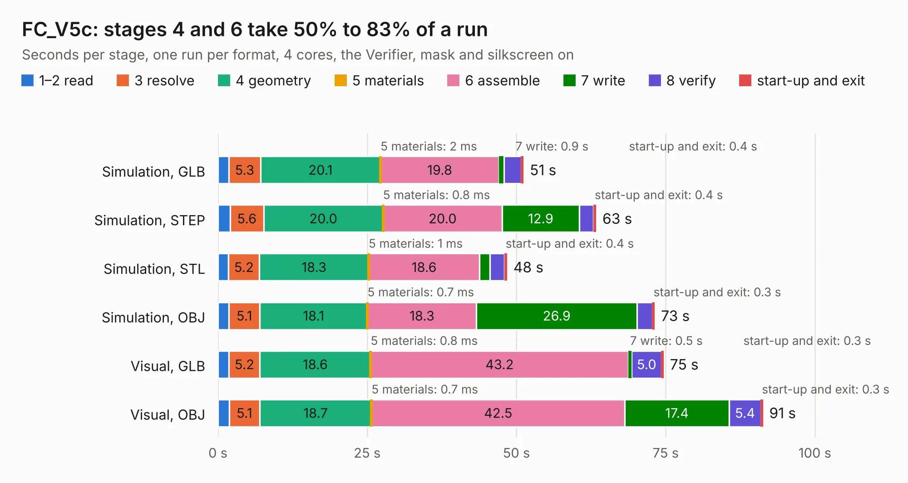

# 2313. FC_V5c

Board 2,313 of the 3,120 of [Corpus Testing](../Corpus-Testing.md), on [Corpus Page 22](../CorpusTestingPages/Corpus-Testing-22.md#2313-fc_v5c).

| Mode and format | 1–2 read | 3 resolve | 4 geometry | 5 materials | 6 assemble | 7 write | 8 verify | start-up and exit | Total |
|---|---:|---:|---:|---:|---:|---:|---:|---:|---:|
| Simulation, GLB | 1.8 | 5.3 | 20.1 | 2&nbsp;ms | 19.8 | 0.9 | 2.8 | 0.4 | 51.2 |
| Simulation, STEP | 2.0 | 5.6 | 20.0 | 0.8&nbsp;ms | 20.0 | 12.9 | 2.4 | 0.4 | 63.3 |
| Simulation, STL | 1.8 | 5.2 | 18.3 | 1&nbsp;ms | 18.6 | 1.8 | 2.4 | 0.4 | 48.4 |
| Simulation, OBJ | 1.8 | 5.1 | 18.1 | 0.7&nbsp;ms | 18.3 | 26.9 | 2.6 | 0.3 | 73.1 |
| Visual, GLB | 1.9 | 5.2 | 18.6 | 0.8&nbsp;ms | 43.2 | 0.5 | 5.0 | 0.3 | 74.6 |
| Visual, OBJ | 1.9 | 5.1 | 18.7 | 0.7&nbsp;ms | 42.5 | 17.4 | 5.4 | 0.3 | 91.3 |

<table align="center"><tr><td valign="top">

| Board | Repo: [proveskit/flight_controller_board](https://github.com/proveskit/flight_controller_board) Board: `FC_V5c.kicad_pcb` |
|---|---|
| Folder | FC_V5c |
| Complexity | 412&nbsp;/&nbsp;1000 (size&nbsp;282, features&nbsp;130) |
| KESE&nbsp;features | through vias, slotted holes, custom pads, rounded, trapezoid or chamfered pads, filled zones, copper drawings, copper text, curved board outline, stack-up, dielectric εr and tanδ |
| Tested | 9th November 2026 |
| Copper&nbsp;layers | 4 |
| File&nbsp;format | KiCad 9 (20241229) |
| Parts,&nbsp;tracks,&nbsp;vias | 242, 2,594, 489 |
| Triangles,&nbsp;simulation | 4,501,378 in 242 parts |
| Verifier | PASS in all six runs |

</td><td valign="top">

<table>
<tr><th>File type</th><th>File size</th><th>Peak memory used</th></tr>
<tr><th colspan="3" align="left">Simulation</th></tr>
<tr><td>GLB</td><td align="right">155&nbsp;MB</td><td align="right">1.4&nbsp;GB</td></tr>
<tr><td>STEP</td><td align="right">772&nbsp;MB</td><td align="right">1.7&nbsp;GB</td></tr>
<tr><td>STL</td><td align="right">225&nbsp;MB</td><td align="right">1.4&nbsp;GB</td></tr>
<tr><td>OBJ</td><td align="right">490&nbsp;MB</td><td align="right">3.0&nbsp;GB</td></tr>
<tr><th colspan="3" align="left">Visual</th></tr>
<tr><td>GLB</td><td align="right">102&nbsp;MB</td><td align="right">1.8&nbsp;GB</td></tr>
<tr><td>OBJ</td><td align="right">324&nbsp;MB</td><td align="right">2.0&nbsp;GB</td></tr>
</table>

</td></tr></table>

| Previous | Next |
|:---|---:|
| [2312. FC_V5b](b2312b_flight-controller-board_FC-V5b.md) | [2314. FC_V5d_Production](b2314b_flight-controller-board_FC-V5d-Production.md) |
