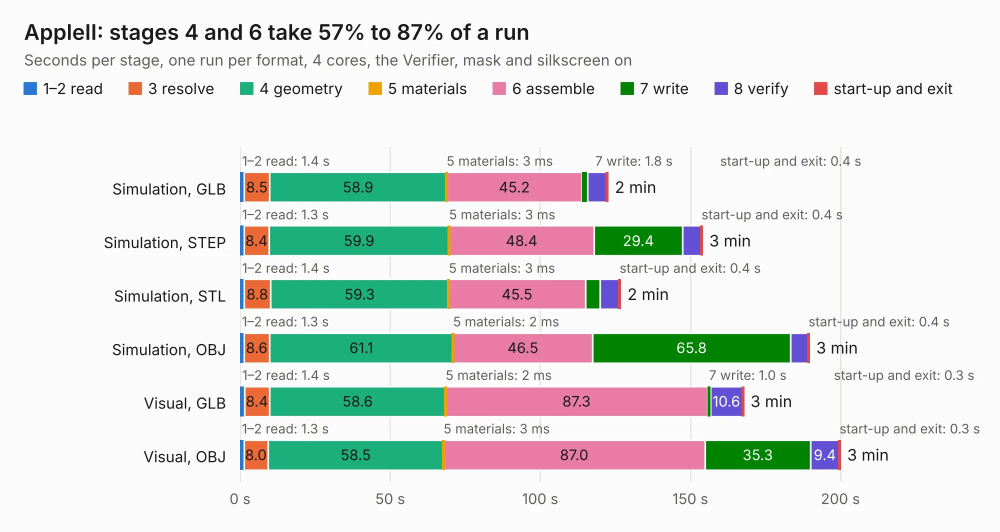

# 2318. AppleII

Board 2,318 of the 3,100 of [Corpus Testing](../Corpus-Testing.md), on [Corpus Page 22](../CorpusTestingPages/Corpus-Testing-22.md#2318-appleii).

| Mode and format | 1–2 read | 3 resolve | 4 geometry | 5 materials | 6 assemble | 7 write | 8 verify | start-up and exit | Total |
|---|---:|---:|---:|---:|---:|---:|---:|---:|---:|
| Simulation, GLB | 1.4 | 8.5 | 58.9 | 3&nbsp;ms | 45.2 | 1.8 | 6.3 | 0.4 | 122.5 |
| Simulation, STEP | 1.3 | 8.4 | 59.9 | 3&nbsp;ms | 48.4 | 29.4 | 6.1 | 0.4 | 153.9 |
| Simulation, STL | 1.4 | 8.8 | 59.3 | 3&nbsp;ms | 45.5 | 4.9 | 6.3 | 0.4 | 126.7 |
| Simulation, OBJ | 1.3 | 8.6 | 61.1 | 2&nbsp;ms | 46.5 | 65.8 | 5.8 | 0.4 | 189.6 |
| Visual, GLB | 1.4 | 8.4 | 58.6 | 2&nbsp;ms | 87.3 | 1.0 | 10.6 | 0.3 | 167.7 |
| Visual, OBJ | 1.3 | 8.0 | 58.5 | 3&nbsp;ms | 87.0 | 35.3 | 9.4 | 0.3 | 199.9 |

<table align="center"><tr><td valign="top">

| Board | Repo: [reifsnyderb/Apple-II-R0](https://github.com/reifsnyderb/Apple-II-R0) Board: `AppleII.kicad_pcb` |
|---|---|
| Complexity | 318&nbsp;/&nbsp;1000 (size&nbsp;228, features&nbsp;90) |
| KESE&nbsp;features | through vias, slotted holes, filled zones, TrueType text, stack-up, dielectric εr and tanδ |
| Tested | 9th November 2026 |
| Copper&nbsp;layers | 2 |
| File&nbsp;format | KiCad 8 (20240108) |
| Parts,&nbsp;tracks,&nbsp;vias | 194, 10,767, 374 |
| Triangles,&nbsp;simulation | 11,575,970 in 495 parts |
| Verifier | PASS in all six runs |

</td><td valign="top">

<table>
<tr><th>File type</th><th>File size</th><th>Peak memory used</th></tr>
<tr><th colspan="3" align="left">Simulation</th></tr>
<tr><td>GLB</td><td align="right">387&nbsp;MB</td><td align="right">2.7&nbsp;GB</td></tr>
<tr><td>STEP</td><td align="right">1.7&nbsp;GB</td><td align="right">4.2&nbsp;GB</td></tr>
<tr><td>STL</td><td align="right">579&nbsp;MB</td><td align="right">2.6&nbsp;GB</td></tr>
<tr><td>OBJ</td><td align="right">1.2&nbsp;GB</td><td align="right">7.1&nbsp;GB</td></tr>
<tr><th colspan="3" align="left">Visual</th></tr>
<tr><td>GLB</td><td align="right">220&nbsp;MB</td><td align="right">3.4&nbsp;GB</td></tr>
<tr><td>OBJ</td><td align="right">709&nbsp;MB</td><td align="right">4.5&nbsp;GB</td></tr>
</table>

</td></tr></table>

| Previous | Next |
|:---|---:|
| [2317. Wii PCB](b2317b_Wee-Wii_Wii-PCB.md) | [2319. 11ua](b2319b_stmbl_11ua.md) |
