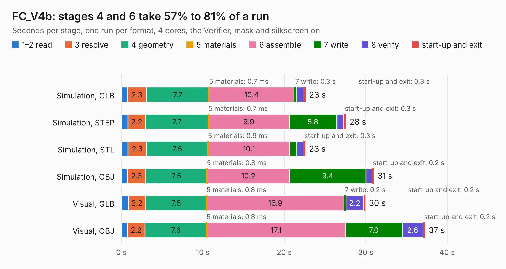

# 2318. FC_V4b

Board 2,318 of the 3,138 of [Corpus Testing](../Corpus-Testing.md), on [Corpus Page 22](../CorpusTestingPages/Corpus-Testing-22.md#2318-fc_v4b).

| Mode and format | 1–2 read | 3 resolve | 4 geometry | 5 materials | 6 assemble | 7 write | 8 verify | start-up and exit | Total |
|---|---:|---:|---:|---:|---:|---:|---:|---:|---:|
| Simulation, GLB | 0.7 | 2.3 | 7.7 | 0.7&nbsp;ms | 10.4 | 0.3 | 0.9 | 0.3 | 22.6 |
| Simulation, STEP | 0.8 | 2.2 | 7.7 | 0.7&nbsp;ms | 9.9 | 5.8 | 0.9 | 0.3 | 27.6 |
| Simulation, STL | 0.8 | 2.3 | 7.5 | 0.9&nbsp;ms | 10.1 | 0.8 | 0.8 | 0.3 | 22.6 |
| Simulation, OBJ | 0.7 | 2.3 | 7.5 | 0.8&nbsp;ms | 10.2 | 9.4 | 0.8 | 0.2 | 31.0 |
| Visual, GLB | 0.8 | 2.2 | 7.5 | 0.8&nbsp;ms | 16.9 | 0.2 | 2.2 | 0.2 | 30.0 |
| Visual, OBJ | 0.7 | 2.2 | 7.6 | 0.8&nbsp;ms | 17.1 | 7.0 | 2.6 | 0.2 | 37.3 |

<table align="center"><tr><td valign="top">

| Board | Repo: [proveskit/flight_controller_board](https://github.com/proveskit/flight_controller_board) Board: `FC_V4b.kicad_pcb` |
|---|---|
| Folder | Deprecated Versions / FC_V4b |
| Complexity | 402&nbsp;/&nbsp;1000 (size&nbsp;257, features&nbsp;145) |
| KESE&nbsp;features | through vias, slotted holes, custom pads, rounded, trapezoid or chamfered pads, arc tracks, filled zones, copper drawings, copper text, curved board outline, stack-up, dielectric εr and tanδ |
| Tested | 9th November 2026 |
| Copper&nbsp;layers | 4 |
| File&nbsp;format | KiCad 8 (20240108) |
| Parts,&nbsp;tracks,&nbsp;vias | 108, 1,453, 257 |
| Triangles,&nbsp;simulation | 2,254,680 in 135 parts |
| Verifier | PASS in all six runs |

</td><td valign="top">

<table>
<tr><th>File type</th><th>File size</th><th>Peak memory used</th></tr>
<tr><th colspan="3" align="left">Simulation</th></tr>
<tr><td>GLB</td><td align="right">79&nbsp;MB</td><td align="right">836&nbsp;MB</td></tr>
<tr><td>STEP</td><td align="right">385&nbsp;MB</td><td align="right">992&nbsp;MB</td></tr>
<tr><td>STL</td><td align="right">113&nbsp;MB</td><td align="right">826&nbsp;MB</td></tr>
<tr><td>OBJ</td><td align="right">244&nbsp;MB</td><td align="right">1.5&nbsp;GB</td></tr>
<tr><th colspan="3" align="left">Visual</th></tr>
<tr><td>GLB</td><td align="right">57&nbsp;MB</td><td align="right">1.1&nbsp;GB</td></tr>
<tr><td>OBJ</td><td align="right">175&nbsp;MB</td><td align="right">1.3&nbsp;GB</td></tr>
</table>

</td></tr></table>

| Previous | Next |
|:---|---:|
| [2317. FC_V4a](b2317b_flight-controller-board_FC-V4a.md) | [2319. FC_V4c_Express](b2319b_flight-controller-board_FC-V4c-Express.md) |
