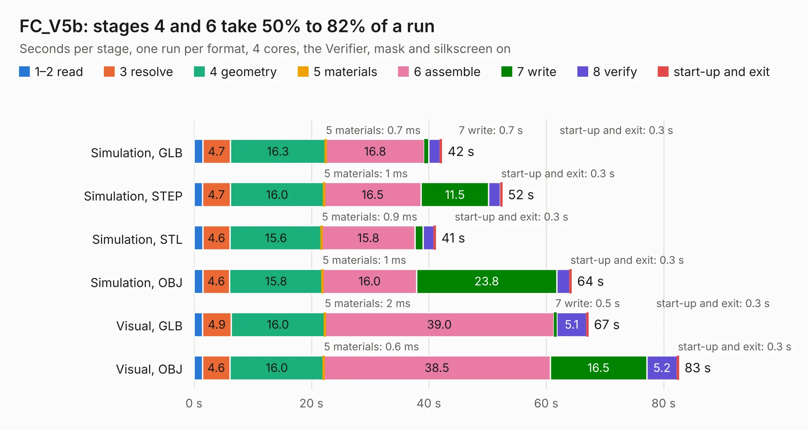

# 2318. FC_V5b

Board 2,318 of the 3,129 of [Corpus Testing](../Corpus-Testing.md), on [Corpus Page 22](../CorpusTestingPages/Corpus-Testing-22.md#2318-fc_v5b).

| Mode and format | 1–2 read | 3 resolve | 4 geometry | 5 materials | 6 assemble | 7 write | 8 verify | start-up and exit | Total |
|---|---:|---:|---:|---:|---:|---:|---:|---:|---:|
| Simulation, GLB | 1.5 | 4.7 | 16.3 | 0.7&nbsp;ms | 16.8 | 0.7 | 2.0 | 0.3 | 42.2 |
| Simulation, STEP | 1.5 | 4.7 | 16.0 | 1&nbsp;ms | 16.5 | 11.5 | 2.0 | 0.3 | 52.5 |
| Simulation, STL | 1.5 | 4.6 | 15.6 | 0.9&nbsp;ms | 15.8 | 1.4 | 1.8 | 0.3 | 41.2 |
| Simulation, OBJ | 1.5 | 4.6 | 15.8 | 1&nbsp;ms | 16.0 | 23.8 | 2.2 | 0.3 | 64.3 |
| Visual, GLB | 1.5 | 4.9 | 16.0 | 2&nbsp;ms | 39.0 | 0.5 | 5.1 | 0.3 | 67.1 |
| Visual, OBJ | 1.5 | 4.6 | 16.0 | 0.6&nbsp;ms | 38.5 | 16.5 | 5.2 | 0.3 | 82.6 |

<table align="center"><tr><td valign="top">

| Board | Repo: [proveskit/flight_controller_board](https://github.com/proveskit/flight_controller_board) Board: `FC_V5b.kicad_pcb` |
|---|---|
| Folder | FC_V5b |
| Complexity | 410&nbsp;/&nbsp;1000 (size&nbsp;280, features&nbsp;130) |
| KESE&nbsp;features | through vias, slotted holes, custom pads, rounded, trapezoid or chamfered pads, filled zones, copper drawings, copper text, curved board outline, stack-up, dielectric εr and tanδ |
| Tested | 9th November 2026 |
| Copper&nbsp;layers | 4 |
| File&nbsp;format | KiCad 9 (20241229) |
| Parts,&nbsp;tracks,&nbsp;vias | 253, 2,712, 433 |
| Triangles,&nbsp;simulation | 4,374,488 in 245 parts |
| Verifier | PASS in all six runs |

</td><td valign="top">

<table>
<tr><th>File type</th><th>File size</th><th>Peak memory used</th></tr>
<tr><th colspan="3" align="left">Simulation</th></tr>
<tr><td>GLB</td><td align="right">151&nbsp;MB</td><td align="right">1.3&nbsp;GB</td></tr>
<tr><td>STEP</td><td align="right">771&nbsp;MB</td><td align="right">1.7&nbsp;GB</td></tr>
<tr><td>STL</td><td align="right">219&nbsp;MB</td><td align="right">1.3&nbsp;GB</td></tr>
<tr><td>OBJ</td><td align="right">477&nbsp;MB</td><td align="right">2.9&nbsp;GB</td></tr>
<tr><th colspan="3" align="left">Visual</th></tr>
<tr><td>GLB</td><td align="right">103&nbsp;MB</td><td align="right">1.7&nbsp;GB</td></tr>
<tr><td>OBJ</td><td align="right">325&nbsp;MB</td><td align="right">2.2&nbsp;GB</td></tr>
</table>

</td></tr></table>

| Previous | Next |
|:---|---:|
| [2317. FC_V4c_InspireFly_Special](b2317b_flight-controller-board_FC-V4c-InspireFly-Special.md) | [2319. FC_V5c](b2319b_flight-controller-board_FC-V5c.md) |
