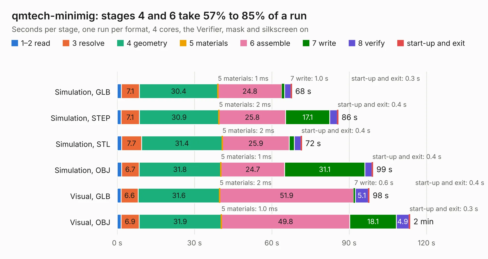

# 2318. qmtech-minimig

Board 2,318 of the 3,108 of [Corpus Testing](../Corpus-Testing.md), on [Corpus Page 22](../CorpusTestingPages/Corpus-Testing-22.md#2318-qmtech-minimig).

| Mode and format | 1–2 read | 3 resolve | 4 geometry | 5 materials | 6 assemble | 7 write | 8 verify | start-up and exit | Total |
|---|---:|---:|---:|---:|---:|---:|---:|---:|---:|
| Simulation, GLB | 1.6 | 7.1 | 30.4 | 1&nbsp;ms | 24.8 | 1.0 | 2.5 | 0.3 | 67.7 |
| Simulation, STEP | 1.5 | 7.1 | 30.9 | 2&nbsp;ms | 25.8 | 17.1 | 2.9 | 0.4 | 85.7 |
| Simulation, STL | 1.7 | 7.7 | 31.4 | 2&nbsp;ms | 25.9 | 1.9 | 2.6 | 0.4 | 71.7 |
| Simulation, OBJ | 1.7 | 6.7 | 31.8 | 1&nbsp;ms | 24.7 | 31.1 | 2.8 | 0.4 | 99.2 |
| Visual, GLB | 1.5 | 6.6 | 31.6 | 2&nbsp;ms | 51.9 | 0.6 | 5.1 | 0.4 | 97.8 |
| Visual, OBJ | 1.6 | 6.9 | 31.9 | 1.0&nbsp;ms | 49.8 | 18.1 | 4.9 | 0.3 | 113.6 |

<table align="center"><tr><td valign="top">

| Board | Repo: [ranzbak/qmtech_minimig](https://github.com/ranzbak/qmtech_minimig) Board: `qmtech-minimig.kicad_pcb` |
|---|---|
| Complexity | 377&nbsp;/&nbsp;1000 (size&nbsp;302, features&nbsp;75) |
| KESE&nbsp;features | through vias, slotted holes, rounded, trapezoid or chamfered pads, filled zones, copper text, curved board outline |
| Tested | 9th November 2026 |
| Copper&nbsp;layers | 4 |
| File&nbsp;format | KiCad 5 (20171130) |
| Parts,&nbsp;tracks,&nbsp;vias | 207, 14,165, 316 |
| Triangles,&nbsp;simulation | 5,567,022 in 308 parts |
| Verifier | PASS in all six runs |

</td><td valign="top">

<table>
<tr><th>File type</th><th>File size</th><th>Peak memory used</th></tr>
<tr><th colspan="3" align="left">Simulation</th></tr>
<tr><td>GLB</td><td align="right">192&nbsp;MB</td><td align="right">1.8&nbsp;GB</td></tr>
<tr><td>STEP</td><td align="right">954&nbsp;MB</td><td align="right">2.0&nbsp;GB</td></tr>
<tr><td>STL</td><td align="right">278&nbsp;MB</td><td align="right">1.8&nbsp;GB</td></tr>
<tr><td>OBJ</td><td align="right">598&nbsp;MB</td><td align="right">3.6&nbsp;GB</td></tr>
<tr><th colspan="3" align="left">Visual</th></tr>
<tr><td>GLB</td><td align="right">113&nbsp;MB</td><td align="right">1.8&nbsp;GB</td></tr>
<tr><td>OBJ</td><td align="right">358&nbsp;MB</td><td align="right">2.4&nbsp;GB</td></tr>
</table>

</td></tr></table>

| Previous | Next |
|:---|---:|
| [2317. unibone.unrouted](b2317b_QUniBoneClassic_unibone-unrouted.md) | [2319. ACU5EV_Carrier_Base](b2319b_fcboardkicad_ACU5EV-Carrier-Base.md) |
