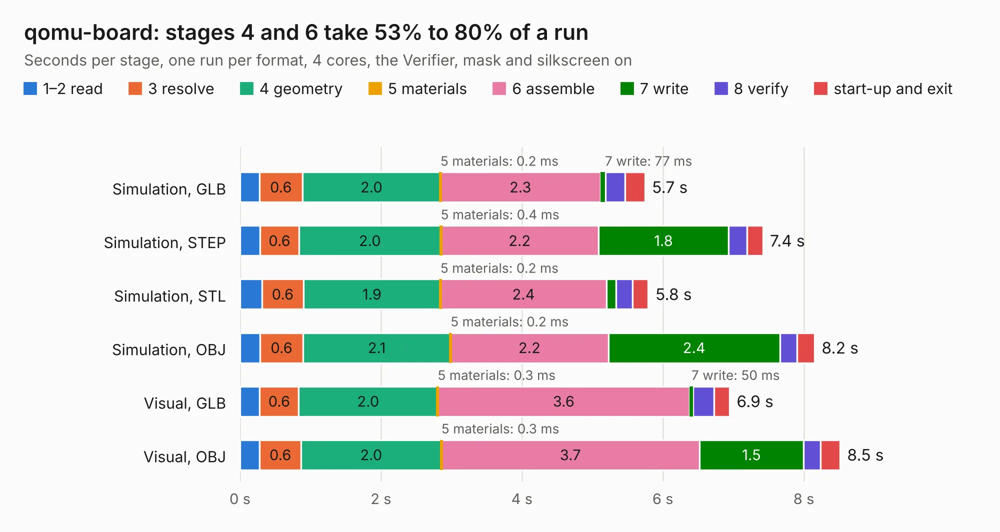

# 2318. qomu-board

Board 2,318 of the 3,111 of [Corpus Testing](../Corpus-Testing.md), on [Corpus Page 22](../CorpusTestingPages/Corpus-Testing-22.md#2318-qomu-board).

| Mode and format | 1–2 read | 3 resolve | 4 geometry | 5 materials | 6 assemble | 7 write | 8 verify | start-up and exit | Total |
|---|---:|---:|---:|---:|---:|---:|---:|---:|---:|
| Simulation, GLB | 0.3 | 0.6 | 2.0 | 0.2&nbsp;ms | 2.3 | 77&nbsp;ms | 0.3 | 0.3 | 5.7 |
| Simulation, STEP | 0.3 | 0.6 | 2.0 | 0.4&nbsp;ms | 2.2 | 1.8 | 0.3 | 0.2 | 7.4 |
| Simulation, STL | 0.3 | 0.6 | 1.9 | 0.2&nbsp;ms | 2.4 | 0.1 | 0.2 | 0.2 | 5.8 |
| Simulation, OBJ | 0.3 | 0.6 | 2.1 | 0.2&nbsp;ms | 2.2 | 2.4 | 0.2 | 0.2 | 8.2 |
| Visual, GLB | 0.3 | 0.6 | 2.0 | 0.3&nbsp;ms | 3.6 | 50&nbsp;ms | 0.3 | 0.2 | 6.9 |
| Visual, OBJ | 0.3 | 0.6 | 2.0 | 0.3&nbsp;ms | 3.7 | 1.5 | 0.2 | 0.3 | 8.5 |

<table align="center"><tr><td valign="top">

| Board | Repo: [QuickLogic-Corp/qomu-dev-board](https://github.com/QuickLogic-Corp/qomu-dev-board) Board: `qomu-board.kicad_pcb` |
|---|---|
| Complexity | 340&nbsp;/&nbsp;1000 (size&nbsp;245, features&nbsp;95) |
| KESE&nbsp;features | blind and buried vias, custom pads, rounded, trapezoid or chamfered pads, filled zones, curved board outline |
| Tested | 9th November 2026 |
| Copper&nbsp;layers | 4 |
| File&nbsp;format | KiCad 5 (20171130) |
| Parts,&nbsp;tracks,&nbsp;vias | 42, 821, 190 |
| Triangles,&nbsp;simulation | 426,198 in 51 parts |
| Verifier | PASS in all six runs |

</td><td valign="top">

<table>
<tr><th>File type</th><th>File size</th><th>Peak memory used</th></tr>
<tr><th colspan="3" align="left">Simulation</th></tr>
<tr><td>GLB</td><td align="right">15&nbsp;MB</td><td align="right">288&nbsp;MB</td></tr>
<tr><td>STEP</td><td align="right">53&nbsp;MB</td><td align="right">321&nbsp;MB</td></tr>
<tr><td>STL</td><td align="right">21&nbsp;MB</td><td align="right">289&nbsp;MB</td></tr>
<tr><td>OBJ</td><td align="right">44&nbsp;MB</td><td align="right">352&nbsp;MB</td></tr>
<tr><th colspan="3" align="left">Visual</th></tr>
<tr><td>GLB</td><td align="right">8.8&nbsp;MB</td><td align="right">303&nbsp;MB</td></tr>
<tr><td>OBJ</td><td align="right">26&nbsp;MB</td><td align="right">308&nbsp;MB</td></tr>
</table>

</td></tr></table>

| Previous | Next |
|:---|---:|
| [2317. coco3](b2317b_coco-motherboards_coco3.md) | [2319. unibone.routed](b2319b_QUniBoneClassic_unibone-routed.md) |
