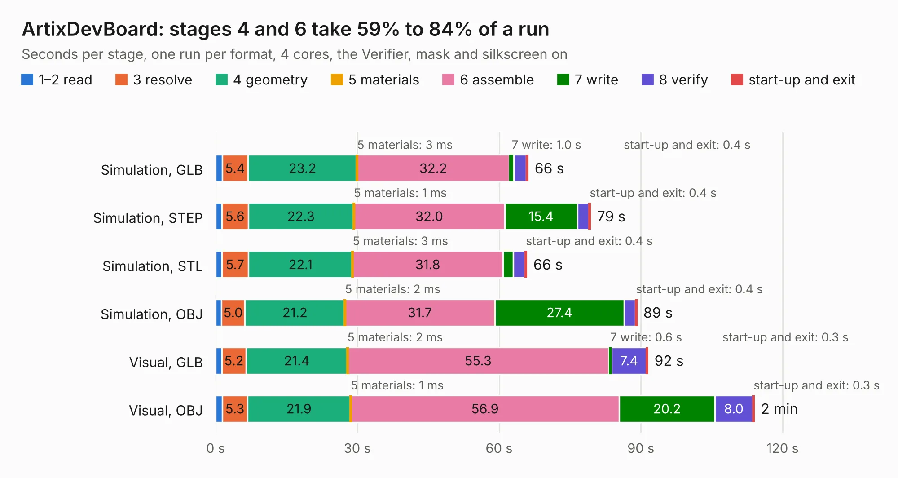

# 2319. ArtixDevBoard

Board 2,319 of the 3,106 of [Corpus Testing](../Corpus-Testing.md), on [Corpus Page 22](../CorpusTestingPages/Corpus-Testing-22.md#2319-artixdevboard).

| Mode and format | 1–2 read | 3 resolve | 4 geometry | 5 materials | 6 assemble | 7 write | 8 verify | start-up and exit | Total |
|---|---:|---:|---:|---:|---:|---:|---:|---:|---:|
| Simulation, GLB | 1.5 | 5.4 | 23.2 | 3&nbsp;ms | 32.2 | 1.0 | 2.6 | 0.4 | 66.2 |
| Simulation, STEP | 1.3 | 5.6 | 22.3 | 1&nbsp;ms | 32.0 | 15.4 | 2.4 | 0.4 | 79.4 |
| Simulation, STL | 1.3 | 5.7 | 22.1 | 3&nbsp;ms | 31.8 | 2.2 | 2.5 | 0.4 | 65.9 |
| Simulation, OBJ | 1.2 | 5.0 | 21.2 | 2&nbsp;ms | 31.7 | 27.4 | 2.3 | 0.4 | 89.2 |
| Visual, GLB | 1.3 | 5.2 | 21.4 | 2&nbsp;ms | 55.3 | 0.6 | 7.4 | 0.3 | 91.5 |
| Visual, OBJ | 1.5 | 5.3 | 21.9 | 1&nbsp;ms | 56.9 | 20.2 | 8.0 | 0.3 | 114.0 |

<table align="center"><tr><td valign="top">

| Board | Repo: [rasmusstagsted/artixdevboard](https://github.com/rasmusstagsted/artixdevboard) Board: `ArtixDevBoard.kicad_pcb` |
|---|---|
| Complexity | 423&nbsp;/&nbsp;1000 (size&nbsp;303, features&nbsp;120) |
| KESE&nbsp;features | through vias, slotted holes, rounded, trapezoid or chamfered pads, arc tracks, filled zones, copper drawings, curved board outline, stack-up, dielectric εr and tanδ |
| Tested | 9th November 2026 |
| Copper&nbsp;layers | 4 |
| File&nbsp;format | KiCad 8 (20240108) |
| Parts,&nbsp;tracks,&nbsp;vias | 301, 5,140, 707 |
| Triangles,&nbsp;simulation | 5,070,308 in 523 parts |
| Verifier | PASS in all six runs |

</td><td valign="top">

<table>
<tr><th>File type</th><th>File size</th><th>Peak memory used</th></tr>
<tr><th colspan="3" align="left">Simulation</th></tr>
<tr><td>GLB</td><td align="right">174&nbsp;MB</td><td align="right">1.5&nbsp;GB</td></tr>
<tr><td>STEP</td><td align="right">802&nbsp;MB</td><td align="right">2.1&nbsp;GB</td></tr>
<tr><td>STL</td><td align="right">254&nbsp;MB</td><td align="right">1.6&nbsp;GB</td></tr>
<tr><td>OBJ</td><td align="right">540&nbsp;MB</td><td align="right">3.3&nbsp;GB</td></tr>
<tr><th colspan="3" align="left">Visual</th></tr>
<tr><td>GLB</td><td align="right">122&nbsp;MB</td><td align="right">2.0&nbsp;GB</td></tr>
<tr><td>OBJ</td><td align="right">387&nbsp;MB</td><td align="right">2.6&nbsp;GB</td></tr>
</table>

</td></tr></table>

| Previous | Next |
|:---|---:|
| [2318. AmplifierHat](b2318b_artixdevboard_AmplifierHat.md) | [2320. scarlet-8088](b2320b_scarlet-8088_scarlet-8088.md) |
