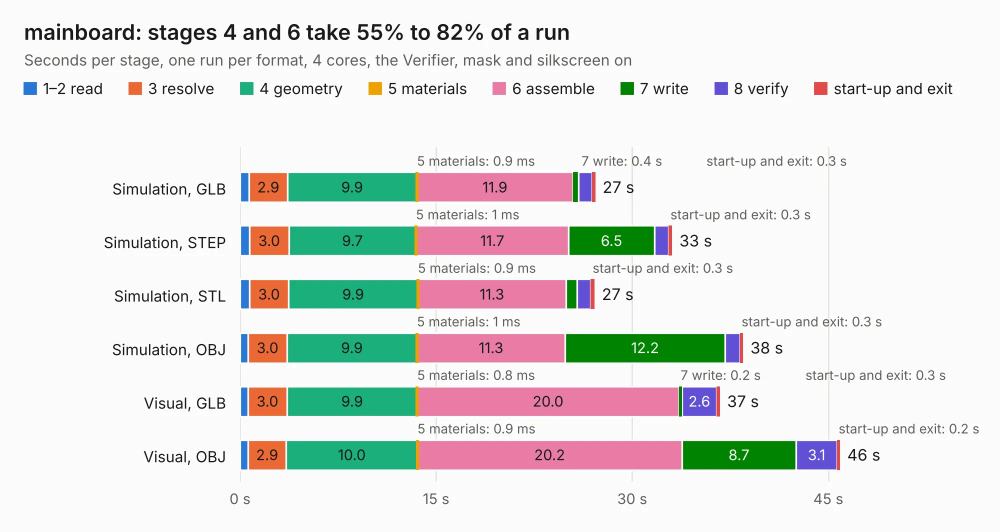

# 2319. mainboard

Board 2,319 of the 3,117 of [Corpus Testing](../Corpus-Testing.md), on [Corpus Page 22](../CorpusTestingPages/Corpus-Testing-22.md#2319-mainboard).

| Mode and format | 1–2 read | 3 resolve | 4 geometry | 5 materials | 6 assemble | 7 write | 8 verify | start-up and exit | Total |
|---|---:|---:|---:|---:|---:|---:|---:|---:|---:|
| Simulation, GLB | 0.7 | 2.9 | 9.9 | 0.9&nbsp;ms | 11.9 | 0.4 | 1.0 | 0.3 | 27.2 |
| Simulation, STEP | 0.7 | 3.0 | 9.7 | 1&nbsp;ms | 11.7 | 6.5 | 1.1 | 0.3 | 33.1 |
| Simulation, STL | 0.7 | 3.0 | 9.9 | 0.9&nbsp;ms | 11.3 | 0.8 | 1.0 | 0.3 | 27.1 |
| Simulation, OBJ | 0.6 | 3.0 | 9.9 | 1&nbsp;ms | 11.3 | 12.2 | 1.1 | 0.3 | 38.5 |
| Visual, GLB | 0.6 | 3.0 | 9.9 | 0.8&nbsp;ms | 20.0 | 0.2 | 2.6 | 0.3 | 36.7 |
| Visual, OBJ | 0.6 | 2.9 | 10.0 | 0.9&nbsp;ms | 20.2 | 8.7 | 3.1 | 0.2 | 45.9 |

<table align="center"><tr><td valign="top">

| Board | Repo: [pycubed/hardware](https://github.com/pycubed/hardware) Board: `mainboard.kicad_pcb` |
|---|---|
| Folder | mainboard-v01 |
| Complexity | 314&nbsp;/&nbsp;1000 (size&nbsp;259, features&nbsp;55) |
| KESE&nbsp;features | through vias, rounded, trapezoid or chamfered pads, filled zones, curved board outline |
| Tested | 9th November 2026 |
| Copper&nbsp;layers | 4 |
| File&nbsp;format | KiCad 5 (20171130) |
| Parts,&nbsp;tracks,&nbsp;vias | 135, 1,293, 276 |
| Triangles,&nbsp;simulation | 2,746,652 in 195 parts |
| Verifier | PASS in all six runs |

</td><td valign="top">

<table>
<tr><th>File type</th><th>File size</th><th>Peak memory used</th></tr>
<tr><th colspan="3" align="left">Simulation</th></tr>
<tr><td>GLB</td><td align="right">96&nbsp;MB</td><td align="right">894&nbsp;MB</td></tr>
<tr><td>STEP</td><td align="right">413&nbsp;MB</td><td align="right">1.2&nbsp;GB</td></tr>
<tr><td>STL</td><td align="right">137&nbsp;MB</td><td align="right">890&nbsp;MB</td></tr>
<tr><td>OBJ</td><td align="right">293&nbsp;MB</td><td align="right">1.9&nbsp;GB</td></tr>
<tr><th colspan="3" align="left">Visual</th></tr>
<tr><td>GLB</td><td align="right">66&nbsp;MB</td><td align="right">1.2&nbsp;GB</td></tr>
<tr><td>OBJ</td><td align="right">205&nbsp;MB</td><td align="right">1.4&nbsp;GB</td></tr>
</table>

</td></tr></table>

| Previous | Next |
|:---|---:|
| [2318. batteryboard](b2318b_hardware_batteryboard-v01b_batteryboard.md) | [2320. mainboard](b2320b_hardware_mainboard-v02_mainboard.md) |
