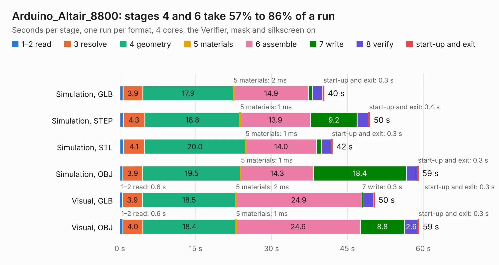

# 2320. Arduino_Altair_8800

Board 2,320 of the 3,104 of [Corpus Testing](../Corpus-Testing.md), on [Corpus Page 22](../CorpusTestingPages/Corpus-Testing-22.md#2320-arduino_altair_8800).

| Mode and format | 1–2 read | 3 resolve | 4 geometry | 5 materials | 6 assemble | 7 write | 8 verify | start-up and exit | Total |
|---|---:|---:|---:|---:|---:|---:|---:|---:|---:|
| Simulation, GLB | 0.6 | 3.9 | 17.9 | 2&nbsp;ms | 14.9 | 0.7 | 2.1 | 0.3 | 40.4 |
| Simulation, STEP | 0.7 | 4.3 | 18.8 | 1&nbsp;ms | 13.9 | 9.2 | 2.2 | 0.4 | 49.5 |
| Simulation, STL | 0.7 | 4.1 | 20.0 | 1&nbsp;ms | 14.0 | 1.0 | 1.9 | 0.3 | 42.1 |
| Simulation, OBJ | 0.6 | 3.9 | 19.5 | 1&nbsp;ms | 14.3 | 18.4 | 2.2 | 0.3 | 59.1 |
| Visual, GLB | 0.6 | 3.9 | 18.5 | 2&nbsp;ms | 24.9 | 0.3 | 2.1 | 0.3 | 50.4 |
| Visual, OBJ | 0.6 | 4.0 | 18.4 | 1&nbsp;ms | 24.6 | 8.8 | 2.6 | 0.3 | 59.2 |

<table align="center"><tr><td valign="top">

| Board | Repo: [Redlolz/Altair8800-Simulator-PCB](https://github.com/Redlolz/Altair8800-Simulator-PCB) Board: `Arduino_Altair_8800.kicad_pcb` |
|---|---|
| Complexity | 225&nbsp;/&nbsp;1000 (size&nbsp;190, features&nbsp;35) |
| KESE&nbsp;features | through vias, slotted holes, rounded, trapezoid or chamfered pads |
| Tested | 9th November 2026 |
| Copper&nbsp;layers | 2 |
| File&nbsp;format | KiCad 5 (20171130) |
| Parts,&nbsp;tracks,&nbsp;vias | 178, 1,081, 50 |
| Triangles,&nbsp;simulation | 2,890,994 in 235 parts |
| Verifier | PASS in all six runs |

</td><td valign="top">

<table>
<tr><th>File type</th><th>File size</th><th>Peak memory used</th></tr>
<tr><th colspan="3" align="left">Simulation</th></tr>
<tr><td>GLB</td><td align="right">98&nbsp;MB</td><td align="right">1.0&nbsp;GB</td></tr>
<tr><td>STEP</td><td align="right">492&nbsp;MB</td><td align="right">1.1&nbsp;GB</td></tr>
<tr><td>STL</td><td align="right">145&nbsp;MB</td><td align="right">934&nbsp;MB</td></tr>
<tr><td>OBJ</td><td align="right">307&nbsp;MB</td><td align="right">1.9&nbsp;GB</td></tr>
<tr><th colspan="3" align="left">Visual</th></tr>
<tr><td>GLB</td><td align="right">53&nbsp;MB</td><td align="right">1.2&nbsp;GB</td></tr>
<tr><td>OBJ</td><td align="right">163&nbsp;MB</td><td align="right">1.1&nbsp;GB</td></tr>
</table>

</td></tr></table>

| Previous | Next |
|:---|---:|
| [2319. Motherboard](b2319b_OpenTendo_Motherboard.md) | [2321. Wii PCB](b2321b_Wee-Wii_Wii-PCB.md) |
