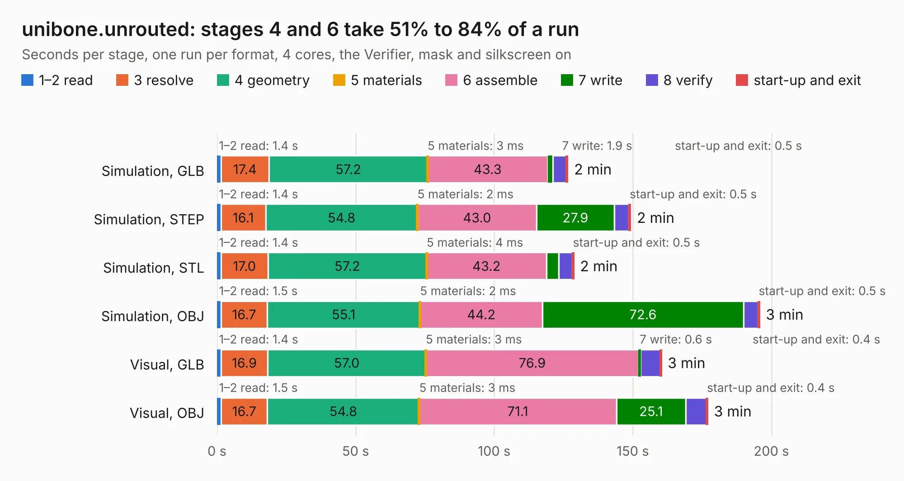

# 2320. unibone.unrouted

Board 2,320 of the 3,111 of [Corpus Testing](../Corpus-Testing.md), on [Corpus Page 22](../CorpusTestingPages/Corpus-Testing-22.md#2320-uniboneunrouted).

| Mode and format | 1–2 read | 3 resolve | 4 geometry | 5 materials | 6 assemble | 7 write | 8 verify | start-up and exit | Total |
|---|---:|---:|---:|---:|---:|---:|---:|---:|---:|
| Simulation, GLB | 1.4 | 17.4 | 57.2 | 3&nbsp;ms | 43.3 | 1.9 | 4.8 | 0.5 | 126.5 |
| Simulation, STEP | 1.4 | 16.1 | 54.8 | 2&nbsp;ms | 43.0 | 27.9 | 5.4 | 0.5 | 149.2 |
| Simulation, STL | 1.4 | 17.0 | 57.2 | 4&nbsp;ms | 43.2 | 4.4 | 4.9 | 0.5 | 128.7 |
| Simulation, OBJ | 1.5 | 16.7 | 55.1 | 2&nbsp;ms | 44.2 | 72.6 | 5.2 | 0.5 | 195.7 |
| Visual, GLB | 1.4 | 16.9 | 57.0 | 3&nbsp;ms | 76.9 | 0.6 | 7.1 | 0.4 | 160.3 |
| Visual, OBJ | 1.5 | 16.7 | 54.8 | 3&nbsp;ms | 71.1 | 25.1 | 7.5 | 0.4 | 177.0 |

<table align="center"><tr><td valign="top">

| Board | Repo: [QUniBone/QUniBoneClassic](https://github.com/QUniBone/QUniBoneClassic) Board: `unibone.unrouted.kicad_pcb` |
|---|---|
| Folder | 01.01_pcb / unibone |
| Complexity | 308&nbsp;/&nbsp;1000 (size&nbsp;248, features&nbsp;60) |
| KESE&nbsp;features | through vias, custom pads, rounded, trapezoid or chamfered pads, drill offsets, copper drawings |
| Tested | 9th November 2026 |
| Copper&nbsp;layers | 4 |
| File&nbsp;format | KiCad 8 (20240108) |
| Parts,&nbsp;tracks,&nbsp;vias | 224, 800, 120 |
| Triangles,&nbsp;simulation | 11,501,714 in 449 parts |
| Verifier | PASS in all six runs |

</td><td valign="top">

<table>
<tr><th>File type</th><th>File size</th><th>Peak memory used</th></tr>
<tr><th colspan="3" align="left">Simulation</th></tr>
<tr><td>GLB</td><td align="right">381&nbsp;MB</td><td align="right">2.7&nbsp;GB</td></tr>
<tr><td>STEP</td><td align="right">1.5&nbsp;GB</td><td align="right">3.7&nbsp;GB</td></tr>
<tr><td>STL</td><td align="right">575&nbsp;MB</td><td align="right">2.6&nbsp;GB</td></tr>
<tr><td>OBJ</td><td align="right">1.2&nbsp;GB</td><td align="right">7.3&nbsp;GB</td></tr>
<tr><th colspan="3" align="left">Visual</th></tr>
<tr><td>GLB</td><td align="right">157&nbsp;MB</td><td align="right">2.9&nbsp;GB</td></tr>
<tr><td>OBJ</td><td align="right">506&nbsp;MB</td><td align="right">3.4&nbsp;GB</td></tr>
</table>

</td></tr></table>

| Previous | Next |
|:---|---:|
| [2319. unibone.routed](b2319b_QUniBoneClassic_unibone-routed.md) | [2321. qmtech-minimig](b2321b_qmtech-minimig_qmtech-minimig.md) |
