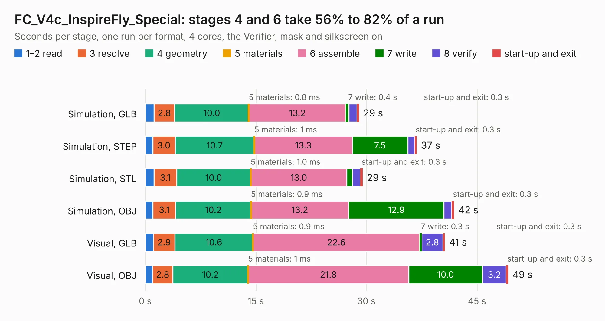

# 2320. FC_V4c_InspireFly_Special

Board 2,320 of the 3,132 of [Corpus Testing](../Corpus-Testing.md), on [Corpus Page 22](../CorpusTestingPages/Corpus-Testing-22.md#2320-fc_v4c_inspirefly_special).

| Mode and format | 1–2 read | 3 resolve | 4 geometry | 5 materials | 6 assemble | 7 write | 8 verify | start-up and exit | Total |
|---|---:|---:|---:|---:|---:|---:|---:|---:|---:|
| Simulation, GLB | 1.2 | 2.8 | 10.0 | 0.8&nbsp;ms | 13.2 | 0.4 | 1.1 | 0.3 | 29.0 |
| Simulation, STEP | 1.0 | 3.0 | 10.7 | 1&nbsp;ms | 13.3 | 7.5 | 0.9 | 0.3 | 36.8 |
| Simulation, STL | 1.2 | 3.1 | 10.0 | 1.0&nbsp;ms | 13.0 | 0.8 | 1.1 | 0.3 | 29.5 |
| Simulation, OBJ | 1.0 | 3.1 | 10.2 | 0.9&nbsp;ms | 13.2 | 12.9 | 1.1 | 0.3 | 41.9 |
| Visual, GLB | 1.1 | 2.9 | 10.6 | 0.9&nbsp;ms | 22.6 | 0.3 | 2.8 | 0.3 | 40.6 |
| Visual, OBJ | 1.0 | 2.8 | 10.2 | 1&nbsp;ms | 21.8 | 10.0 | 3.2 | 0.3 | 49.2 |

<table align="center"><tr><td valign="top">

| Board | Repo: [proveskit/flight_controller_board](https://github.com/proveskit/flight_controller_board) Board: `FC_V4c_InspireFly_Special.kicad_pcb` |
|---|---|
| Folder | FC_V4c_InspireFly_Special |
| Complexity | 406&nbsp;/&nbsp;1000 (size&nbsp;261, features&nbsp;145) |
| KESE&nbsp;features | through vias, slotted holes, custom pads, rounded, trapezoid or chamfered pads, arc tracks, filled zones, copper drawings, copper text, curved board outline, stack-up, dielectric εr and tanδ |
| Tested | 9th November 2026 |
| Copper&nbsp;layers | 4 |
| File&nbsp;format | KiCad 8 (20240108) |
| Parts,&nbsp;tracks,&nbsp;vias | 136, 1,569, 284 |
| Triangles,&nbsp;simulation | 2,557,134 in 149 parts |
| Verifier | PASS in all six runs |

</td><td valign="top">

<table>
<tr><th>File type</th><th>File size</th><th>Peak memory used</th></tr>
<tr><th colspan="3" align="left">Simulation</th></tr>
<tr><td>GLB</td><td align="right">89&nbsp;MB</td><td align="right">924&nbsp;MB</td></tr>
<tr><td>STEP</td><td align="right">447&nbsp;MB</td><td align="right">1.1&nbsp;GB</td></tr>
<tr><td>STL</td><td align="right">128&nbsp;MB</td><td align="right">866&nbsp;MB</td></tr>
<tr><td>OBJ</td><td align="right">277&nbsp;MB</td><td align="right">1.8&nbsp;GB</td></tr>
<tr><th colspan="3" align="left">Visual</th></tr>
<tr><td>GLB</td><td align="right">65&nbsp;MB</td><td align="right">1.3&nbsp;GB</td></tr>
<tr><td>OBJ</td><td align="right">202&nbsp;MB</td><td align="right">1.4&nbsp;GB</td></tr>
</table>

</td></tr></table>

| Previous | Next |
|:---|---:|
| [2319. FC_V5d_Pro_Rev1](b2319b_flight-controller-board_FC-V5d-Pro-Rev1.md) | [2321. FC_V5b](b2321b_flight-controller-board_FC-V5b.md) |
