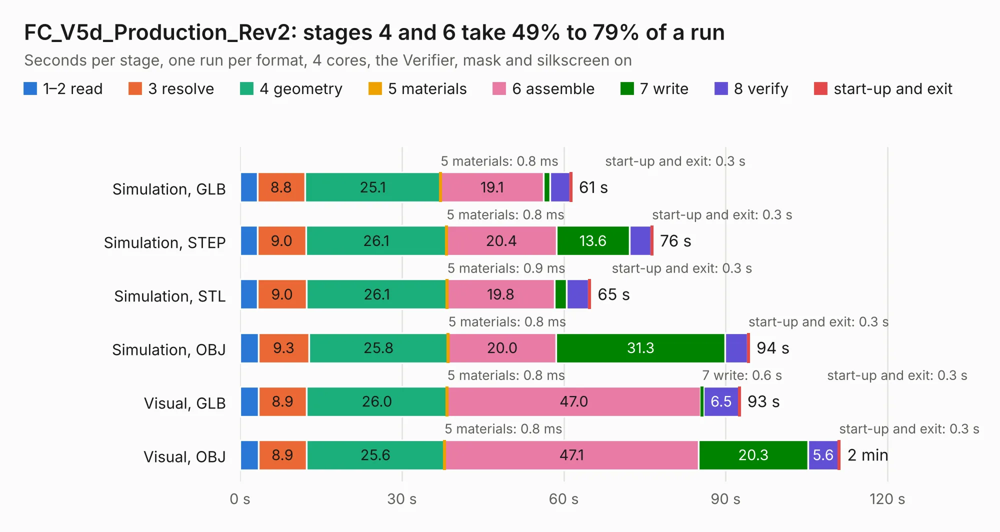

# 2320. FC_V5d_Production_Rev2

Board 2,320 of the 3,127 of [Corpus Testing](../Corpus-Testing.md), on [Corpus Page 22](../CorpusTestingPages/Corpus-Testing-22.md#2320-fc_v5d_production_rev2).

| Mode and format | 1–2 read | 3 resolve | 4 geometry | 5 materials | 6 assemble | 7 write | 8 verify | start-up and exit | Total |
|---|---:|---:|---:|---:|---:|---:|---:|---:|---:|
| Simulation, GLB | 3.2 | 8.8 | 25.1 | 0.8&nbsp;ms | 19.1 | 1.1 | 3.8 | 0.3 | 61.5 |
| Simulation, STEP | 3.2 | 9.0 | 26.1 | 0.8&nbsp;ms | 20.4 | 13.6 | 4.0 | 0.3 | 76.5 |
| Simulation, STL | 3.3 | 9.0 | 26.1 | 0.9&nbsp;ms | 19.8 | 2.2 | 4.1 | 0.3 | 64.9 |
| Simulation, OBJ | 3.4 | 9.3 | 25.8 | 0.8&nbsp;ms | 20.0 | 31.3 | 4.1 | 0.3 | 94.4 |
| Visual, GLB | 3.4 | 8.9 | 26.0 | 0.8&nbsp;ms | 47.0 | 0.6 | 6.5 | 0.3 | 92.7 |
| Visual, OBJ | 3.4 | 8.9 | 25.6 | 0.8&nbsp;ms | 47.1 | 20.3 | 5.6 | 0.3 | 111.2 |

<table align="center"><tr><td valign="top">

| Board | Repo: [proveskit/flight_controller_board](https://github.com/proveskit/flight_controller_board) Board: `FC_V5d_Production_Rev2.kicad_pcb` |
|---|---|
| Folder | FC_V5d_Production_Rev2 |
| Complexity | 428&nbsp;/&nbsp;1000 (size&nbsp;283, features&nbsp;145) |
| KESE&nbsp;features | through vias, slotted holes, custom pads, rounded, trapezoid or chamfered pads, filled zones, copper drawings, copper text, curved board outline, knockout text, stack-up, dielectric εr and tanδ |
| Tested | 9th November 2026 |
| Copper&nbsp;layers | 4 |
| File&nbsp;format | KiCad 9 (20241229) |
| Parts,&nbsp;tracks,&nbsp;vias | 248, 2,691, 494 |
| Triangles,&nbsp;simulation | 5,214,656 in 233 parts |
| Verifier | PASS in all six runs |

</td><td valign="top">

<table>
<tr><th>File type</th><th>File size</th><th>Peak memory used</th></tr>
<tr><th colspan="3" align="left">Simulation</th></tr>
<tr><td>GLB</td><td align="right">185&nbsp;MB</td><td align="right">1.7&nbsp;GB</td></tr>
<tr><td>STEP</td><td align="right">956&nbsp;MB</td><td align="right">2.1&nbsp;GB</td></tr>
<tr><td>STL</td><td align="right">261&nbsp;MB</td><td align="right">1.7&nbsp;GB</td></tr>
<tr><td>OBJ</td><td align="right">582&nbsp;MB</td><td align="right">3.5&nbsp;GB</td></tr>
<tr><th colspan="3" align="left">Visual</th></tr>
<tr><td>GLB</td><td align="right">130&nbsp;MB</td><td align="right">2.1&nbsp;GB</td></tr>
<tr><td>OBJ</td><td align="right">411&nbsp;MB</td><td align="right">2.7&nbsp;GB</td></tr>
</table>

</td></tr></table>

| Previous | Next |
|:---|---:|
| [2319. FC_V5d_Production](b2319b_flight-controller-board_FC-V5d-Production.md) | [2321. FC_V5e](b2321b_flight-controller-board_FC-V5e.md) |
