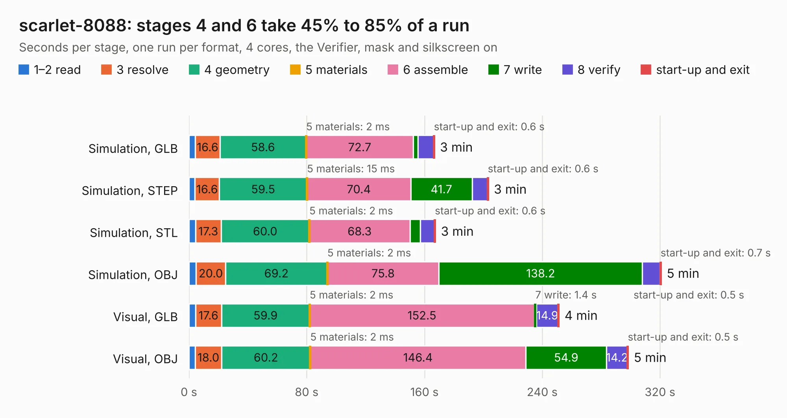

# 2320. scarlet-8088

Board 2,320 of the 3,106 of [Corpus Testing](../Corpus-Testing.md), on [Corpus Page 22](../CorpusTestingPages/Corpus-Testing-22.md#2320-scarlet-8088).

| Mode and format | 1–2 read | 3 resolve | 4 geometry | 5 materials | 6 assemble | 7 write | 8 verify | start-up and exit | Total |
|---|---:|---:|---:|---:|---:|---:|---:|---:|---:|
| Simulation, GLB | 4.4 | 16.6 | 58.6 | 2&nbsp;ms | 72.7 | 3.3 | 10.5 | 0.6 | 166.7 |
| Simulation, STEP | 4.1 | 16.6 | 59.5 | 15&nbsp;ms | 70.4 | 41.7 | 10.4 | 0.6 | 203.3 |
| Simulation, STL | 4.5 | 17.3 | 60.0 | 2&nbsp;ms | 68.3 | 7.0 | 9.7 | 0.6 | 167.4 |
| Simulation, OBJ | 4.8 | 20.0 | 69.2 | 2&nbsp;ms | 75.8 | 138.2 | 12.0 | 0.7 | 320.8 |
| Visual, GLB | 4.5 | 17.6 | 59.9 | 2&nbsp;ms | 152.5 | 1.4 | 14.9 | 0.5 | 251.3 |
| Visual, OBJ | 4.2 | 18.0 | 60.2 | 2&nbsp;ms | 146.4 | 54.9 | 14.2 | 0.5 | 298.4 |

<table align="center"><tr><td valign="top">

| Board | Repo: [Red-Lucy-Engineering/scarlet-8088](https://github.com/Red-Lucy-Engineering/scarlet-8088) Board: `scarlet-8088.kicad_pcb` |
|---|---|
| Complexity | 388&nbsp;/&nbsp;1000 (size&nbsp;283, features&nbsp;105) |
| KESE&nbsp;features | through vias, rounded, trapezoid or chamfered pads, filled zones, knockout text, TrueType text, stack-up, dielectric εr and tanδ |
| Tested | 9th November 2026 to 10th November 2026 |
| Copper&nbsp;layers | 4 |
| File&nbsp;format | KiCad 10 (20260206) |
| Parts,&nbsp;tracks,&nbsp;vias | 140, 6,778, 2,351 |
| Triangles,&nbsp;simulation | 18,399,402 in 411 parts |
| Verifier | PASS in all six runs |
| Run&nbsp;again | Simulation, OBJ: failed in the corpus run, run again with the memory cap raised from 11 GB to 14.5 GB, and passed |

</td><td valign="top">

<table>
<tr><th>File type</th><th>File size</th><th>Peak memory used</th></tr>
<tr><th colspan="3" align="left">Simulation</th></tr>
<tr><td>GLB</td><td align="right">605&nbsp;MB</td><td align="right">3.9&nbsp;GB</td></tr>
<tr><td>STEP</td><td align="right">2.1&nbsp;GB</td><td align="right">6.1&nbsp;GB</td></tr>
<tr><td>STL</td><td align="right">920&nbsp;MB</td><td align="right">4.1&nbsp;GB</td></tr>
<tr><td>OBJ</td><td align="right">2.1&nbsp;GB</td><td align="right">12&nbsp;GB</td></tr>
<tr><th colspan="3" align="left">Visual</th></tr>
<tr><td>GLB</td><td align="right">324&nbsp;MB</td><td align="right">5.3&nbsp;GB</td></tr>
<tr><td>OBJ</td><td align="right">1.1&nbsp;GB</td><td align="right">6.7&nbsp;GB</td></tr>
</table>

</td></tr></table>

| Previous | Next |
|:---|---:|
| [2319. ArtixDevBoard](b2319b_artixdevboard_ArtixDevBoard.md) | [2321. Motherboard](b2321b_OpenTendo_Motherboard.md) |
