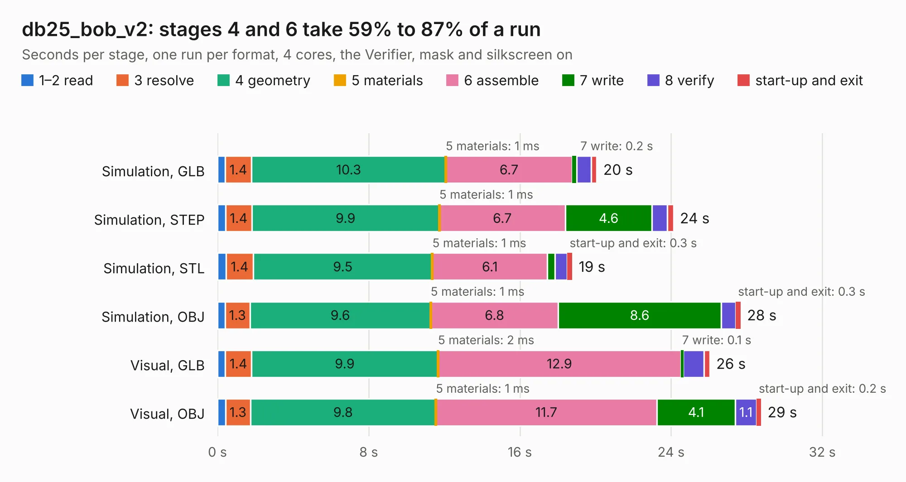

# 2324. db25_bob_v2

Board 2,324 of the 3,102 of [Corpus Testing](../Corpus-Testing.md), on [Corpus Page 22](../CorpusTestingPages/Corpus-Testing-22.md#2324-db25_bob_v2).

| Mode and format | 1–2 read | 3 resolve | 4 geometry | 5 materials | 6 assemble | 7 write | 8 verify | start-up and exit | Total |
|---|---:|---:|---:|---:|---:|---:|---:|---:|---:|
| Simulation, GLB | 0.4 | 1.4 | 10.3 | 1&nbsp;ms | 6.7 | 0.2 | 0.8 | 0.3 | 20.1 |
| Simulation, STEP | 0.4 | 1.4 | 9.9 | 1&nbsp;ms | 6.7 | 4.6 | 0.8 | 0.3 | 24.1 |
| Simulation, STL | 0.4 | 1.4 | 9.5 | 1&nbsp;ms | 6.1 | 0.4 | 0.6 | 0.3 | 18.8 |
| Simulation, OBJ | 0.4 | 1.3 | 9.6 | 1&nbsp;ms | 6.8 | 8.6 | 0.8 | 0.3 | 27.7 |
| Visual, GLB | 0.4 | 1.4 | 9.9 | 2&nbsp;ms | 12.9 | 0.1 | 1.1 | 0.3 | 26.0 |
| Visual, OBJ | 0.4 | 1.3 | 9.8 | 1&nbsp;ms | 11.7 | 4.1 | 1.1 | 0.2 | 28.8 |

<table align="center"><tr><td valign="top">

| Board | Repo: [rene-dev/stmbl](https://github.com/rene-dev/stmbl) Board: `db25_bob_v2.kicad_pcb` |
|---|---|
| Folder | hw / kicad / bob / db25_bob_v2 |
| Complexity | 266&nbsp;/&nbsp;1000 (size&nbsp;231, features&nbsp;35) |
| KESE&nbsp;features | through vias, filled zones |
| Tested | 9th November 2026 |
| Copper&nbsp;layers | 2 |
| File&nbsp;format | KiCad 4 (4) |
| Parts,&nbsp;tracks,&nbsp;vias | 129, 941, 56 |
| Triangles,&nbsp;simulation | 1,359,766 in 314 parts |
| Verifier | PASS in all six runs |

</td><td valign="top">

<table>
<tr><th>File type</th><th>File size</th><th>Peak memory used</th></tr>
<tr><th colspan="3" align="left">Simulation</th></tr>
<tr><td>GLB</td><td align="right">47&nbsp;MB</td><td align="right">615&nbsp;MB</td></tr>
<tr><td>STEP</td><td align="right">232&nbsp;MB</td><td align="right">645&nbsp;MB</td></tr>
<tr><td>STL</td><td align="right">68&nbsp;MB</td><td align="right">619&nbsp;MB</td></tr>
<tr><td>OBJ</td><td align="right">143&nbsp;MB</td><td align="right">957&nbsp;MB</td></tr>
<tr><th colspan="3" align="left">Visual</th></tr>
<tr><td>GLB</td><td align="right">26&nbsp;MB</td><td align="right">615&nbsp;MB</td></tr>
<tr><td>OBJ</td><td align="right">79&nbsp;MB</td><td align="right">630&nbsp;MB</td></tr>
</table>

</td></tr></table>

| Previous | Next |
|:---|---:|
| [2323. db25_bob](b2323b_stmbl_db25-bob.md) | [2325. ethernet_bob](b2325b_stmbl_ethernet-bob.md) |
