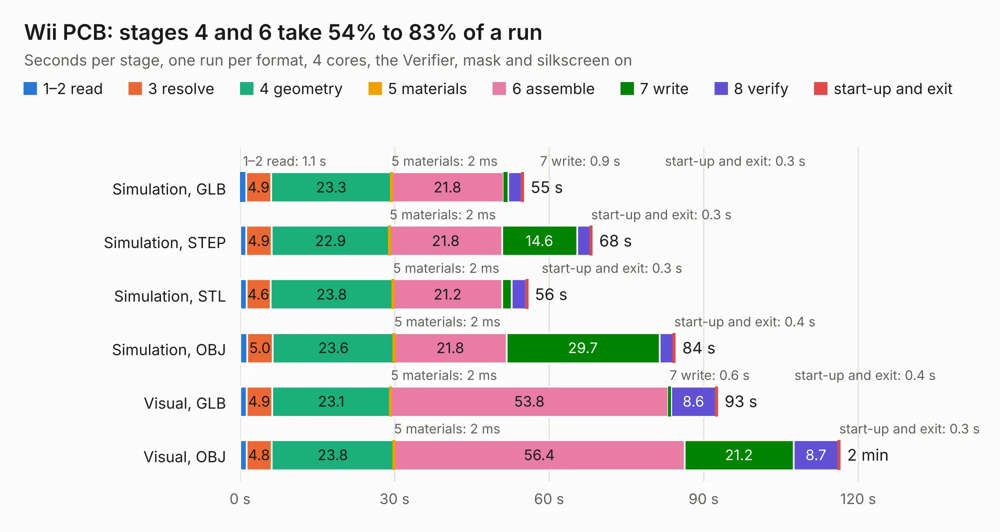

# 2326. Wii PCB

Board 2,326 of the 3,109 of [Corpus Testing](../Corpus-Testing.md), on [Corpus Page 22](../CorpusTestingPages/Corpus-Testing-22.md#2326-wii-pcb).

| Mode and format | 1–2 read | 3 resolve | 4 geometry | 5 materials | 6 assemble | 7 write | 8 verify | start-up and exit | Total |
|---|---:|---:|---:|---:|---:|---:|---:|---:|---:|
| Simulation, GLB | 1.1 | 4.9 | 23.3 | 2&nbsp;ms | 21.8 | 0.9 | 2.6 | 0.3 | 55.0 |
| Simulation, STEP | 1.2 | 4.9 | 22.9 | 2&nbsp;ms | 21.8 | 14.6 | 2.6 | 0.3 | 68.3 |
| Simulation, STL | 1.3 | 4.6 | 23.8 | 2&nbsp;ms | 21.2 | 1.9 | 2.7 | 0.3 | 55.8 |
| Simulation, OBJ | 1.4 | 5.0 | 23.6 | 2&nbsp;ms | 21.8 | 29.7 | 2.7 | 0.4 | 84.5 |
| Visual, GLB | 1.3 | 4.9 | 23.1 | 2&nbsp;ms | 53.8 | 0.6 | 8.6 | 0.4 | 92.7 |
| Visual, OBJ | 1.3 | 4.8 | 23.8 | 2&nbsp;ms | 56.4 | 21.2 | 8.7 | 0.3 | 116.5 |

<table align="center"><tr><td valign="top">

| Board | Repo: [ReflowOven/Wee_Wii](https://github.com/ReflowOven/Wee_Wii) Board: `Wii PCB.kicad_pcb` |
|---|---|
| Folder | KiCad_Files / Wii_PCB |
| Complexity | 384&nbsp;/&nbsp;1000 (size&nbsp;279, features&nbsp;105) |
| KESE&nbsp;features | through vias, rounded, trapezoid or chamfered pads, arc tracks, filled zones, copper drawings, stack-up, dielectric εr and tanδ, mask and silkscreen colours |
| Tested | 9th November 2026 |
| Copper&nbsp;layers | 4 |
| File&nbsp;format | KiCad 9 (20241229) |
| Parts,&nbsp;tracks,&nbsp;vias | 181, 6,430, 830 |
| Triangles,&nbsp;simulation | 6,132,510 in 459 parts |
| Verifier | PASS in all six runs |

</td><td valign="top">

<table>
<tr><th>File type</th><th>File size</th><th>Peak memory used</th></tr>
<tr><th colspan="3" align="left">Simulation</th></tr>
<tr><td>GLB</td><td align="right">211&nbsp;MB</td><td align="right">2.0&nbsp;GB</td></tr>
<tr><td>STEP</td><td align="right">968&nbsp;MB</td><td align="right">2.4&nbsp;GB</td></tr>
<tr><td>STL</td><td align="right">307&nbsp;MB</td><td align="right">2.0&nbsp;GB</td></tr>
<tr><td>OBJ</td><td align="right">658&nbsp;MB</td><td align="right">4.0&nbsp;GB</td></tr>
<tr><th colspan="3" align="left">Visual</th></tr>
<tr><td>GLB</td><td align="right">142&nbsp;MB</td><td align="right">2.2&nbsp;GB</td></tr>
<tr><td>OBJ</td><td align="right">459&nbsp;MB</td><td align="right">3.1&nbsp;GB</td></tr>
</table>

</td></tr></table>

| Previous | Next |
|:---|---:|
| [2325. Arduino_Altair_8800](b2325b_Altair8800-Simulator-PCB_Arduino-Altair-8800.md) | [2327. AppleII](b2327b_Apple-II-R0_AppleII.md) |
