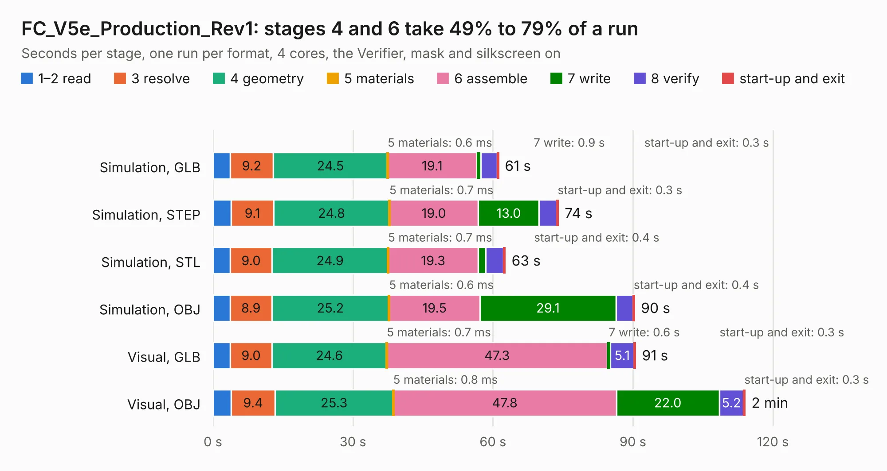

# 2326. FC_V5e_Production_Rev1

Board 2,326 of the 3,132 of [Corpus Testing](../Corpus-Testing.md), on [Corpus Page 22](../CorpusTestingPages/Corpus-Testing-22.md#2326-fc_v5e_production_rev1).

| Mode and format | 1–2 read | 3 resolve | 4 geometry | 5 materials | 6 assemble | 7 write | 8 verify | start-up and exit | Total |
|---|---:|---:|---:|---:|---:|---:|---:|---:|---:|
| Simulation, GLB | 3.7 | 9.2 | 24.5 | 0.6&nbsp;ms | 19.1 | 0.9 | 3.5 | 0.3 | 61.2 |
| Simulation, STEP | 3.9 | 9.1 | 24.8 | 0.7&nbsp;ms | 19.0 | 13.0 | 3.8 | 0.3 | 74.0 |
| Simulation, STL | 3.7 | 9.0 | 24.9 | 0.7&nbsp;ms | 19.3 | 1.6 | 3.8 | 0.4 | 62.6 |
| Simulation, OBJ | 3.7 | 8.9 | 25.2 | 0.6&nbsp;ms | 19.5 | 29.1 | 3.6 | 0.4 | 90.4 |
| Visual, GLB | 3.7 | 9.0 | 24.6 | 0.7&nbsp;ms | 47.3 | 0.6 | 5.1 | 0.3 | 90.6 |
| Visual, OBJ | 3.9 | 9.4 | 25.3 | 0.8&nbsp;ms | 47.8 | 22.0 | 5.2 | 0.3 | 114.0 |

<table align="center"><tr><td valign="top">

| Board | Repo: [proveskit/flight_controller_board](https://github.com/proveskit/flight_controller_board) Board: `FC_V5e_Production_Rev1.kicad_pcb` |
|---|---|
| Folder | FC_V5e_Production_Rev1 |
| Complexity | 425&nbsp;/&nbsp;1000 (size&nbsp;280, features&nbsp;145) |
| KESE&nbsp;features | through vias, slotted holes, custom pads, rounded, trapezoid or chamfered pads, filled zones, copper drawings, copper text, curved board outline, knockout text, stack-up, dielectric εr and tanδ |
| Tested | 9th November 2026 |
| Copper&nbsp;layers | 4 |
| File&nbsp;format | KiCad 10 (20260206) |
| Parts,&nbsp;tracks,&nbsp;vias | 247, 2,735, 477 |
| Triangles,&nbsp;simulation | 5,097,294 in 231 parts |
| Verifier | PASS in all six runs |

</td><td valign="top">

<table>
<tr><th>File type</th><th>File size</th><th>Peak memory used</th></tr>
<tr><th colspan="3" align="left">Simulation</th></tr>
<tr><td>GLB</td><td align="right">182&nbsp;MB</td><td align="right">1.8&nbsp;GB</td></tr>
<tr><td>STEP</td><td align="right">1000&nbsp;MB</td><td align="right">2.1&nbsp;GB</td></tr>
<tr><td>STL</td><td align="right">255&nbsp;MB</td><td align="right">1.8&nbsp;GB</td></tr>
<tr><td>OBJ</td><td align="right">569&nbsp;MB</td><td align="right">3.5&nbsp;GB</td></tr>
<tr><th colspan="3" align="left">Visual</th></tr>
<tr><td>GLB</td><td align="right">131&nbsp;MB</td><td align="right">2.0&nbsp;GB</td></tr>
<tr><td>OBJ</td><td align="right">414&nbsp;MB</td><td align="right">2.7&nbsp;GB</td></tr>
</table>

</td></tr></table>

| Previous | Next |
|:---|---:|
| [2325. FC_V5e](b2325b_flight-controller-board_FC-V5e.md) | [2327. cm5MiniITX](b2327b_cm5MiniITX_cm5MiniITX.md) |
