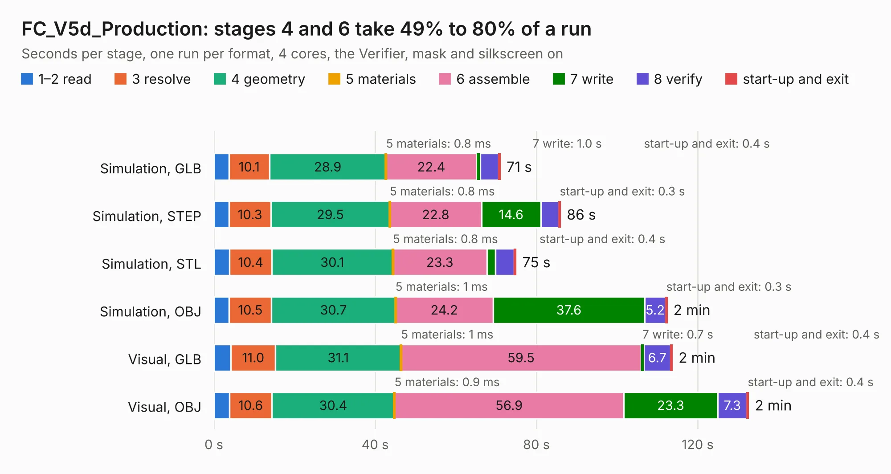

# 2327 FC_V5d_Production

Board 2,327 of the 3,138 of [Corpus Testing](../Corpus-Testing.md), on [Corpus Page 22](../CorpusTestingPages/Corpus-Testing-22.md#2327-fc_v5d_production).

| Mode and format | 1–2 read | 3 resolve | 4 geometry | 5 materials | 6 assemble | 7 write | 8 verify | start-up and exit | Total |
|---|---:|---:|---:|---:|---:|---:|---:|---:|---:|
| Simulation, GLB | 3.7 | 10.1 | 28.9 | 0.8&nbsp;ms | 22.4 | 1.0 | 4.5 | 0.4 | 71.0 |
| Simulation, STEP | 3.8 | 10.3 | 29.5 | 0.8&nbsp;ms | 22.8 | 14.6 | 4.6 | 0.3 | 86.0 |
| Simulation, STL | 3.9 | 10.4 | 30.1 | 0.8&nbsp;ms | 23.3 | 2.2 | 4.6 | 0.4 | 74.9 |
| Simulation, OBJ | 3.8 | 10.5 | 30.7 | 1&nbsp;ms | 24.2 | 37.6 | 5.2 | 0.3 | 112.4 |
| Visual, GLB | 4.2 | 11.0 | 31.1 | 1&nbsp;ms | 59.5 | 0.7 | 6.7 | 0.4 | 113.7 |
| Visual, OBJ | 3.8 | 10.6 | 30.4 | 0.9&nbsp;ms | 56.9 | 23.3 | 7.3 | 0.4 | 132.6 |

<table align="center"><tr><td valign="top">

| Board | Repo: [proveskit/flight_controller_board](https://github.com/proveskit/flight_controller_board) Board: `FC_V5d_Production.kicad_pcb` |
|---|---|
| Folder | FC_V5d_Production |
| Complexity | 428&nbsp;/&nbsp;1000 (size&nbsp;283, features&nbsp;145) |
| KESE&nbsp;features | through vias, slotted holes, custom pads, rounded, trapezoid or chamfered pads, filled zones, copper drawings, copper text, curved board outline, knockout text, stack-up, dielectric εr and tanδ |
| Tested | 9th November 2026 |
| Copper&nbsp;layers | 4 |
| File&nbsp;format | KiCad 9 (20241229) |
| Parts,&nbsp;tracks,&nbsp;vias | 252, 2,703, 497 |
| Triangles,&nbsp;simulation | 5,242,696 in 236 parts |
| Verifier | PASS in all six runs |

</td><td valign="top">

<table>
<tr><th>File type</th><th>File size</th><th>Peak memory used</th></tr>
<tr><th colspan="3" align="left">Simulation</th></tr>
<tr><td>GLB</td><td align="right">186&nbsp;MB</td><td align="right">1.9&nbsp;GB</td></tr>
<tr><td>STEP</td><td align="right">958&nbsp;MB</td><td align="right">2.1&nbsp;GB</td></tr>
<tr><td>STL</td><td align="right">262&nbsp;MB</td><td align="right">1.8&nbsp;GB</td></tr>
<tr><td>OBJ</td><td align="right">585&nbsp;MB</td><td align="right">3.5&nbsp;GB</td></tr>
<tr><th colspan="3" align="left">Visual</th></tr>
<tr><td>GLB</td><td align="right">131&nbsp;MB</td><td align="right">2.2&nbsp;GB</td></tr>
<tr><td>OBJ</td><td align="right">412&nbsp;MB</td><td align="right">2.6&nbsp;GB</td></tr>
</table>

</td></tr></table>

| Previous | Next |
|:---|---:|
| [2326 FC_V5c](b2326b_flight-controller-board_FC-V5c.md) | [2328 FC_V5d_Production_Rev2](b2328b_flight-controller-board_FC-V5d-Production-Rev2.md) |
