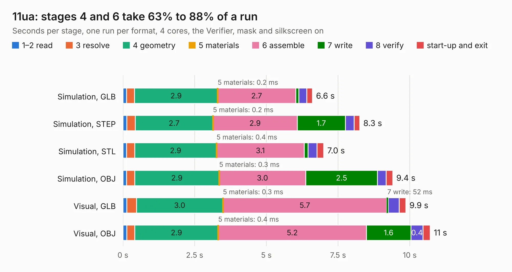

# 2330. 11ua

Board 2,330 of the 3,111 of [Corpus Testing](../Corpus-Testing.md), on [Corpus Page 22](../CorpusTestingPages/Corpus-Testing-22.md#2330-11ua).

| Mode and format | 1–2 read | 3 resolve | 4 geometry | 5 materials | 6 assemble | 7 write | 8 verify | start-up and exit | Total |
|---|---:|---:|---:|---:|---:|---:|---:|---:|---:|
| Simulation, GLB | 0.1 | 0.3 | 2.9 | 0.2&nbsp;ms | 2.7 | 0.1 | 0.3 | 0.2 | 6.6 |
| Simulation, STEP | 0.1 | 0.3 | 2.7 | 0.2&nbsp;ms | 2.9 | 1.7 | 0.3 | 0.2 | 8.3 |
| Simulation, STL | 0.1 | 0.3 | 2.9 | 0.4&nbsp;ms | 3.1 | 0.1 | 0.3 | 0.2 | 7.0 |
| Simulation, OBJ | 0.1 | 0.3 | 2.9 | 0.3&nbsp;ms | 3.0 | 2.5 | 0.3 | 0.2 | 9.4 |
| Visual, GLB | 0.1 | 0.3 | 3.0 | 0.3&nbsp;ms | 5.7 | 52&nbsp;ms | 0.4 | 0.2 | 9.9 |
| Visual, OBJ | 0.1 | 0.3 | 2.9 | 0.4&nbsp;ms | 5.2 | 1.6 | 0.4 | 0.2 | 10.7 |

<table align="center"><tr><td valign="top">

| Board | Repo: [rene-dev/stmbl](https://github.com/rene-dev/stmbl) Board: `11ua.kicad_pcb` |
|---|---|
| Folder | hw / kicad / 11ua |
| Complexity | 193&nbsp;/&nbsp;1000 (size&nbsp;148, features&nbsp;45) |
| KESE&nbsp;features | through vias, rounded, trapezoid or chamfered pads, filled zones |
| Tested | 9th November 2026 |
| Copper&nbsp;layers | 2 |
| File&nbsp;format | KiCad 6 (20190605) |
| Parts,&nbsp;tracks,&nbsp;vias | 26, 184, 49 |
| Triangles,&nbsp;simulation | 555,700 in 32 parts |
| Verifier | PASS in all six runs |

</td><td valign="top">

<table>
<tr><th>File type</th><th>File size</th><th>Peak memory used</th></tr>
<tr><th colspan="3" align="left">Simulation</th></tr>
<tr><td>GLB</td><td align="right">20&nbsp;MB</td><td align="right">330&nbsp;MB</td></tr>
<tr><td>STEP</td><td align="right">114&nbsp;MB</td><td align="right">386&nbsp;MB</td></tr>
<tr><td>STL</td><td align="right">28&nbsp;MB</td><td align="right">307&nbsp;MB</td></tr>
<tr><td>OBJ</td><td align="right">58&nbsp;MB</td><td align="right">424&nbsp;MB</td></tr>
<tr><th colspan="3" align="left">Visual</th></tr>
<tr><td>GLB</td><td align="right">13&nbsp;MB</td><td align="right">374&nbsp;MB</td></tr>
<tr><td>OBJ</td><td align="right">39&nbsp;MB</td><td align="right">359&nbsp;MB</td></tr>
</table>

</td></tr></table>

| Previous | Next |
|:---|---:|
| [2329. AppleII](b2329b_Apple-II-R0_AppleII.md) | [2331. triple_adapter](b2331b_stmbl_triple-adapter.md) |
