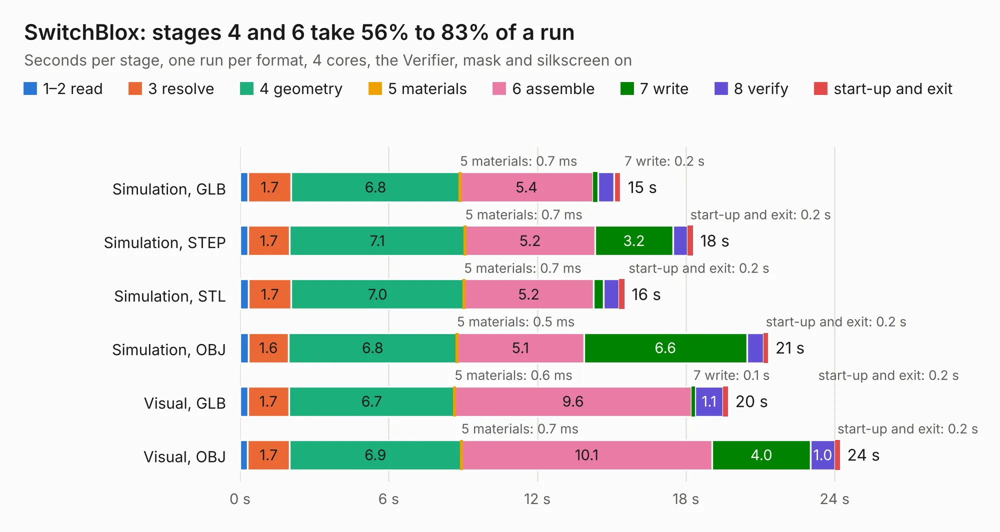

# 2332. SwitchBlox

Board 2,332 of the 3,139 of [Corpus Testing](../Corpus-Testing.md), on [Corpus Page 22](../CorpusTestingPages/Corpus-Testing-22.md#2332-switchblox).

| Mode and format | 1–2 read | 3 resolve | 4 geometry | 5 materials | 6 assemble | 7 write | 8 verify | start-up and exit | Total |
|---|---:|---:|---:|---:|---:|---:|---:|---:|---:|
| Simulation, GLB | 0.3 | 1.7 | 6.8 | 0.7&nbsp;ms | 5.4 | 0.2 | 0.7 | 0.3 | 15.4 |
| Simulation, STEP | 0.3 | 1.7 | 7.1 | 0.7&nbsp;ms | 5.2 | 3.2 | 0.6 | 0.2 | 18.3 |
| Simulation, STL | 0.3 | 1.7 | 7.0 | 0.7&nbsp;ms | 5.2 | 0.4 | 0.6 | 0.2 | 15.5 |
| Simulation, OBJ | 0.3 | 1.6 | 6.8 | 0.5&nbsp;ms | 5.1 | 6.6 | 0.7 | 0.2 | 21.3 |
| Visual, GLB | 0.3 | 1.7 | 6.7 | 0.6&nbsp;ms | 9.6 | 0.1 | 1.1 | 0.2 | 19.7 |
| Visual, OBJ | 0.3 | 1.7 | 6.9 | 0.7&nbsp;ms | 10.1 | 4.0 | 1.0 | 0.2 | 24.2 |

<table align="center"><tr><td valign="top">

| Board | Repo: [puyams/SwitchBlox](https://github.com/puyams/SwitchBlox) Board: `SwitchBlox.kicad_pcb` |
|---|---|
| Folder | Hardware / Release Design Files / Source Kicad Files |
| Complexity | 273&nbsp;/&nbsp;1000 (size&nbsp;228, features&nbsp;45) |
| KESE&nbsp;features | through vias, filled zones, curved board outline |
| Tested | 9th November 2026 |
| Copper&nbsp;layers | 2 |
| File&nbsp;format | KiCad 5 (20171130) |
| Parts,&nbsp;tracks,&nbsp;vias | 84, 1,564, 105 |
| Triangles,&nbsp;simulation | 1,226,446 in 156 parts |
| Verifier | PASS in all six runs |

</td><td valign="top">

<table>
<tr><th>File type</th><th>File size</th><th>Peak memory used</th></tr>
<tr><th colspan="3" align="left">Simulation</th></tr>
<tr><td>GLB</td><td align="right">44&nbsp;MB</td><td align="right">464&nbsp;MB</td></tr>
<tr><td>STEP</td><td align="right">237&nbsp;MB</td><td align="right">562&nbsp;MB</td></tr>
<tr><td>STL</td><td align="right">61&nbsp;MB</td><td align="right">454&nbsp;MB</td></tr>
<tr><td>OBJ</td><td align="right">130&nbsp;MB</td><td align="right">890&nbsp;MB</td></tr>
<tr><th colspan="3" align="left">Visual</th></tr>
<tr><td>GLB</td><td align="right">28&nbsp;MB</td><td align="right">592&nbsp;MB</td></tr>
<tr><td>OBJ</td><td align="right">83&nbsp;MB</td><td align="right">617&nbsp;MB</td></tr>
</table>

</td></tr></table>

| Previous | Next |
|:---|---:|
| [2331. cm5MiniITX](b2331b_cm5MiniITX_cm5MiniITX.md) | [2333. batteryboard](b2333b_hardware_batteryboard-v01_batteryboard.md) |
