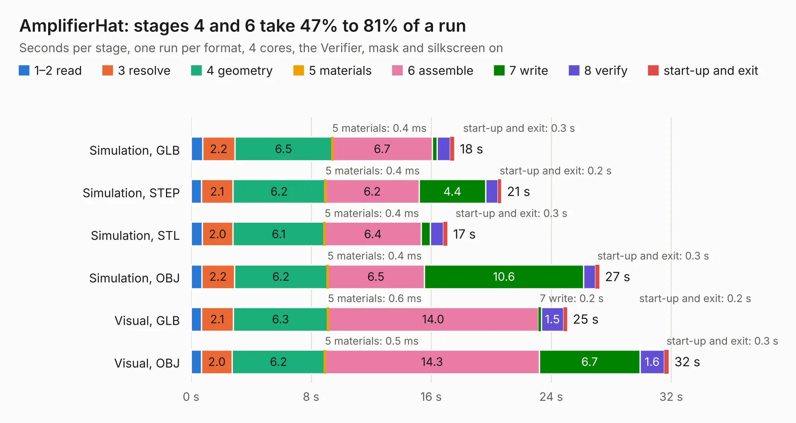

# 2332. AmplifierHat

Board 2,332 of the 3,120 of [Corpus Testing](../Corpus-Testing.md), on [Corpus Page 22](../CorpusTestingPages/Corpus-Testing-22.md#2332-amplifierhat).

| Mode and format | 1–2 read | 3 resolve | 4 geometry | 5 materials | 6 assemble | 7 write | 8 verify | start-up and exit | Total |
|---|---:|---:|---:|---:|---:|---:|---:|---:|---:|
| Simulation, GLB | 0.8 | 2.2 | 6.5 | 0.4&nbsp;ms | 6.7 | 0.3 | 0.9 | 0.3 | 17.5 |
| Simulation, STEP | 0.7 | 2.1 | 6.2 | 0.4&nbsp;ms | 6.2 | 4.4 | 0.8 | 0.2 | 20.7 |
| Simulation, STL | 0.7 | 2.0 | 6.1 | 0.4&nbsp;ms | 6.4 | 0.6 | 0.9 | 0.3 | 17.1 |
| Simulation, OBJ | 0.7 | 2.2 | 6.2 | 0.4&nbsp;ms | 6.5 | 10.6 | 0.8 | 0.3 | 27.2 |
| Visual, GLB | 0.7 | 2.1 | 6.3 | 0.6&nbsp;ms | 14.0 | 0.2 | 1.5 | 0.2 | 25.1 |
| Visual, OBJ | 0.7 | 2.0 | 6.2 | 0.5&nbsp;ms | 14.3 | 6.7 | 1.6 | 0.3 | 31.8 |

<table align="center"><tr><td valign="top">

| Board | Repo: [rasmusstagsted/artixdevboard](https://github.com/rasmusstagsted/artixdevboard) Board: `AmplifierHat.kicad_pcb` |
|---|---|
| Folder | AmplifierHat |
| Complexity | 307&nbsp;/&nbsp;1000 (size&nbsp;212, features&nbsp;95) |
| KESE&nbsp;features | through vias, slotted holes, rounded, trapezoid or chamfered pads, filled zones, copper drawings, stack-up, dielectric εr and tanδ |
| Tested | 9th November 2026 |
| Copper&nbsp;layers | 4 |
| File&nbsp;format | KiCad 8 (20240108) |
| Parts,&nbsp;tracks,&nbsp;vias | 163, 706, 387 |
| Triangles,&nbsp;simulation | 1,971,778 in 122 parts |
| Verifier | PASS in all six runs |

</td><td valign="top">

<table>
<tr><th>File type</th><th>File size</th><th>Peak memory used</th></tr>
<tr><th colspan="3" align="left">Simulation</th></tr>
<tr><td>GLB</td><td align="right">67&nbsp;MB</td><td align="right">799&nbsp;MB</td></tr>
<tr><td>STEP</td><td align="right">218&nbsp;MB</td><td align="right">855&nbsp;MB</td></tr>
<tr><td>STL</td><td align="right">99&nbsp;MB</td><td align="right">788&nbsp;MB</td></tr>
<tr><td>OBJ</td><td align="right">203&nbsp;MB</td><td align="right">1.3&nbsp;GB</td></tr>
<tr><th colspan="3" align="left">Visual</th></tr>
<tr><td>GLB</td><td align="right">41&nbsp;MB</td><td align="right">897&nbsp;MB</td></tr>
<tr><td>OBJ</td><td align="right">124&nbsp;MB</td><td align="right">952&nbsp;MB</td></tr>
</table>

</td></tr></table>

| Previous | Next |
|:---|---:|
| [2331. ACU5EV_Carrier_Base](b2331b_fcboardkicad_ACU5EV-Carrier-Base.md) | [2333. ArtixDevBoard](b2333b_artixdevboard_ArtixDevBoard.md) |
