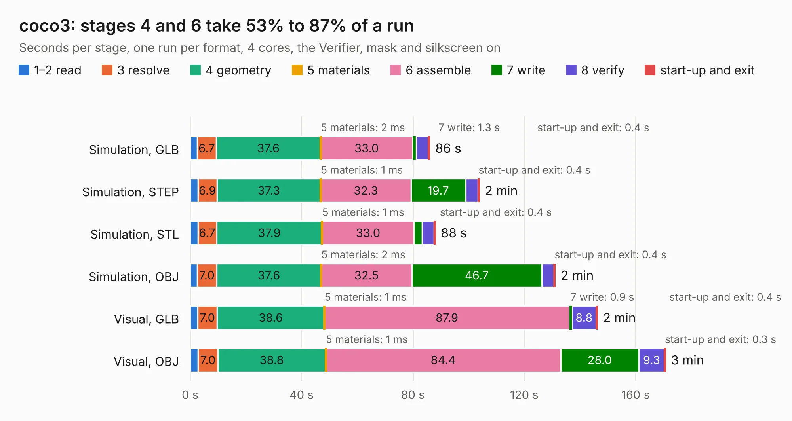

# 2332. coco3

Board 2,332 of the 3,129 of [Corpus Testing](../Corpus-Testing.md), on [Corpus Page 22](../CorpusTestingPages/Corpus-Testing-22.md#2332-coco3).

| Mode and format | 1–2 read | 3 resolve | 4 geometry | 5 materials | 6 assemble | 7 write | 8 verify | start-up and exit | Total |
|---|---:|---:|---:|---:|---:|---:|---:|---:|---:|
| Simulation, GLB | 2.6 | 6.7 | 37.6 | 2&nbsp;ms | 33.0 | 1.3 | 4.4 | 0.4 | 86.0 |
| Simulation, STEP | 2.8 | 6.9 | 37.3 | 1&nbsp;ms | 32.3 | 19.7 | 4.4 | 0.4 | 103.8 |
| Simulation, STL | 2.8 | 6.7 | 37.9 | 1&nbsp;ms | 33.0 | 3.0 | 4.3 | 0.4 | 88.0 |
| Simulation, OBJ | 2.5 | 7.0 | 37.6 | 2&nbsp;ms | 32.5 | 46.7 | 4.4 | 0.4 | 131.1 |
| Visual, GLB | 2.7 | 7.0 | 38.6 | 1&nbsp;ms | 87.9 | 0.9 | 8.8 | 0.4 | 146.2 |
| Visual, OBJ | 2.9 | 7.0 | 38.8 | 1&nbsp;ms | 84.4 | 28.0 | 9.3 | 0.3 | 170.7 |

<table align="center"><tr><td valign="top">

| Board | Repo: [qbancoffee/coco_motherboards](https://github.com/qbancoffee/coco_motherboards) Board: `coco3.kicad_pcb` |
|---|---|
| Folder | 26-3334 / coco3 |
| Complexity | 323&nbsp;/&nbsp;1000 (size&nbsp;258, features&nbsp;65) |
| KESE&nbsp;features | through vias, slotted holes, rounded, trapezoid or chamfered pads, filled zones, curved board outline |
| Tested | 9th November 2026 |
| Copper&nbsp;layers | 2 |
| File&nbsp;format | KiCad 7 (20221018) |
| Parts,&nbsp;tracks,&nbsp;vias | 205, 5,365, 359 |
| Triangles,&nbsp;simulation | 7,284,548 in 248 parts |
| Verifier | PASS in all six runs |

</td><td valign="top">

<table>
<tr><th>File type</th><th>File size</th><th>Peak memory used</th></tr>
<tr><th colspan="3" align="left">Simulation</th></tr>
<tr><td>GLB</td><td align="right">247&nbsp;MB</td><td align="right">2.4&nbsp;GB</td></tr>
<tr><td>STEP</td><td align="right">1.2&nbsp;GB</td><td align="right">2.9&nbsp;GB</td></tr>
<tr><td>STL</td><td align="right">364&nbsp;MB</td><td align="right">2.4&nbsp;GB</td></tr>
<tr><td>OBJ</td><td align="right">773&nbsp;MB</td><td align="right">4.6&nbsp;GB</td></tr>
<tr><th colspan="3" align="left">Visual</th></tr>
<tr><td>GLB</td><td align="right">172&nbsp;MB</td><td align="right">2.7&nbsp;GB</td></tr>
<tr><td>OBJ</td><td align="right">549&nbsp;MB</td><td align="right">3.6&nbsp;GB</td></tr>
</table>

</td></tr></table>

| Previous | Next |
|:---|---:|
| [2331. mainboard](b2331b_hardware_mainboard-v05_mainboard.md) | [2333. qomu-board](b2333b_qomu-dev-board_qomu-board_1326.md) |
