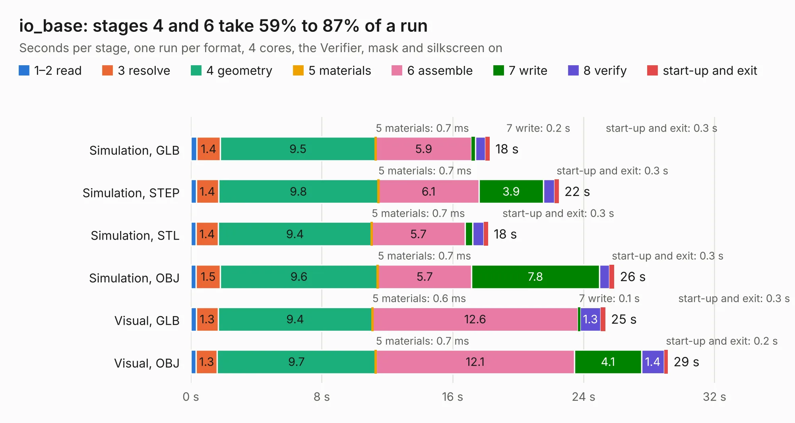

# 2334. io_base

Board 2,334 of the 3,110 of [Corpus Testing](../Corpus-Testing.md), on [Corpus Page 22](../CorpusTestingPages/Corpus-Testing-22.md#2334-io_base).

| Mode and format | 1–2 read | 3 resolve | 4 geometry | 5 materials | 6 assemble | 7 write | 8 verify | start-up and exit | Total |
|---|---:|---:|---:|---:|---:|---:|---:|---:|---:|
| Simulation, GLB | 0.4 | 1.4 | 9.5 | 0.7&nbsp;ms | 5.9 | 0.2 | 0.6 | 0.3 | 18.3 |
| Simulation, STEP | 0.3 | 1.4 | 9.8 | 0.7&nbsp;ms | 6.1 | 3.9 | 0.7 | 0.3 | 22.5 |
| Simulation, STL | 0.3 | 1.4 | 9.4 | 0.7&nbsp;ms | 5.7 | 0.5 | 0.7 | 0.3 | 18.2 |
| Simulation, OBJ | 0.3 | 1.5 | 9.6 | 0.7&nbsp;ms | 5.7 | 7.8 | 0.6 | 0.3 | 25.9 |
| Visual, GLB | 0.3 | 1.3 | 9.4 | 0.6&nbsp;ms | 12.6 | 0.1 | 1.3 | 0.3 | 25.3 |
| Visual, OBJ | 0.3 | 1.3 | 9.7 | 0.7&nbsp;ms | 12.1 | 4.1 | 1.4 | 0.2 | 29.1 |

<table align="center"><tr><td valign="top">

| Board | Repo: [rene-dev/stmbl](https://github.com/rene-dev/stmbl) Board: `io_base.kicad_pcb` |
|---|---|
| Folder | hw / kicad / bob / ethernet_bob / io_base |
| Complexity | 197&nbsp;/&nbsp;1000 (size&nbsp;172, features&nbsp;25) |
| KESE&nbsp;features | through vias, drill offsets |
| Tested | 9th November 2026 |
| Copper&nbsp;layers | 2 |
| File&nbsp;format | KiCad 5 (20160815) |
| Parts,&nbsp;tracks,&nbsp;vias | 98, 531, 36 |
| Triangles,&nbsp;simulation | 1,345,646 in 181 parts |
| Verifier | PASS in all six runs |

</td><td valign="top">

<table>
<tr><th>File type</th><th>File size</th><th>Peak memory used</th></tr>
<tr><th colspan="3" align="left">Simulation</th></tr>
<tr><td>GLB</td><td align="right">46&nbsp;MB</td><td align="right">555&nbsp;MB</td></tr>
<tr><td>STEP</td><td align="right">217&nbsp;MB</td><td align="right">623&nbsp;MB</td></tr>
<tr><td>STL</td><td align="right">67&nbsp;MB</td><td align="right">559&nbsp;MB</td></tr>
<tr><td>OBJ</td><td align="right">140&nbsp;MB</td><td align="right">903&nbsp;MB</td></tr>
<tr><th colspan="3" align="left">Visual</th></tr>
<tr><td>GLB</td><td align="right">25&nbsp;MB</td><td align="right">611&nbsp;MB</td></tr>
<tr><td>OBJ</td><td align="right">76&nbsp;MB</td><td align="right">593&nbsp;MB</td></tr>
</table>

</td></tr></table>

| Previous | Next |
|:---|---:|
| [2333. ethernet_bob](b2333b_stmbl_ethernet-bob.md) | [2335. ethernet_bob_base](b2335b_stmbl_ethernet-bob-base.md) |
