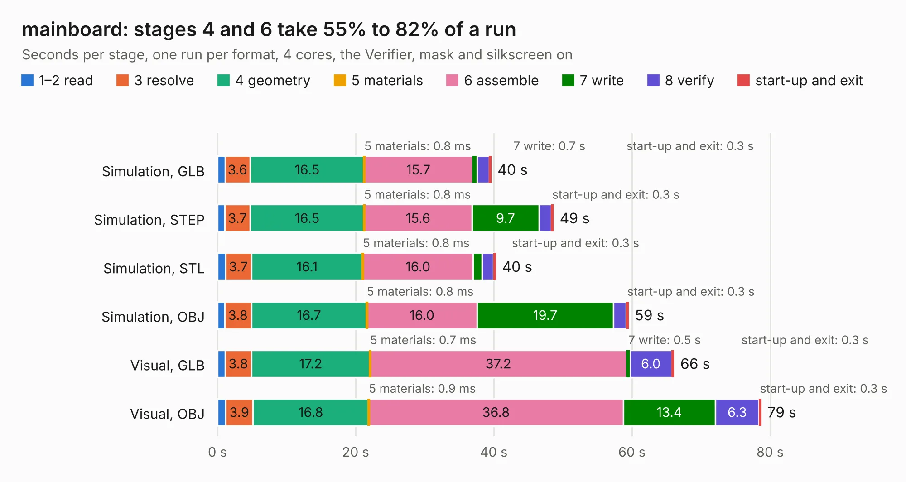

# 2338. mainboard

Board 2,338 of the 3,138 of [Corpus Testing](../Corpus-Testing.md), on [Corpus Page 22](../CorpusTestingPages/Corpus-Testing-22.md#2338-mainboard).

| Mode and format | 1–2 read | 3 resolve | 4 geometry | 5 materials | 6 assemble | 7 write | 8 verify | start-up and exit | Total |
|---|---:|---:|---:|---:|---:|---:|---:|---:|---:|
| Simulation, GLB | 1.1 | 3.6 | 16.5 | 0.8&nbsp;ms | 15.7 | 0.7 | 1.7 | 0.3 | 39.6 |
| Simulation, STEP | 1.1 | 3.7 | 16.5 | 0.8&nbsp;ms | 15.6 | 9.7 | 1.7 | 0.3 | 48.6 |
| Simulation, STL | 1.2 | 3.7 | 16.1 | 0.8&nbsp;ms | 16.0 | 1.3 | 1.7 | 0.3 | 40.3 |
| Simulation, OBJ | 1.1 | 3.8 | 16.7 | 0.8&nbsp;ms | 16.0 | 19.7 | 1.9 | 0.3 | 59.5 |
| Visual, GLB | 1.1 | 3.8 | 17.2 | 0.7&nbsp;ms | 37.2 | 0.5 | 6.0 | 0.3 | 66.1 |
| Visual, OBJ | 1.2 | 3.9 | 16.8 | 0.9&nbsp;ms | 36.8 | 13.4 | 6.3 | 0.3 | 78.7 |

<table align="center"><tr><td valign="top">

| Board | Repo: [pycubed/hardware](https://github.com/pycubed/hardware) Board: `mainboard.kicad_pcb` |
|---|---|
| Folder | mainboard-v05 |
| Complexity | 361&nbsp;/&nbsp;1000 (size&nbsp;271, features&nbsp;90) |
| KESE&nbsp;features | through vias, slotted holes, custom pads, rounded, trapezoid or chamfered pads, filled zones, copper drawings, curved board outline |
| Tested | 9th November 2026 |
| Copper&nbsp;layers | 4 |
| File&nbsp;format | KiCad 5 (20171130) |
| Parts,&nbsp;tracks,&nbsp;vias | 220, 1,958, 409 |
| Triangles,&nbsp;simulation | 4,482,088 in 257 parts |
| Verifier | PASS in all six runs |

</td><td valign="top">

<table>
<tr><th>File type</th><th>File size</th><th>Peak memory used</th></tr>
<tr><th colspan="3" align="left">Simulation</th></tr>
<tr><td>GLB</td><td align="right">157&nbsp;MB</td><td align="right">1.7&nbsp;GB</td></tr>
<tr><td>STEP</td><td align="right">695&nbsp;MB</td><td align="right">1.7&nbsp;GB</td></tr>
<tr><td>STL</td><td align="right">224&nbsp;MB</td><td align="right">1.6&nbsp;GB</td></tr>
<tr><td>OBJ</td><td align="right">492&nbsp;MB</td><td align="right">3.0&nbsp;GB</td></tr>
<tr><th colspan="3" align="left">Visual</th></tr>
<tr><td>GLB</td><td align="right">108&nbsp;MB</td><td align="right">1.7&nbsp;GB</td></tr>
<tr><td>OBJ</td><td align="right">344&nbsp;MB</td><td align="right">2.2&nbsp;GB</td></tr>
</table>

</td></tr></table>

| Previous | Next |
|:---|---:|
| [2337. mainboard](b2337b_hardware_mainboard-v04_mainboard.md) | [2339. coco3](b2339b_coco-motherboards_coco3.md) |
