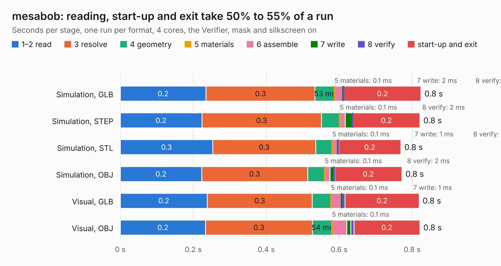

# 2339. mesabob

Board 2,339 of the 3,111 of [Corpus Testing](../Corpus-Testing.md), on [Corpus Page 22](../CorpusTestingPages/Corpus-Testing-22.md#2339-mesabob).

| Mode and format | 1–2 read | 3 resolve | 4 geometry | 5 materials | 6 assemble | 7 write | 8 verify | start-up and exit | Total |
|---|---:|---:|---:|---:|---:|---:|---:|---:|---:|
| Simulation, GLB | 0.2 | 0.3 | 53&nbsp;ms | 0.1&nbsp;ms | 22&nbsp;ms | 2&nbsp;ms | 2&nbsp;ms | 0.2 | 0.8 |
| Simulation, STEP | 0.2 | 0.3 | 50&nbsp;ms | 0.1&nbsp;ms | 15&nbsp;ms | 19&nbsp;ms | 2&nbsp;ms | 0.2 | 0.8 |
| Simulation, STL | 0.3 | 0.3 | 46&nbsp;ms | 0.1&nbsp;ms | 14&nbsp;ms | 1&nbsp;ms | 2&nbsp;ms | 0.2 | 0.8 |
| Simulation, OBJ | 0.2 | 0.3 | 47&nbsp;ms | 0.1&nbsp;ms | 15&nbsp;ms | 11&nbsp;ms | 2&nbsp;ms | 0.2 | 0.8 |
| Visual, GLB | 0.2 | 0.3 | 51&nbsp;ms | 0.1&nbsp;ms | 29&nbsp;ms | 1&nbsp;ms | 9&nbsp;ms | 0.2 | 0.8 |
| Visual, OBJ | 0.2 | 0.3 | 54&nbsp;ms | 0.1&nbsp;ms | 41&nbsp;ms | 11&nbsp;ms | 9&nbsp;ms | 0.2 | 0.8 |

<table align="center"><tr><td valign="top">

| Board | Repo: [rene-dev/stmbl](https://github.com/rene-dev/stmbl) Board: `mesabob.kicad_pcb` |
|---|---|
| Folder | hw / kicad / mesabob |
| Complexity | 216&nbsp;/&nbsp;1000 (size&nbsp;161, features&nbsp;55) |
| KESE&nbsp;features | through vias, rounded, trapezoid or chamfered pads, filled zones, curved board outline |
| Tested | 9th November 2026 |
| Copper&nbsp;layers | 2 |
| File&nbsp;format | KiCad 5 (20171130) |
| Parts,&nbsp;tracks,&nbsp;vias | 44, 446, 25 |
| Triangles,&nbsp;simulation | 1,872 in 3 parts |
| Verifier | PASS in all six runs |

</td><td valign="top">

<table>
<tr><th>File type</th><th>File size</th><th>Peak memory used</th></tr>
<tr><th colspan="3" align="left">Simulation</th></tr>
<tr><td>GLB</td><td align="right">56&nbsp;kB</td><td align="right">77&nbsp;MB</td></tr>
<tr><td>STEP</td><td align="right">33&nbsp;kB</td><td align="right">76&nbsp;MB</td></tr>
<tr><td>STL</td><td align="right">94&nbsp;kB</td><td align="right">77&nbsp;MB</td></tr>
<tr><td>OBJ</td><td align="right">174&nbsp;kB</td><td align="right">79&nbsp;MB</td></tr>
<tr><th colspan="3" align="left">Visual</th></tr>
<tr><td>GLB</td><td align="right">72&nbsp;kB</td><td align="right">77&nbsp;MB</td></tr>
<tr><td>OBJ</td><td align="right">175&nbsp;kB</td><td align="right">77&nbsp;MB</td></tr>
</table>

</td></tr></table>

| Previous | Next |
|:---|---:|
| [2338. diff_driver](b2338b_stmbl_diff-driver.md) | [2340. powerstep](b2340b_stmbl_powerstep.md) |
