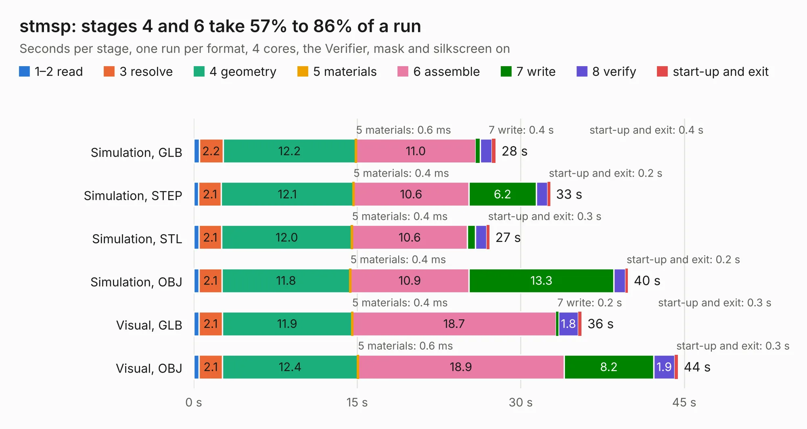

# 2339. stmsp

Board 2,339 of the 3,106 of [Corpus Testing](../Corpus-Testing.md), on [Corpus Page 22](../CorpusTestingPages/Corpus-Testing-22.md#2339-stmsp).

| Mode and format | 1–2 read | 3 resolve | 4 geometry | 5 materials | 6 assemble | 7 write | 8 verify | start-up and exit | Total |
|---|---:|---:|---:|---:|---:|---:|---:|---:|---:|
| Simulation, GLB | 0.5 | 2.2 | 12.2 | 0.6&nbsp;ms | 11.0 | 0.4 | 1.1 | 0.4 | 27.7 |
| Simulation, STEP | 0.5 | 2.1 | 12.1 | 0.4&nbsp;ms | 10.6 | 6.2 | 1.0 | 0.2 | 32.7 |
| Simulation, STL | 0.5 | 2.1 | 12.0 | 0.4&nbsp;ms | 10.6 | 0.7 | 1.0 | 0.3 | 27.1 |
| Simulation, OBJ | 0.5 | 2.1 | 11.8 | 0.4&nbsp;ms | 10.9 | 13.3 | 1.1 | 0.2 | 39.8 |
| Visual, GLB | 0.5 | 2.1 | 11.9 | 0.4&nbsp;ms | 18.7 | 0.2 | 1.8 | 0.3 | 35.6 |
| Visual, OBJ | 0.5 | 2.1 | 12.4 | 0.6&nbsp;ms | 18.9 | 8.2 | 1.9 | 0.3 | 44.4 |

<table align="center"><tr><td valign="top">

| Board | Repo: [rene-dev/stmbl](https://github.com/rene-dev/stmbl) Board: `stmsp.kicad_pcb` |
|---|---|
| Folder | hw / kicad / stmsp |
| Complexity | 310&nbsp;/&nbsp;1000 (size&nbsp;255, features&nbsp;55) |
| KESE&nbsp;features | through vias, rounded, trapezoid or chamfered pads, filled zones, curved board outline |
| Tested | 9th November 2026 |
| Copper&nbsp;layers | 4 |
| File&nbsp;format | KiCad 5 (20170123) |
| Parts,&nbsp;tracks,&nbsp;vias | 128, 975, 276 |
| Triangles,&nbsp;simulation | 2,220,152 in 102 parts |
| Verifier | PASS in all six runs |

</td><td valign="top">

<table>
<tr><th>File type</th><th>File size</th><th>Peak memory used</th></tr>
<tr><th colspan="3" align="left">Simulation</th></tr>
<tr><td>GLB</td><td align="right">77&nbsp;MB</td><td align="right">735&nbsp;MB</td></tr>
<tr><td>STEP</td><td align="right">365&nbsp;MB</td><td align="right">947&nbsp;MB</td></tr>
<tr><td>STL</td><td align="right">111&nbsp;MB</td><td align="right">719&nbsp;MB</td></tr>
<tr><td>OBJ</td><td align="right">234&nbsp;MB</td><td align="right">1.5&nbsp;GB</td></tr>
<tr><th colspan="3" align="left">Visual</th></tr>
<tr><td>GLB</td><td align="right">47&nbsp;MB</td><td align="right">931&nbsp;MB</td></tr>
<tr><td>OBJ</td><td align="right">144&nbsp;MB</td><td align="right">1.1&nbsp;GB</td></tr>
</table>

</td></tr></table>

| Previous | Next |
|:---|---:|
| [2338. rj45_breakout](b2338b_stmbl_rj45-breakout.md) | [2340. to220_powerstage](b2340b_stmbl_to220-powerstage.md) |
