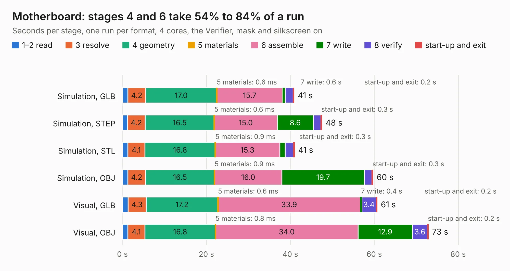

# 2340. Motherboard

Board 2,340 of the 3,127 of [Corpus Testing](../Corpus-Testing.md), on [Corpus Page 22](../CorpusTestingPages/Corpus-Testing-22.md#2340-motherboard).

| Mode and format | 1–2 read | 3 resolve | 4 geometry | 5 materials | 6 assemble | 7 write | 8 verify | start-up and exit | Total |
|---|---:|---:|---:|---:|---:|---:|---:|---:|---:|
| Simulation, GLB | 1.3 | 4.2 | 17.0 | 0.6&nbsp;ms | 15.7 | 0.6 | 1.9 | 0.2 | 40.9 |
| Simulation, STEP | 1.2 | 4.2 | 16.5 | 0.6&nbsp;ms | 15.0 | 8.6 | 1.8 | 0.3 | 47.5 |
| Simulation, STL | 1.3 | 4.1 | 16.8 | 0.9&nbsp;ms | 15.3 | 1.3 | 1.9 | 0.3 | 41.0 |
| Simulation, OBJ | 1.3 | 4.2 | 16.5 | 0.9&nbsp;ms | 16.0 | 19.7 | 1.7 | 0.3 | 59.7 |
| Visual, GLB | 1.3 | 4.3 | 17.2 | 0.6&nbsp;ms | 33.9 | 0.4 | 3.4 | 0.2 | 60.7 |
| Visual, OBJ | 1.3 | 4.1 | 16.8 | 0.8&nbsp;ms | 34.0 | 12.9 | 3.6 | 0.2 | 72.9 |

<table align="center"><tr><td valign="top">

| Board | Repo: [Redherring32/OpenTendo](https://github.com/Redherring32/OpenTendo) Board: `Motherboard.kicad_pcb` |
|---|---|
| Folder | Board Files |
| Complexity | 297&nbsp;/&nbsp;1000 (size&nbsp;202, features&nbsp;95) |
| KESE&nbsp;features | through vias, slotted holes, rounded, trapezoid or chamfered pads, filled zones, curved board outline, stack-up, dielectric εr and tanδ |
| Tested | 9th November 2026 |
| Copper&nbsp;layers | 2 |
| File&nbsp;format | KiCad 8 (20240108) |
| Parts,&nbsp;tracks,&nbsp;vias | 99, 2,644, 387 |
| Triangles,&nbsp;simulation | 3,801,422 in 142 parts |
| Verifier | PASS in all six runs |

</td><td valign="top">

<table>
<tr><th>File type</th><th>File size</th><th>Peak memory used</th></tr>
<tr><th colspan="3" align="left">Simulation</th></tr>
<tr><td>GLB</td><td align="right">129&nbsp;MB</td><td align="right">1.2&nbsp;GB</td></tr>
<tr><td>STEP</td><td align="right">573&nbsp;MB</td><td align="right">1.5&nbsp;GB</td></tr>
<tr><td>STL</td><td align="right">190&nbsp;MB</td><td align="right">1.1&nbsp;GB</td></tr>
<tr><td>OBJ</td><td align="right">401&nbsp;MB</td><td align="right">2.5&nbsp;GB</td></tr>
<tr><th colspan="3" align="left">Visual</th></tr>
<tr><td>GLB</td><td align="right">86&nbsp;MB</td><td align="right">1.6&nbsp;GB</td></tr>
<tr><td>OBJ</td><td align="right">271&nbsp;MB</td><td align="right">1.8&nbsp;GB</td></tr>
</table>

</td></tr></table>

| Previous | Next |
|:---|---:|
| [2339. scarlet-8088](b2339b_scarlet-8088_scarlet-8088.md) | [2341. Arduino_Altair_8800](b2341b_Altair8800-Simulator-PCB_Arduino-Altair-8800.md) |
