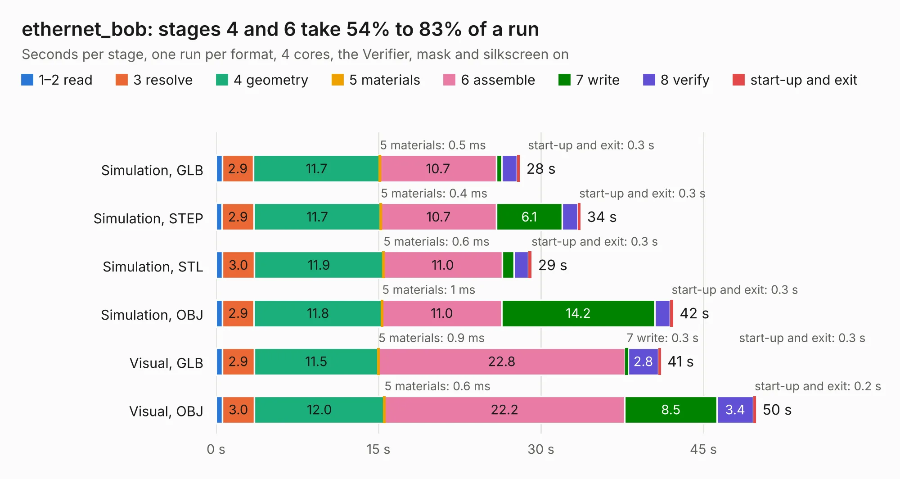

# 2340. ethernet_bob

Board 2,340 of the 3,117 of [Corpus Testing](../Corpus-Testing.md), on [Corpus Page 22](../CorpusTestingPages/Corpus-Testing-22.md#2340-ethernet_bob).

| Mode and format | 1–2 read | 3 resolve | 4 geometry | 5 materials | 6 assemble | 7 write | 8 verify | start-up and exit | Total |
|---|---:|---:|---:|---:|---:|---:|---:|---:|---:|
| Simulation, GLB | 0.6 | 2.9 | 11.7 | 0.5&nbsp;ms | 10.7 | 0.5 | 1.4 | 0.3 | 28.1 |
| Simulation, STEP | 0.6 | 2.9 | 11.7 | 0.4&nbsp;ms | 10.7 | 6.1 | 1.5 | 0.3 | 33.7 |
| Simulation, STL | 0.6 | 3.0 | 11.9 | 0.6&nbsp;ms | 11.0 | 1.1 | 1.3 | 0.3 | 29.1 |
| Simulation, OBJ | 0.6 | 2.9 | 11.8 | 1&nbsp;ms | 11.0 | 14.2 | 1.4 | 0.3 | 42.2 |
| Visual, GLB | 0.6 | 2.9 | 11.5 | 0.9&nbsp;ms | 22.8 | 0.3 | 2.8 | 0.3 | 41.1 |
| Visual, OBJ | 0.6 | 3.0 | 12.0 | 0.6&nbsp;ms | 22.2 | 8.5 | 3.4 | 0.2 | 49.9 |

<table align="center"><tr><td valign="top">

| Board | Repo: [rene-dev/stmbl](https://github.com/rene-dev/stmbl) Board: `ethernet_bob.kicad_pcb` |
|---|---|
| Folder | hw / kicad / bob / ethernet_bob |
| Complexity | 289&nbsp;/&nbsp;1000 (size&nbsp;244, features&nbsp;45) |
| KESE&nbsp;features | through vias, rounded, trapezoid or chamfered pads, filled zones |
| Tested | 9th November 2026 |
| Copper&nbsp;layers | 4 |
| File&nbsp;format | KiCad 5 (20171130) |
| Parts,&nbsp;tracks,&nbsp;vias | 68, 1,672, 112 |
| Triangles,&nbsp;simulation | 3,430,750 in 160 parts |
| Verifier | PASS in all six runs |

</td><td valign="top">

<table>
<tr><th>File type</th><th>File size</th><th>Peak memory used</th></tr>
<tr><th colspan="3" align="left">Simulation</th></tr>
<tr><td>GLB</td><td align="right">117&nbsp;MB</td><td align="right">1.1&nbsp;GB</td></tr>
<tr><td>STEP</td><td align="right">396&nbsp;MB</td><td align="right">1.4&nbsp;GB</td></tr>
<tr><td>STL</td><td align="right">172&nbsp;MB</td><td align="right">1.1&nbsp;GB</td></tr>
<tr><td>OBJ</td><td align="right">363&nbsp;MB</td><td align="right">2.2&nbsp;GB</td></tr>
<tr><th colspan="3" align="left">Visual</th></tr>
<tr><td>GLB</td><td align="right">66&nbsp;MB</td><td align="right">1.2&nbsp;GB</td></tr>
<tr><td>OBJ</td><td align="right">207&nbsp;MB</td><td align="right">1.5&nbsp;GB</td></tr>
</table>

</td></tr></table>

| Previous | Next |
|:---|---:|
| [2339. db25_bob_v2](b2339b_stmbl_db25-bob-v2.md) | [2341. io_base](b2341b_stmbl_io-base.md) |
