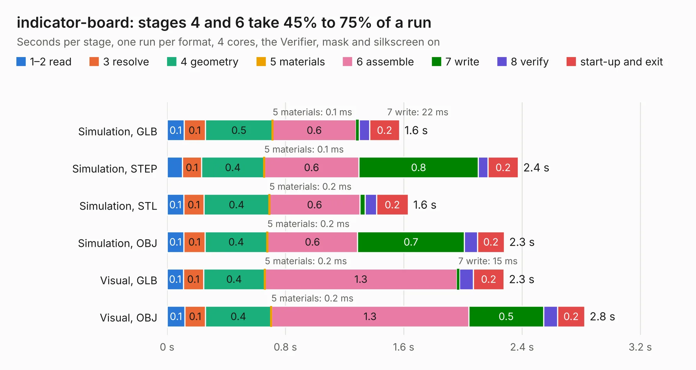

# 2341. indicator-board

Board 2,341 of the 3,104 of [Corpus Testing](../Corpus-Testing.md), on [Corpus Page 22](../CorpusTestingPages/Corpus-Testing-22.md#2341-indicator-board).

| Mode and format | 1–2 read | 3 resolve | 4 geometry | 5 materials | 6 assemble | 7 write | 8 verify | start-up and exit | Total |
|---|---:|---:|---:|---:|---:|---:|---:|---:|---:|
| Simulation, GLB | 0.1 | 0.1 | 0.5 | 0.1&nbsp;ms | 0.6 | 22&nbsp;ms | 71&nbsp;ms | 0.2 | 1.6 |
| Simulation, STEP | 0.1 | 0.1 | 0.4 | 0.1&nbsp;ms | 0.6 | 0.8 | 66&nbsp;ms | 0.2 | 2.4 |
| Simulation, STL | 0.1 | 0.1 | 0.4 | 0.2&nbsp;ms | 0.6 | 34&nbsp;ms | 78&nbsp;ms | 0.2 | 1.6 |
| Simulation, OBJ | 0.1 | 0.1 | 0.4 | 0.2&nbsp;ms | 0.6 | 0.7 | 90&nbsp;ms | 0.2 | 2.3 |
| Visual, GLB | 0.1 | 0.1 | 0.4 | 0.2&nbsp;ms | 1.3 | 15&nbsp;ms | 95&nbsp;ms | 0.2 | 2.3 |
| Visual, OBJ | 0.1 | 0.1 | 0.4 | 0.2&nbsp;ms | 1.3 | 0.5 | 95&nbsp;ms | 0.2 | 2.8 |

<table align="center"><tr><td valign="top">

| Board | Repo: [respiraworks/ventilator](https://github.com/respiraworks/ventilator) Board: `indicator-board.kicad_pcb` |
|---|---|
| Folder | pcb / indicator-board |
| Complexity | 182&nbsp;/&nbsp;1000 (size&nbsp;137, features&nbsp;45) |
| KESE&nbsp;features | through vias, rounded, trapezoid or chamfered pads, filled zones |
| Tested | 9th November 2026 |
| Copper&nbsp;layers | 4 |
| File&nbsp;format | KiCad 5 (20171130) |
| Parts,&nbsp;tracks,&nbsp;vias | 15, 67, 7 |
| Triangles,&nbsp;simulation | 135,180 in 28 parts |
| Verifier | PASS in all six runs |

</td><td valign="top">

<table>
<tr><th>File type</th><th>File size</th><th>Peak memory used</th></tr>
<tr><th colspan="3" align="left">Simulation</th></tr>
<tr><td>GLB</td><td align="right">4.5&nbsp;MB</td><td align="right">193&nbsp;MB</td></tr>
<tr><td>STEP</td><td align="right">20&nbsp;MB</td><td align="right">202&nbsp;MB</td></tr>
<tr><td>STL</td><td align="right">6.8&nbsp;MB</td><td align="right">189&nbsp;MB</td></tr>
<tr><td>OBJ</td><td align="right">13&nbsp;MB</td><td align="right">191&nbsp;MB</td></tr>
<tr><th colspan="3" align="left">Visual</th></tr>
<tr><td>GLB</td><td align="right">3.2&nbsp;MB</td><td align="right">156&nbsp;MB</td></tr>
<tr><td>OBJ</td><td align="right">9.0&nbsp;MB</td><td align="right">156&nbsp;MB</td></tr>
</table>

</td></tr></table>

| Previous | Next |
|:---|---:|
| [2340. stmbl_4.0](b2340b_stmbl_stmbl-4-0.md) | [2342. pressure_mpx5700ap,gp](b2342b_ventilator_pressure-mpx5700ap-gp.md) |
