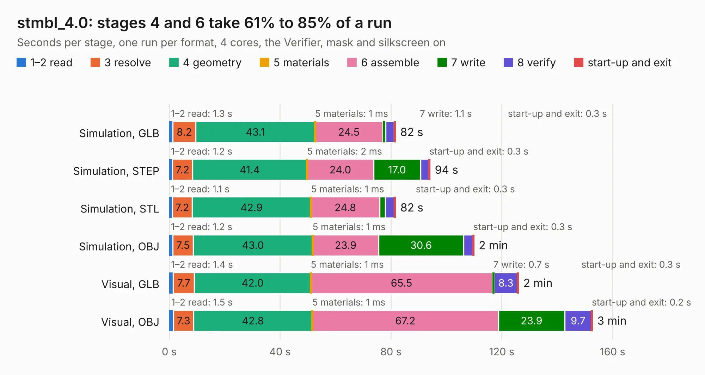

# 2344. stmbl_4.0

Board 2,344 of the 3,108 of [Corpus Testing](../Corpus-Testing.md), on [Corpus Page 22](../CorpusTestingPages/Corpus-Testing-22.md#2344-stmbl_40).

| Mode and format | 1–2 read | 3 resolve | 4 geometry | 5 materials | 6 assemble | 7 write | 8 verify | start-up and exit | Total |
|---|---:|---:|---:|---:|---:|---:|---:|---:|---:|
| Simulation, GLB | 1.3 | 8.2 | 43.1 | 1&nbsp;ms | 24.5 | 1.1 | 3.1 | 0.3 | 81.6 |
| Simulation, STEP | 1.2 | 7.2 | 41.4 | 2&nbsp;ms | 24.0 | 17.0 | 3.0 | 0.3 | 94.0 |
| Simulation, STL | 1.1 | 7.2 | 42.9 | 1&nbsp;ms | 24.8 | 2.0 | 3.3 | 0.3 | 81.6 |
| Simulation, OBJ | 1.2 | 7.5 | 43.0 | 1&nbsp;ms | 23.9 | 30.6 | 3.4 | 0.3 | 109.9 |
| Visual, GLB | 1.4 | 7.7 | 42.0 | 1&nbsp;ms | 65.5 | 0.7 | 8.3 | 0.3 | 126.0 |
| Visual, OBJ | 1.5 | 7.3 | 42.8 | 1&nbsp;ms | 67.2 | 23.9 | 9.7 | 0.2 | 152.6 |

<table align="center"><tr><td valign="top">

| Board | Repo: [rene-dev/stmbl](https://github.com/rene-dev/stmbl) Board: `stmbl_4.0.kicad_pcb` |
|---|---|
| Folder | hw / kicad / v4.0 |
| Complexity | 326&nbsp;/&nbsp;1000 (size&nbsp;271, features&nbsp;55) |
| KESE&nbsp;features | through vias, rounded, trapezoid or chamfered pads, filled zones, curved board outline |
| Tested | 9th November 2026 |
| Copper&nbsp;layers | 2 |
| File&nbsp;format | KiCad 5 (20171130) |
| Parts,&nbsp;tracks,&nbsp;vias | 407, 2,788, 1,076 |
| Triangles,&nbsp;simulation | 5,892,236 in 242 parts |
| Verifier | PASS in all six runs |

</td><td valign="top">

<table>
<tr><th>File type</th><th>File size</th><th>Peak memory used</th></tr>
<tr><th colspan="3" align="left">Simulation</th></tr>
<tr><td>GLB</td><td align="right">205&nbsp;MB</td><td align="right">2.0&nbsp;GB</td></tr>
<tr><td>STEP</td><td align="right">1.2&nbsp;GB</td><td align="right">2.4&nbsp;GB</td></tr>
<tr><td>STL</td><td align="right">295&nbsp;MB</td><td align="right">1.9&nbsp;GB</td></tr>
<tr><td>OBJ</td><td align="right">634&nbsp;MB</td><td align="right">3.9&nbsp;GB</td></tr>
<tr><th colspan="3" align="left">Visual</th></tr>
<tr><td>GLB</td><td align="right">159&nbsp;MB</td><td align="right">2.4&nbsp;GB</td></tr>
<tr><td>OBJ</td><td align="right">499&nbsp;MB</td><td align="right">3.2&nbsp;GB</td></tr>
</table>

</td></tr></table>

| Previous | Next |
|:---|---:|
| [2343. trollerv2](b2343b_stmbl_trollerv2.md) | [2345. indicator-board](b2345b_ventilator_indicator-board.md) |
