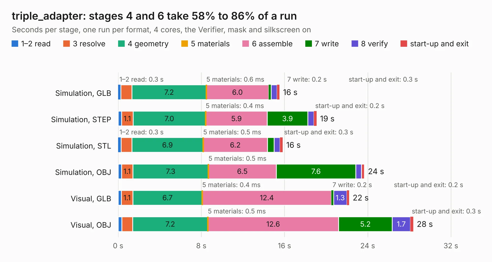

# 2346. triple_adapter

Board 2,346 of the 3,129 of [Corpus Testing](../Corpus-Testing.md), on [Corpus Page 22](../CorpusTestingPages/Corpus-Testing-22.md#2346-triple_adapter).

| Mode and format | 1–2 read | 3 resolve | 4 geometry | 5 materials | 6 assemble | 7 write | 8 verify | start-up and exit | Total |
|---|---:|---:|---:|---:|---:|---:|---:|---:|---:|
| Simulation, GLB | 0.3 | 1.1 | 7.2 | 0.6&nbsp;ms | 6.0 | 0.2 | 0.6 | 0.3 | 15.5 |
| Simulation, STEP | 0.3 | 1.1 | 7.0 | 0.4&nbsp;ms | 5.9 | 3.9 | 0.6 | 0.2 | 19.1 |
| Simulation, STL | 0.3 | 1.0 | 6.9 | 0.5&nbsp;ms | 6.2 | 0.6 | 0.6 | 0.3 | 15.8 |
| Simulation, OBJ | 0.3 | 1.1 | 7.3 | 0.5&nbsp;ms | 6.5 | 7.6 | 0.5 | 0.3 | 23.7 |
| Visual, GLB | 0.3 | 1.1 | 6.7 | 0.4&nbsp;ms | 12.4 | 0.2 | 1.3 | 0.2 | 22.2 |
| Visual, OBJ | 0.3 | 1.1 | 7.2 | 0.5&nbsp;ms | 12.6 | 5.2 | 1.7 | 0.3 | 28.4 |

<table align="center"><tr><td valign="top">

| Board | Repo: [rene-dev/stmbl](https://github.com/rene-dev/stmbl) Board: `triple_adapter.kicad_pcb` |
|---|---|
| Folder | hw / kicad / 11ua |
| Complexity | 236&nbsp;/&nbsp;1000 (size&nbsp;181, features&nbsp;55) |
| KESE&nbsp;features | through vias, rounded, trapezoid or chamfered pads, filled zones, curved board outline |
| Tested | 9th November 2026 |
| Copper&nbsp;layers | 2 |
| File&nbsp;format | KiCad 5 (20171130) |
| Parts,&nbsp;tracks,&nbsp;vias | 78, 831, 138 |
| Triangles,&nbsp;simulation | 1,473,076 in 33 parts |
| Verifier | PASS in all six runs |

</td><td valign="top">

<table>
<tr><th>File type</th><th>File size</th><th>Peak memory used</th></tr>
<tr><th colspan="3" align="left">Simulation</th></tr>
<tr><td>GLB</td><td align="right">51&nbsp;MB</td><td align="right">582&nbsp;MB</td></tr>
<tr><td>STEP</td><td align="right">261&nbsp;MB</td><td align="right">727&nbsp;MB</td></tr>
<tr><td>STL</td><td align="right">74&nbsp;MB</td><td align="right">605&nbsp;MB</td></tr>
<tr><td>OBJ</td><td align="right">154&nbsp;MB</td><td align="right">1.0&nbsp;GB</td></tr>
<tr><th colspan="3" align="left">Visual</th></tr>
<tr><td>GLB</td><td align="right">37&nbsp;MB</td><td align="right">880&nbsp;MB</td></tr>
<tr><td>OBJ</td><td align="right">110&nbsp;MB</td><td align="right">832&nbsp;MB</td></tr>
</table>

</td></tr></table>

| Previous | Next |
|:---|---:|
| [2345. 11ua](b2345b_stmbl_11ua.md) | [2347. db25_bob](b2347b_stmbl_db25-bob.md) |
