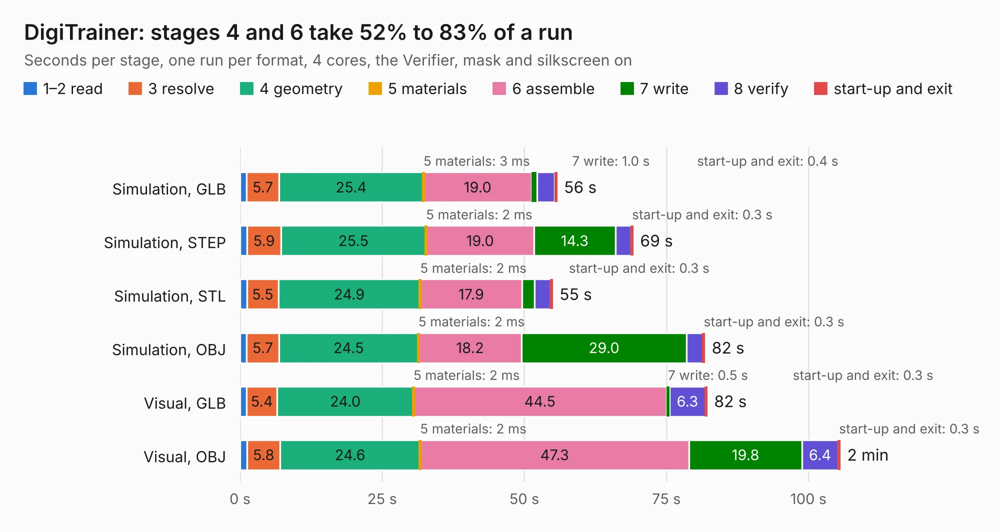

# 2347. DigiTrainer

Board 2,347 of the 3,102 of [Corpus Testing](../Corpus-Testing.md), on [Corpus Page 22](../CorpusTestingPages/Corpus-Testing-22.md#2347-digitrainer).

| Mode and format | 1–2 read | 3 resolve | 4 geometry | 5 materials | 6 assemble | 7 write | 8 verify | start-up and exit | Total |
|---|---:|---:|---:|---:|---:|---:|---:|---:|---:|
| Simulation, GLB | 1.2 | 5.7 | 25.4 | 3&nbsp;ms | 19.0 | 1.0 | 3.1 | 0.4 | 55.7 |
| Simulation, STEP | 1.3 | 5.9 | 25.5 | 2&nbsp;ms | 19.0 | 14.3 | 2.8 | 0.3 | 69.1 |
| Simulation, STL | 1.2 | 5.5 | 24.9 | 2&nbsp;ms | 17.9 | 2.1 | 2.9 | 0.3 | 54.9 |
| Simulation, OBJ | 1.2 | 5.7 | 24.5 | 2&nbsp;ms | 18.2 | 29.0 | 2.9 | 0.3 | 81.7 |
| Visual, GLB | 1.1 | 5.4 | 24.0 | 2&nbsp;ms | 44.5 | 0.5 | 6.3 | 0.3 | 82.1 |
| Visual, OBJ | 1.3 | 5.8 | 24.6 | 2&nbsp;ms | 47.3 | 19.8 | 6.4 | 0.3 | 105.5 |

<table align="center"><tr><td valign="top">

| Board | Repo: [RetroStack/BitStack-DigiTrainer](https://github.com/RetroStack/BitStack-DigiTrainer) Board: `DigiTrainer.kicad_pcb` |
|---|---|
| Folder | KiCAD |
| Complexity | 290&nbsp;/&nbsp;1000 (size&nbsp;215, features&nbsp;75) |
| KESE&nbsp;features | through vias, slotted holes, rounded, trapezoid or chamfered pads, curved board outline, knockout text, TrueType text |
| Tested | 9th November 2026 |
| Copper&nbsp;layers | 2 |
| File&nbsp;format | KiCad 8 (20240108) |
| Parts,&nbsp;tracks,&nbsp;vias | 262, 4,169, 145 |
| Triangles,&nbsp;simulation | 5,400,662 in 485 parts |
| Verifier | PASS in all six runs |

</td><td valign="top">

<table>
<tr><th>File type</th><th>File size</th><th>Peak memory used</th></tr>
<tr><th colspan="3" align="left">Simulation</th></tr>
<tr><td>GLB</td><td align="right">182&nbsp;MB</td><td align="right">1.6&nbsp;GB</td></tr>
<tr><td>STEP</td><td align="right">795&nbsp;MB</td><td align="right">2.1&nbsp;GB</td></tr>
<tr><td>STL</td><td align="right">270&nbsp;MB</td><td align="right">1.6&nbsp;GB</td></tr>
<tr><td>OBJ</td><td align="right">572&nbsp;MB</td><td align="right">3.4&nbsp;GB</td></tr>
<tr><th colspan="3" align="left">Visual</th></tr>
<tr><td>GLB</td><td align="right">120&nbsp;MB</td><td align="right">1.9&nbsp;GB</td></tr>
<tr><td>OBJ</td><td align="right">381&nbsp;MB</td><td align="right">2.4&nbsp;GB</td></tr>
</table>

</td></tr></table>

| Previous | Next |
|:---|---:|
| [2346. Ventilator](b2346b_ventilator_Ventilator.md) | [2348. TRS80_Model_I_A_E1](b2348b_TRS-80-Model-I-A-E1_TRS80-Model-I-A-E1.md) |
