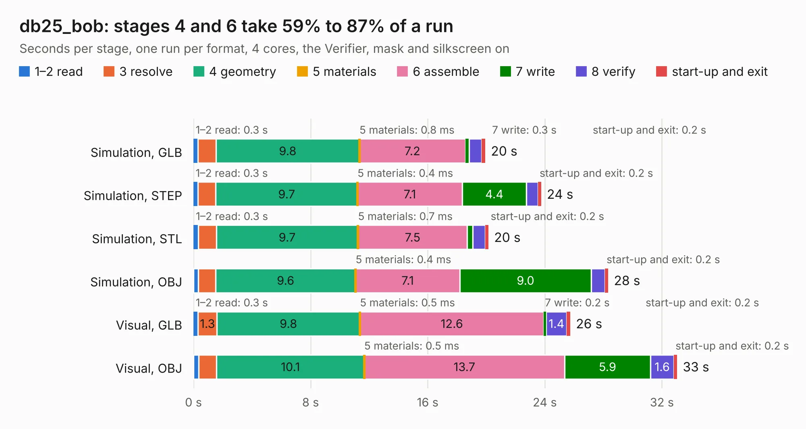

# 2347. db25_bob

Board 2,347 of the 3,129 of [Corpus Testing](../Corpus-Testing.md), on [Corpus Page 22](../CorpusTestingPages/Corpus-Testing-22.md#2347-db25_bob).

| Mode and format | 1–2 read | 3 resolve | 4 geometry | 5 materials | 6 assemble | 7 write | 8 verify | start-up and exit | Total |
|---|---:|---:|---:|---:|---:|---:|---:|---:|---:|
| Simulation, GLB | 0.3 | 1.2 | 9.8 | 0.8&nbsp;ms | 7.2 | 0.3 | 0.9 | 0.2 | 19.9 |
| Simulation, STEP | 0.3 | 1.2 | 9.7 | 0.4&nbsp;ms | 7.1 | 4.4 | 0.8 | 0.2 | 23.7 |
| Simulation, STL | 0.3 | 1.2 | 9.7 | 0.7&nbsp;ms | 7.5 | 0.4 | 0.9 | 0.2 | 20.1 |
| Simulation, OBJ | 0.3 | 1.2 | 9.6 | 0.4&nbsp;ms | 7.1 | 9.0 | 0.9 | 0.2 | 28.3 |
| Visual, GLB | 0.3 | 1.3 | 9.8 | 0.5&nbsp;ms | 12.6 | 0.2 | 1.4 | 0.2 | 25.7 |
| Visual, OBJ | 0.3 | 1.2 | 10.1 | 0.5&nbsp;ms | 13.7 | 5.9 | 1.6 | 0.2 | 33.0 |

<table align="center"><tr><td valign="top">

| Board | Repo: [rene-dev/stmbl](https://github.com/rene-dev/stmbl) Board: `db25_bob.kicad_pcb` |
|---|---|
| Folder | hw / kicad / bob / db25_bob |
| Complexity | 221&nbsp;/&nbsp;1000 (size&nbsp;186, features&nbsp;35) |
| KESE&nbsp;features | through vias, filled zones |
| Tested | 9th November 2026 |
| Copper&nbsp;layers | 2 |
| File&nbsp;format | KiCad 4 (4) |
| Parts,&nbsp;tracks,&nbsp;vias | 94, 1,289, 65 |
| Triangles,&nbsp;simulation | 1,631,048 in 156 parts |
| Verifier | PASS in all six runs |

</td><td valign="top">

<table>
<tr><th>File type</th><th>File size</th><th>Peak memory used</th></tr>
<tr><th colspan="3" align="left">Simulation</th></tr>
<tr><td>GLB</td><td align="right">58&nbsp;MB</td><td align="right">615&nbsp;MB</td></tr>
<tr><td>STEP</td><td align="right">303&nbsp;MB</td><td align="right">751&nbsp;MB</td></tr>
<tr><td>STL</td><td align="right">82&nbsp;MB</td><td align="right">619&nbsp;MB</td></tr>
<tr><td>OBJ</td><td align="right">174&nbsp;MB</td><td align="right">1.1&nbsp;GB</td></tr>
<tr><th colspan="3" align="left">Visual</th></tr>
<tr><td>GLB</td><td align="right">38&nbsp;MB</td><td align="right">767&nbsp;MB</td></tr>
<tr><td>OBJ</td><td align="right">114&nbsp;MB</td><td align="right">859&nbsp;MB</td></tr>
</table>

</td></tr></table>

| Previous | Next |
|:---|---:|
| [2346. triple_adapter](b2346b_stmbl_triple-adapter.md) | [2348. db25_bob_v2](b2348b_stmbl_db25-bob-v2.md) |
