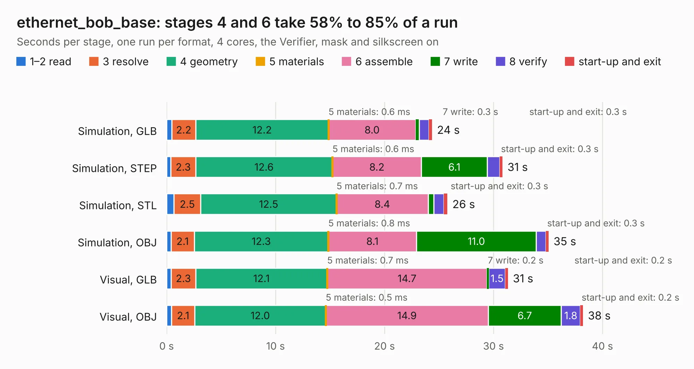

# 2348. ethernet_bob_base

Board 2,348 of the 3,123 of [Corpus Testing](../Corpus-Testing.md), on [Corpus Page 22](../CorpusTestingPages/Corpus-Testing-22.md#2348-ethernet_bob_base).

| Mode and format | 1–2 read | 3 resolve | 4 geometry | 5 materials | 6 assemble | 7 write | 8 verify | start-up and exit | Total |
|---|---:|---:|---:|---:|---:|---:|---:|---:|---:|
| Simulation, GLB | 0.5 | 2.2 | 12.2 | 0.6&nbsp;ms | 8.0 | 0.3 | 0.9 | 0.3 | 24.4 |
| Simulation, STEP | 0.4 | 2.3 | 12.6 | 0.6&nbsp;ms | 8.2 | 6.1 | 1.1 | 0.3 | 30.8 |
| Simulation, STL | 0.7 | 2.5 | 12.5 | 0.7&nbsp;ms | 8.4 | 0.5 | 0.9 | 0.3 | 25.8 |
| Simulation, OBJ | 0.4 | 2.1 | 12.3 | 0.8&nbsp;ms | 8.1 | 11.0 | 0.9 | 0.3 | 35.1 |
| Visual, GLB | 0.4 | 2.3 | 12.1 | 0.7&nbsp;ms | 14.7 | 0.2 | 1.5 | 0.2 | 31.3 |
| Visual, OBJ | 0.5 | 2.1 | 12.0 | 0.5&nbsp;ms | 14.9 | 6.7 | 1.8 | 0.2 | 38.2 |

<table align="center"><tr><td valign="top">

| Board | Repo: [rene-dev/stmbl](https://github.com/rene-dev/stmbl) Board: `ethernet_bob_base.kicad_pcb` |
|---|---|
| Folder | hw / kicad / bob / ethernet_bob_base |
| Complexity | 279&nbsp;/&nbsp;1000 (size&nbsp;224, features&nbsp;55) |
| KESE&nbsp;features | through vias, rounded, trapezoid or chamfered pads, filled zones, curved board outline |
| Tested | 9th November 2026 |
| Copper&nbsp;layers | 2 |
| File&nbsp;format | KiCad 5 (20171130) |
| Parts,&nbsp;tracks,&nbsp;vias | 111, 544, 92 |
| Triangles,&nbsp;simulation | 2,128,744 in 169 parts |
| Verifier | PASS in all six runs |

</td><td valign="top">

<table>
<tr><th>File type</th><th>File size</th><th>Peak memory used</th></tr>
<tr><th colspan="3" align="left">Simulation</th></tr>
<tr><td>GLB</td><td align="right">73&nbsp;MB</td><td align="right">835&nbsp;MB</td></tr>
<tr><td>STEP</td><td align="right">381&nbsp;MB</td><td align="right">937&nbsp;MB</td></tr>
<tr><td>STL</td><td align="right">106&nbsp;MB</td><td align="right">914&nbsp;MB</td></tr>
<tr><td>OBJ</td><td align="right">224&nbsp;MB</td><td align="right">1.4&nbsp;GB</td></tr>
<tr><th colspan="3" align="left">Visual</th></tr>
<tr><td>GLB</td><td align="right">44&nbsp;MB</td><td align="right">853&nbsp;MB</td></tr>
<tr><td>OBJ</td><td align="right">134&nbsp;MB</td><td align="right">1.0&nbsp;GB</td></tr>
</table>

</td></tr></table>

| Previous | Next |
|:---|---:|
| [2347. io_base](b2347b_stmbl_io-base.md) | [2349. Bob](b2349b_stmbl_Bob.md) |
