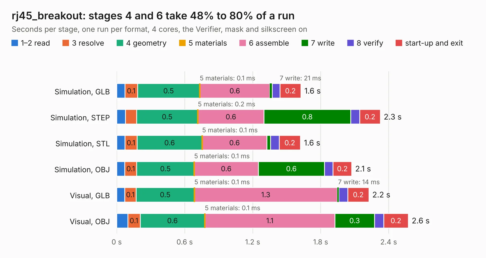

# 2348. rj45_breakout

Board 2,348 of the 3,116 of [Corpus Testing](../Corpus-Testing.md), on [Corpus Page 22](../CorpusTestingPages/Corpus-Testing-22.md#2348-rj45_breakout).

| Mode and format | 1–2 read | 3 resolve | 4 geometry | 5 materials | 6 assemble | 7 write | 8 verify | start-up and exit | Total |
|---|---:|---:|---:|---:|---:|---:|---:|---:|---:|
| Simulation, GLB | 73&nbsp;ms | 0.1 | 0.5 | 0.1&nbsp;ms | 0.6 | 21&nbsp;ms | 67&nbsp;ms | 0.2 | 1.6 |
| Simulation, STEP | 77&nbsp;ms | 97&nbsp;ms | 0.5 | 0.2&nbsp;ms | 0.6 | 0.8 | 80&nbsp;ms | 0.2 | 2.3 |
| Simulation, STL | 72&nbsp;ms | 0.1 | 0.6 | 0.1&nbsp;ms | 0.6 | 32&nbsp;ms | 76&nbsp;ms | 0.2 | 1.6 |
| Simulation, OBJ | 71&nbsp;ms | 0.1 | 0.5 | 0.1&nbsp;ms | 0.6 | 0.6 | 76&nbsp;ms | 0.2 | 2.1 |
| Visual, GLB | 71&nbsp;ms | 0.1 | 0.5 | 0.1&nbsp;ms | 1.3 | 14&nbsp;ms | 79&nbsp;ms | 0.2 | 2.2 |
| Visual, OBJ | 98&nbsp;ms | 0.1 | 0.6 | 0.1&nbsp;ms | 1.1 | 0.3 | 81&nbsp;ms | 0.2 | 2.6 |

<table align="center"><tr><td valign="top">

| Board | Repo: [rene-dev/stmbl](https://github.com/rene-dev/stmbl) Board: `rj45_breakout.kicad_pcb` |
|---|---|
| Folder | hw / kicad / rj45_breakout |
| Complexity | 114&nbsp;/&nbsp;1000 (size&nbsp;94, features&nbsp;20) |
| KESE&nbsp;features | filled zones |
| Tested | 9th November 2026 |
| Copper&nbsp;layers | 2 |
| File&nbsp;format | KiCad 4 (4) |
| Parts,&nbsp;tracks,&nbsp;vias | 3, 43, 0 |
| Triangles,&nbsp;simulation | 150,252 in 20 parts |
| Verifier | PASS in all six runs |

</td><td valign="top">

<table>
<tr><th>File type</th><th>File size</th><th>Peak memory used</th></tr>
<tr><th colspan="3" align="left">Simulation</th></tr>
<tr><td>GLB</td><td align="right">5.2&nbsp;MB</td><td align="right">187&nbsp;MB</td></tr>
<tr><td>STEP</td><td align="right">27&nbsp;MB</td><td align="right">201&nbsp;MB</td></tr>
<tr><td>STL</td><td align="right">7.5&nbsp;MB</td><td align="right">188&nbsp;MB</td></tr>
<tr><td>OBJ</td><td align="right">15&nbsp;MB</td><td align="right">188&nbsp;MB</td></tr>
<tr><th colspan="3" align="left">Visual</th></tr>
<tr><td>GLB</td><td align="right">3.0&nbsp;MB</td><td align="right">157&nbsp;MB</td></tr>
<tr><td>OBJ</td><td align="right">8.4&nbsp;MB</td><td align="right">160&nbsp;MB</td></tr>
</table>

</td></tr></table>

| Previous | Next |
|:---|---:|
| [2347. rectifier](b2347b_stmbl_hw-kicad-rectifier2_rectifier.md) | [2349. stmsp](b2349b_stmbl_stmsp.md) |
