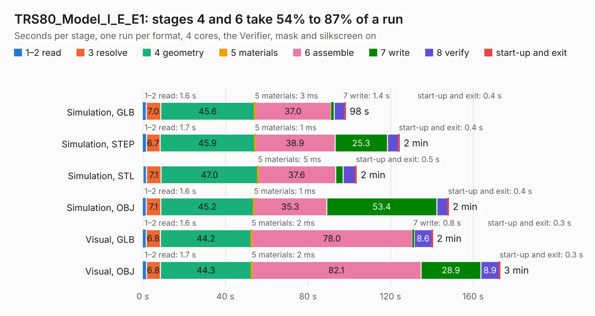

# 2350. TRS80_Model_I_E_E1

Board 2,350 of the 3,102 of [Corpus Testing](../Corpus-Testing.md), on [Corpus Page 22](../CorpusTestingPages/Corpus-Testing-22.md#2350-trs80_model_i_e_e1).

| Mode and format | 1–2 read | 3 resolve | 4 geometry | 5 materials | 6 assemble | 7 write | 8 verify | start-up and exit | Total |
|---|---:|---:|---:|---:|---:|---:|---:|---:|---:|
| Simulation, GLB | 1.6 | 7.0 | 45.6 | 3&nbsp;ms | 37.0 | 1.4 | 5.1 | 0.4 | 98.2 |
| Simulation, STEP | 1.7 | 6.7 | 45.9 | 1&nbsp;ms | 38.9 | 25.3 | 5.4 | 0.4 | 124.3 |
| Simulation, STL | 1.8 | 7.1 | 47.0 | 5&nbsp;ms | 37.6 | 3.7 | 6.0 | 0.5 | 103.5 |
| Simulation, OBJ | 1.6 | 7.1 | 45.2 | 1&nbsp;ms | 35.3 | 53.4 | 5.3 | 0.4 | 148.1 |
| Visual, GLB | 1.6 | 6.8 | 44.2 | 2&nbsp;ms | 78.0 | 0.8 | 8.6 | 0.3 | 140.4 |
| Visual, OBJ | 1.7 | 6.8 | 44.3 | 2&nbsp;ms | 82.1 | 28.9 | 8.9 | 0.3 | 173.0 |

<table align="center"><tr><td valign="top">

| Board | Repo: [RetroStack/TRS-80-Model-I-E-E1](https://github.com/RetroStack/TRS-80-Model-I-E-E1) Board: `TRS80_Model_I_E_E1.kicad_pcb` |
|---|---|
| Folder | KiCAD |
| Complexity | 356&nbsp;/&nbsp;1000 (size&nbsp;226, features&nbsp;130) |
| KESE&nbsp;features | through vias, rounded, trapezoid or chamfered pads, drill offsets, filled zones, copper drawings, copper text, curved board outline, stack-up, dielectric εr and tanδ, copper finish |
| Tested | 9th November 2026 |
| Copper&nbsp;layers | 2 |
| File&nbsp;format | KiCad 9 (20241229) |
| Parts,&nbsp;tracks,&nbsp;vias | 225, 8,532, 349 |
| Triangles,&nbsp;simulation | 9,125,234 in 388 parts |
| Verifier | PASS in all six runs |

</td><td valign="top">

<table>
<tr><th>File type</th><th>File size</th><th>Peak memory used</th></tr>
<tr><th colspan="3" align="left">Simulation</th></tr>
<tr><td>GLB</td><td align="right">306&nbsp;MB</td><td align="right">2.4&nbsp;GB</td></tr>
<tr><td>STEP</td><td align="right">1.4&nbsp;GB</td><td align="right">3.3&nbsp;GB</td></tr>
<tr><td>STL</td><td align="right">456&nbsp;MB</td><td align="right">2.3&nbsp;GB</td></tr>
<tr><td>OBJ</td><td align="right">964&nbsp;MB</td><td align="right">5.6&nbsp;GB</td></tr>
<tr><th colspan="3" align="left">Visual</th></tr>
<tr><td>GLB</td><td align="right">176&nbsp;MB</td><td align="right">2.7&nbsp;GB</td></tr>
<tr><td>OBJ</td><td align="right">561&nbsp;MB</td><td align="right">3.6&nbsp;GB</td></tr>
</table>

</td></tr></table>

| Previous | Next |
|:---|---:|
| [2349. TRS80_Model_I_D_E1](b2349b_TRS-80-Model-I-D-E1_TRS80-Model-I-D-E1.md) | [2351. TRS80_Model_I_EI_RevD](b2351b_TRS-80-Model-I-Expansion-Interface-Rev-D_TRS80-Model-I-EI-RevD.md) |
