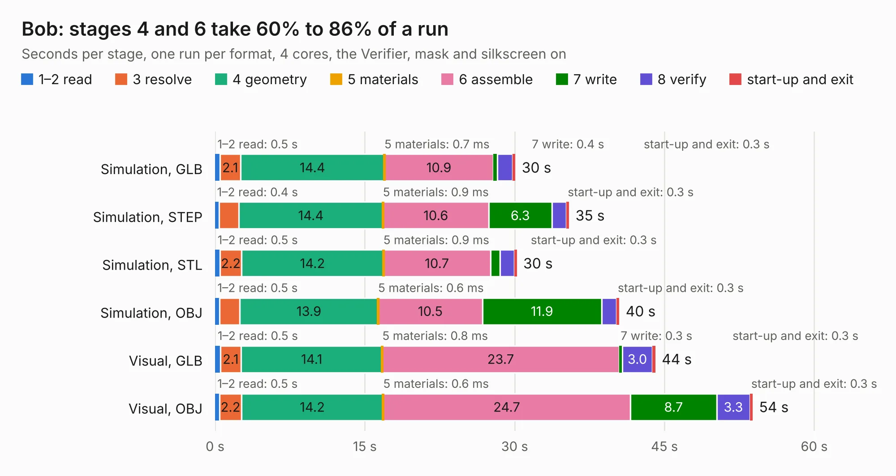

# 2350. Bob

Board 2,350 of the 3,124 of [Corpus Testing](../Corpus-Testing.md), on [Corpus Page 22](../CorpusTestingPages/Corpus-Testing-22.md#2350-bob).

| Mode and format | 1–2 read | 3 resolve | 4 geometry | 5 materials | 6 assemble | 7 write | 8 verify | start-up and exit | Total |
|---|---:|---:|---:|---:|---:|---:|---:|---:|---:|
| Simulation, GLB | 0.5 | 2.1 | 14.4 | 0.7&nbsp;ms | 10.9 | 0.4 | 1.5 | 0.3 | 30.1 |
| Simulation, STEP | 0.4 | 2.0 | 14.4 | 0.9&nbsp;ms | 10.6 | 6.3 | 1.5 | 0.3 | 35.5 |
| Simulation, STL | 0.5 | 2.2 | 14.2 | 0.9&nbsp;ms | 10.7 | 0.9 | 1.4 | 0.3 | 30.2 |
| Simulation, OBJ | 0.5 | 2.0 | 13.9 | 0.6&nbsp;ms | 10.5 | 11.9 | 1.5 | 0.3 | 40.5 |
| Visual, GLB | 0.5 | 2.1 | 14.1 | 0.8&nbsp;ms | 23.7 | 0.3 | 3.0 | 0.3 | 44.1 |
| Visual, OBJ | 0.5 | 2.2 | 14.2 | 0.6&nbsp;ms | 24.7 | 8.7 | 3.3 | 0.3 | 53.8 |

<table align="center"><tr><td valign="top">

| Board | Repo: [rene-dev/stmbl](https://github.com/rene-dev/stmbl) Board: `Bob.kicad_pcb` |
|---|---|
| Folder | hw / kicad / de0bob |
| Complexity | 238&nbsp;/&nbsp;1000 (size&nbsp;203, features&nbsp;35) |
| KESE&nbsp;features | through vias, filled zones |
| Tested | 9th November 2026 |
| Copper&nbsp;layers | 2 |
| File&nbsp;format | KiCad 5 (20170123) |
| Parts,&nbsp;tracks,&nbsp;vias | 140, 2,759, 170 |
| Triangles,&nbsp;simulation | 2,427,452 in 212 parts |
| Verifier | PASS in all six runs |

</td><td valign="top">

<table>
<tr><th>File type</th><th>File size</th><th>Peak memory used</th></tr>
<tr><th colspan="3" align="left">Simulation</th></tr>
<tr><td>GLB</td><td align="right">85&nbsp;MB</td><td align="right">907&nbsp;MB</td></tr>
<tr><td>STEP</td><td align="right">447&nbsp;MB</td><td align="right">1.0&nbsp;GB</td></tr>
<tr><td>STL</td><td align="right">121&nbsp;MB</td><td align="right">841&nbsp;MB</td></tr>
<tr><td>OBJ</td><td align="right">260&nbsp;MB</td><td align="right">1.6&nbsp;GB</td></tr>
<tr><th colspan="3" align="left">Visual</th></tr>
<tr><td>GLB</td><td align="right">61&nbsp;MB</td><td align="right">1.1&nbsp;GB</td></tr>
<tr><td>OBJ</td><td align="right">188&nbsp;MB</td><td align="right">1.4&nbsp;GB</td></tr>
</table>

</td></tr></table>

| Previous | Next |
|:---|---:|
| [2349. ethernet_bob_base](b2349b_stmbl_ethernet-bob-base.md) | [2351. diff_driver](b2351b_stmbl_diff-driver.md) |
