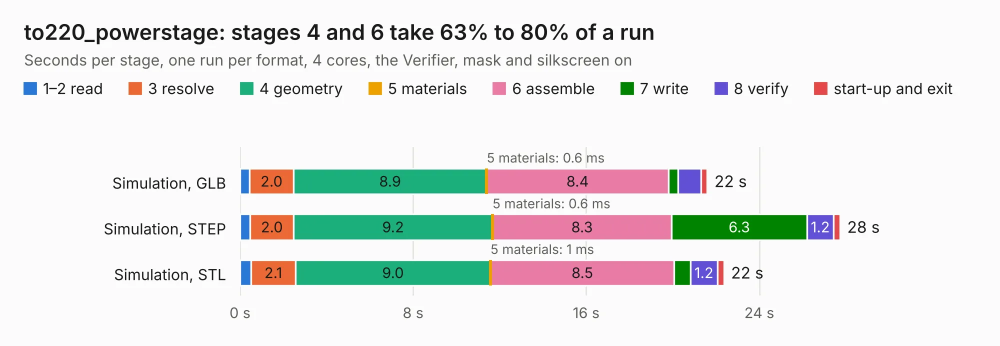

# 2352. to220_powerstage

Board 2,352 of the 3,118 of [Corpus Testing](../Corpus-Testing.md), on [Corpus Page 22](../CorpusTestingPages/Corpus-Testing-22.md#2352-to220_powerstage).

| Mode and format | 1–2 read | 3 resolve | 4 geometry | 5 materials | 6 assemble | 7 write | 8 verify | start-up and exit | Total |
|---|---:|---:|---:|---:|---:|---:|---:|---:|---:|
| Simulation, GLB | 0.4 | 2.0 | 8.9 | 0.6&nbsp;ms | 8.4 | 0.4 | 1.1 | 0.3 | 21.6 |
| Simulation, STEP | 0.5 | 2.0 | 9.2 | 0.6&nbsp;ms | 8.3 | 6.3 | 1.2 | 0.3 | 27.7 |
| Simulation, STL | 0.5 | 2.1 | 9.0 | 1&nbsp;ms | 8.5 | 0.8 | 1.2 | 0.3 | 22.4 |
| Simulation, OBJ | 0.5 | 2.0 | 9.2 | 0.8&nbsp;ms | 8.4 | 14.3 | 1.3 | 0.3 | 35.9 |
| Visual, GLB | 0.5 | 2.2 | 9.7 | 0.8&nbsp;ms | 18.7 | 0.2 | 1.8 | 0.2 | 33.2 |
| Visual, OBJ | 0.4 | 2.0 | 9.5 | 0.7&nbsp;ms | 16.7 | 6.9 | 2.1 | 0.3 | 37.9 |

<table align="center"><tr><td valign="top">

| Board | Repo: [rene-dev/stmbl](https://github.com/rene-dev/stmbl) Board: `to220_powerstage.kicad_pcb` |
|---|---|
| Folder | hw / kicad / troller |
| Complexity | 297&nbsp;/&nbsp;1000 (size&nbsp;252, features&nbsp;45) |
| KESE&nbsp;features | through vias, filled zones, curved board outline |
| Tested | 9th November 2026 |
| Copper&nbsp;layers | 4 |
| File&nbsp;format | KiCad 4 (4) |
| Parts,&nbsp;tracks,&nbsp;vias | 119, 1,563, 231 |
| Triangles,&nbsp;simulation | 2,273,470 in 111 parts |
| Verifier | PASS in all six runs |

</td><td valign="top">

<table>
<tr><th>File type</th><th>File size</th><th>Peak memory used</th></tr>
<tr><th colspan="3" align="left">Simulation</th></tr>
<tr><td>GLB</td><td align="right">77&nbsp;MB</td><td align="right">802&nbsp;MB</td></tr>
<tr><td>STEP</td><td align="right">313&nbsp;MB</td><td align="right">883&nbsp;MB</td></tr>
<tr><td>STL</td><td align="right">114&nbsp;MB</td><td align="right">786&nbsp;MB</td></tr>
<tr><td>OBJ</td><td align="right">235&nbsp;MB</td><td align="right">1.5&nbsp;GB</td></tr>
<tr><th colspan="3" align="left">Visual</th></tr>
<tr><td>GLB</td><td align="right">40&nbsp;MB</td><td align="right">964&nbsp;MB</td></tr>
<tr><td>OBJ</td><td align="right">122&nbsp;MB</td><td align="right">881&nbsp;MB</td></tr>
</table>

</td></tr></table>

| Previous | Next |
|:---|---:|
| [2351. stmsp](b2351b_stmbl_stmsp.md) | [2353. trollerv2](b2353b_stmbl_trollerv2.md) |
