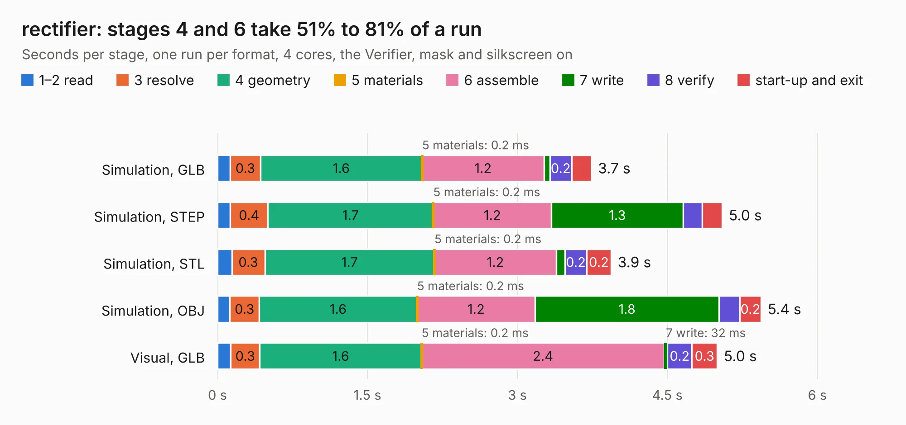

# 2355. rectifier

Board 2,355 of the 3,126 of [Corpus Testing](../Corpus-Testing.md), on [Corpus Page 22](../CorpusTestingPages/Corpus-Testing-22.md#2355-rectifier).

| Mode and format | 1–2 read | 3 resolve | 4 geometry | 5 materials | 6 assemble | 7 write | 8 verify | start-up and exit | Total |
|---|---:|---:|---:|---:|---:|---:|---:|---:|---:|
| Simulation, GLB | 0.1 | 0.3 | 1.6 | 0.2&nbsp;ms | 1.2 | 59&nbsp;ms | 0.2 | 0.2 | 3.7 |
| Simulation, STEP | 0.1 | 0.4 | 1.7 | 0.2&nbsp;ms | 1.2 | 1.3 | 0.2 | 0.2 | 5.0 |
| Simulation, STL | 0.1 | 0.3 | 1.7 | 0.2&nbsp;ms | 1.2 | 89&nbsp;ms | 0.2 | 0.2 | 3.9 |
| Simulation, OBJ | 0.1 | 0.3 | 1.6 | 0.2&nbsp;ms | 1.2 | 1.8 | 0.2 | 0.2 | 5.4 |
| Visual, GLB | 0.1 | 0.3 | 1.6 | 0.2&nbsp;ms | 2.4 | 32&nbsp;ms | 0.2 | 0.3 | 5.0 |
| Visual, OBJ | 0.1 | 0.3 | 1.6 | 0.3&nbsp;ms | 2.4 | 1.0 | 0.2 | 0.2 | 5.8 |

<table align="center"><tr><td valign="top">

| Board | Repo: [rene-dev/stmbl](https://github.com/rene-dev/stmbl) Board: `rectifier.kicad_pcb` |
|---|---|
| Folder | hw / kicad / rectifier |
| Complexity | 154&nbsp;/&nbsp;1000 (size&nbsp;124, features&nbsp;30) |
| KESE&nbsp;features | filled zones, curved board outline |
| Tested | 9th November 2026 |
| Copper&nbsp;layers | 2 |
| File&nbsp;format | KiCad 4 (4) |
| Parts,&nbsp;tracks,&nbsp;vias | 15, 113, 0 |
| Triangles,&nbsp;simulation | 307,610 in 29 parts |
| Verifier | PASS in all six runs |

</td><td valign="top">

<table>
<tr><th>File type</th><th>File size</th><th>Peak memory used</th></tr>
<tr><th colspan="3" align="left">Simulation</th></tr>
<tr><td>GLB</td><td align="right">11&nbsp;MB</td><td align="right">243&nbsp;MB</td></tr>
<tr><td>STEP</td><td align="right">54&nbsp;MB</td><td align="right">252&nbsp;MB</td></tr>
<tr><td>STL</td><td align="right">15&nbsp;MB</td><td align="right">234&nbsp;MB</td></tr>
<tr><td>OBJ</td><td align="right">31&nbsp;MB</td><td align="right">258&nbsp;MB</td></tr>
<tr><th colspan="3" align="left">Visual</th></tr>
<tr><td>GLB</td><td align="right">6.1&nbsp;MB</td><td align="right">216&nbsp;MB</td></tr>
<tr><td>OBJ</td><td align="right">18&nbsp;MB</td><td align="right">215&nbsp;MB</td></tr>
</table>

</td></tr></table>

| Previous | Next |
|:---|---:|
| [2354. powerstep](b2354b_stmbl_powerstep.md) | [2356. rectifier](b2356b_stmbl_hw-kicad-rectifier2_rectifier.md) |
