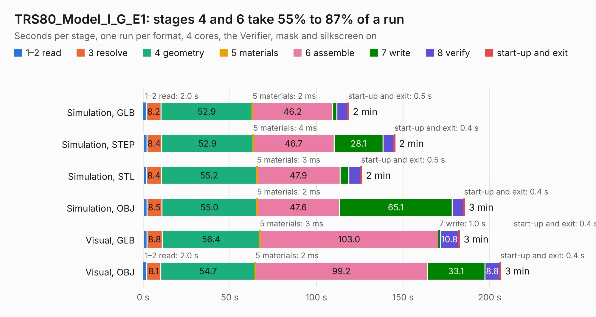

# 2356. TRS80_Model_I_G_E1

Board 2,356 of the 3,106 of [Corpus Testing](../Corpus-Testing.md), on [Corpus Page 22](../CorpusTestingPages/Corpus-Testing-22.md#2356-trs80_model_i_g_e1).

| Mode and format | 1–2 read | 3 resolve | 4 geometry | 5 materials | 6 assemble | 7 write | 8 verify | start-up and exit | Total |
|---|---:|---:|---:|---:|---:|---:|---:|---:|---:|
| Simulation, GLB | 2.0 | 8.2 | 52.9 | 2&nbsp;ms | 46.2 | 2.3 | 6.4 | 0.5 | 118.6 |
| Simulation, STEP | 2.2 | 8.4 | 52.9 | 4&nbsp;ms | 46.7 | 28.1 | 6.5 | 0.4 | 145.3 |
| Simulation, STL | 2.1 | 8.4 | 55.2 | 3&nbsp;ms | 47.9 | 5.1 | 6.9 | 0.5 | 126.1 |
| Simulation, OBJ | 2.3 | 8.5 | 55.0 | 2&nbsp;ms | 47.6 | 65.1 | 6.7 | 0.4 | 185.5 |
| Visual, GLB | 2.2 | 8.8 | 56.4 | 3&nbsp;ms | 103.0 | 1.0 | 10.8 | 0.4 | 182.6 |
| Visual, OBJ | 2.0 | 8.1 | 54.7 | 2&nbsp;ms | 99.2 | 33.1 | 8.8 | 0.4 | 206.4 |

<table align="center"><tr><td valign="top">

| Board | Repo: [RetroStack/TRS-80-Model-I-G-E1](https://github.com/RetroStack/TRS-80-Model-I-G-E1) Board: `TRS80_Model_I_G_E1.kicad_pcb` |
|---|---|
| Folder | KiCAD |
| Complexity | 358&nbsp;/&nbsp;1000 (size&nbsp;228, features&nbsp;130) |
| KESE&nbsp;features | through vias, rounded, trapezoid or chamfered pads, drill offsets, filled zones, copper drawings, copper text, curved board outline, stack-up, dielectric εr and tanδ, copper finish |
| Tested | 9th November 2026 |
| Copper&nbsp;layers | 2 |
| File&nbsp;format | KiCad 9 (20241229) |
| Parts,&nbsp;tracks,&nbsp;vias | 230, 9,405, 383 |
| Triangles,&nbsp;simulation | 9,412,534 in 386 parts |
| Verifier | PASS in all six runs |

</td><td valign="top">

<table>
<tr><th>File type</th><th>File size</th><th>Peak memory used</th></tr>
<tr><th colspan="3" align="left">Simulation</th></tr>
<tr><td>GLB</td><td align="right">316&nbsp;MB</td><td align="right">2.7&nbsp;GB</td></tr>
<tr><td>STEP</td><td align="right">1.5&nbsp;GB</td><td align="right">3.4&nbsp;GB</td></tr>
<tr><td>STL</td><td align="right">471&nbsp;MB</td><td align="right">2.8&nbsp;GB</td></tr>
<tr><td>OBJ</td><td align="right">996&nbsp;MB</td><td align="right">5.8&nbsp;GB</td></tr>
<tr><th colspan="3" align="left">Visual</th></tr>
<tr><td>GLB</td><td align="right">182&nbsp;MB</td><td align="right">2.9&nbsp;GB</td></tr>
<tr><td>OBJ</td><td align="right">580&nbsp;MB</td><td align="right">3.6&nbsp;GB</td></tr>
</table>

</td></tr></table>

| Previous | Next |
|:---|---:|
| [2355. TRS80_Model_I_EI_RevD](b2355b_TRS-80-Model-I-Expansion-Interface-Rev-D_TRS80-Model-I-EI-RevD.md) | [2357. TRS80_Model_I_Jap20_E1](b2357b_TRS-80-Model-I-Jap20-E1_TRS80-Model-I-Jap20-E1.md) |
