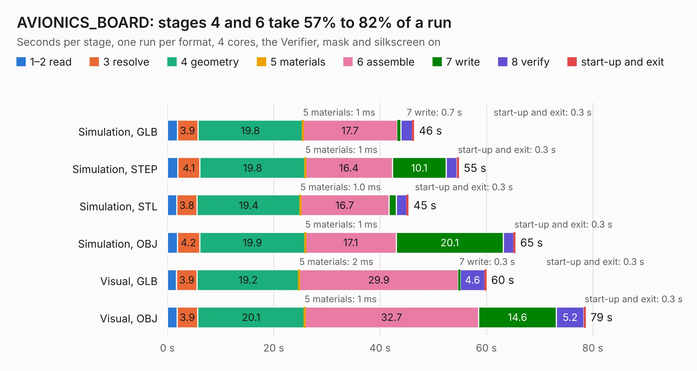

# 2357. AVIONICS_BOARD

Board 2,357 of the 3,104 of [Corpus Testing](../Corpus-Testing.md), on [Corpus Page 22](../CorpusTestingPages/Corpus-Testing-22.md#2357-avionics_board).

| Mode and format | 1–2 read | 3 resolve | 4 geometry | 5 materials | 6 assemble | 7 write | 8 verify | start-up and exit | Total |
|---|---:|---:|---:|---:|---:|---:|---:|---:|---:|
| Simulation, GLB | 1.9 | 3.9 | 19.8 | 1&nbsp;ms | 17.7 | 0.7 | 2.1 | 0.3 | 46.4 |
| Simulation, STEP | 2.0 | 4.1 | 19.8 | 1&nbsp;ms | 16.4 | 10.1 | 2.0 | 0.3 | 54.8 |
| Simulation, STL | 1.8 | 3.8 | 19.4 | 1.0&nbsp;ms | 16.7 | 1.3 | 2.0 | 0.3 | 45.3 |
| Simulation, OBJ | 1.9 | 4.2 | 19.9 | 1&nbsp;ms | 17.1 | 20.1 | 2.0 | 0.3 | 65.4 |
| Visual, GLB | 1.7 | 3.9 | 19.2 | 2&nbsp;ms | 29.9 | 0.3 | 4.6 | 0.3 | 60.0 |
| Visual, OBJ | 1.8 | 3.9 | 20.1 | 1&nbsp;ms | 32.7 | 14.6 | 5.2 | 0.3 | 78.6 |

<table align="center"><tr><td valign="top">

| Board | Repo: [rgw3d/1kcubesat_hardware](https://github.com/rgw3d/1kcubesat_hardware) Board: `AVIONICS_BOARD.kicad_pcb` |
|---|---|
| Folder | avionics_board |
| Complexity | 307&nbsp;/&nbsp;1000 (size&nbsp;252, features&nbsp;55) |
| KESE&nbsp;features | through vias, rounded, trapezoid or chamfered pads, filled zones, curved board outline |
| Tested | 9th November 2026 |
| Copper&nbsp;layers | 4 |
| File&nbsp;format | KiCad 5 (20171130) |
| Parts,&nbsp;tracks,&nbsp;vias | 136, 1,434, 205 |
| Triangles,&nbsp;simulation | 3,198,324 in 157 parts |
| Verifier | PASS in all six runs |

</td><td valign="top">

<table>
<tr><th>File type</th><th>File size</th><th>Peak memory used</th></tr>
<tr><th colspan="3" align="left">Simulation</th></tr>
<tr><td>GLB</td><td align="right">112&nbsp;MB</td><td align="right">967&nbsp;MB</td></tr>
<tr><td>STEP</td><td align="right">527&nbsp;MB</td><td align="right">1.3&nbsp;GB</td></tr>
<tr><td>STL</td><td align="right">160&nbsp;MB</td><td align="right">929&nbsp;MB</td></tr>
<tr><td>OBJ</td><td align="right">344&nbsp;MB</td><td align="right">2.1&nbsp;GB</td></tr>
<tr><th colspan="3" align="left">Visual</th></tr>
<tr><td>GLB</td><td align="right">75&nbsp;MB</td><td align="right">1.3&nbsp;GB</td></tr>
<tr><td>OBJ</td><td align="right">233&nbsp;MB</td><td align="right">1.6&nbsp;GB</td></tr>
</table>

</td></tr></table>

| Previous | Next |
|:---|---:|
| [2356. TRS80_Model_I_Jap50_E1](b2356b_TRS-80-Model-I-Jap50-E1_TRS80-Model-I-Jap50-E1.md) | [2358. EPS](b2358b_1kcubesat-hardware_EPS.md) |
