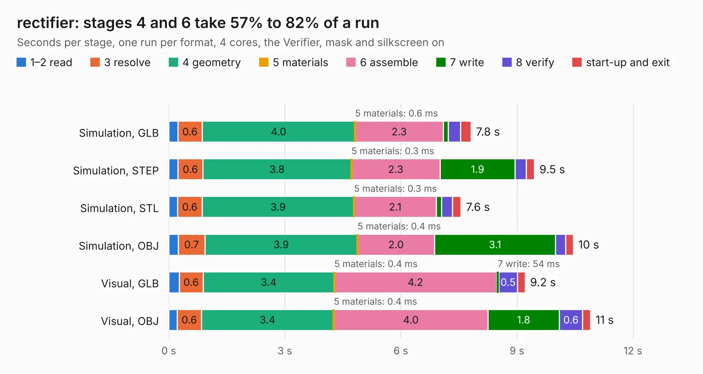

# 2357. rectifier

Board 2,357 of the 3,129 of [Corpus Testing](../Corpus-Testing.md), on [Corpus Page 22](../CorpusTestingPages/Corpus-Testing-22.md#2357-rectifier).

| Mode and format | 1–2 read | 3 resolve | 4 geometry | 5 materials | 6 assemble | 7 write | 8 verify | start-up and exit | Total |
|---|---:|---:|---:|---:|---:|---:|---:|---:|---:|
| Simulation, GLB | 0.2 | 0.6 | 4.0 | 0.6&nbsp;ms | 2.3 | 0.1 | 0.3 | 0.3 | 7.8 |
| Simulation, STEP | 0.2 | 0.6 | 3.8 | 0.3&nbsp;ms | 2.3 | 1.9 | 0.3 | 0.2 | 9.5 |
| Simulation, STL | 0.2 | 0.6 | 3.9 | 0.3&nbsp;ms | 2.1 | 0.1 | 0.3 | 0.2 | 7.6 |
| Simulation, OBJ | 0.2 | 0.7 | 3.9 | 0.4&nbsp;ms | 2.0 | 3.1 | 0.3 | 0.2 | 10.5 |
| Visual, GLB | 0.3 | 0.6 | 3.4 | 0.4&nbsp;ms | 4.2 | 54&nbsp;ms | 0.5 | 0.2 | 9.2 |
| Visual, OBJ | 0.2 | 0.6 | 3.4 | 0.4&nbsp;ms | 4.0 | 1.8 | 0.6 | 0.2 | 10.9 |

<table align="center"><tr><td valign="top">

| Board | Repo: [rene-dev/stmbl](https://github.com/rene-dev/stmbl) Board: `rectifier.kicad_pcb` |
|---|---|
| Folder | hw / kicad / rectifier2 |
| Complexity | 224&nbsp;/&nbsp;1000 (size&nbsp;159, features&nbsp;65) |
| KESE&nbsp;features | through vias, rounded, trapezoid or chamfered pads, drill offsets, filled zones, curved board outline |
| Tested | 9th November 2026 |
| Copper&nbsp;layers | 2 |
| File&nbsp;format | KiCad 5 (20170922) |
| Parts,&nbsp;tracks,&nbsp;vias | 80, 231, 27 |
| Triangles,&nbsp;simulation | 606,992 in 68 parts |
| Verifier | PASS in all six runs |

</td><td valign="top">

<table>
<tr><th>File type</th><th>File size</th><th>Peak memory used</th></tr>
<tr><th colspan="3" align="left">Simulation</th></tr>
<tr><td>GLB</td><td align="right">22&nbsp;MB</td><td align="right">340&nbsp;MB</td></tr>
<tr><td>STEP</td><td align="right">110&nbsp;MB</td><td align="right">367&nbsp;MB</td></tr>
<tr><td>STL</td><td align="right">30&nbsp;MB</td><td align="right">317&nbsp;MB</td></tr>
<tr><td>OBJ</td><td align="right">63&nbsp;MB</td><td align="right">462&nbsp;MB</td></tr>
<tr><th colspan="3" align="left">Visual</th></tr>
<tr><td>GLB</td><td align="right">13&nbsp;MB</td><td align="right">356&nbsp;MB</td></tr>
<tr><td>OBJ</td><td align="right">38&nbsp;MB</td><td align="right">350&nbsp;MB</td></tr>
</table>

</td></tr></table>

| Previous | Next |
|:---|---:|
| [2356. rectifier](b2356b_stmbl_hw-kicad-rectifier_rectifier.md) | [2358. rj45_breakout](b2358b_stmbl_rj45-breakout.md) |
