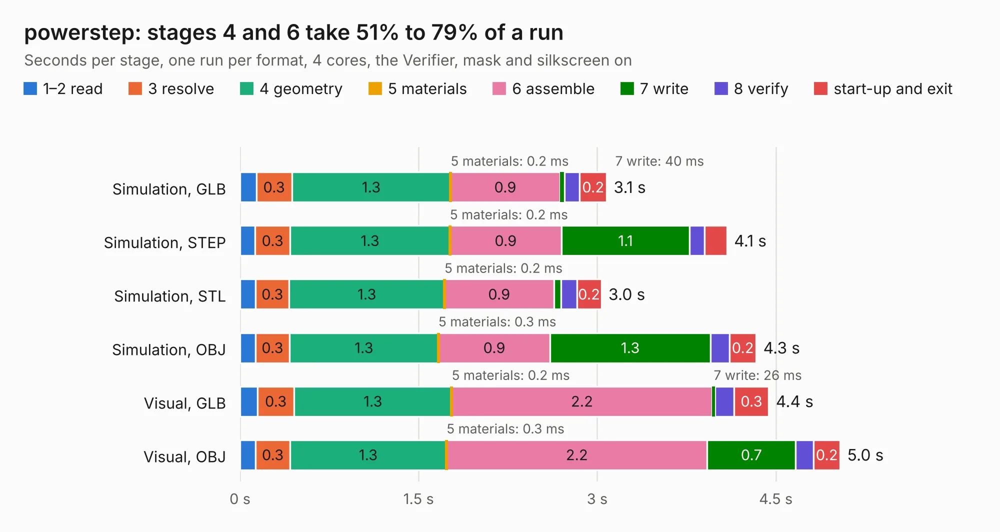

# 2357. powerstep

Board 2,357 of the 3,131 of [Corpus Testing](../Corpus-Testing.md), on [Corpus Page 22](../CorpusTestingPages/Corpus-Testing-22.md#2357-powerstep).

| Mode and format | 1–2 read | 3 resolve | 4 geometry | 5 materials | 6 assemble | 7 write | 8 verify | start-up and exit | Total |
|---|---:|---:|---:|---:|---:|---:|---:|---:|---:|
| Simulation, GLB | 0.1 | 0.3 | 1.3 | 0.2&nbsp;ms | 0.9 | 40&nbsp;ms | 0.1 | 0.2 | 3.1 |
| Simulation, STEP | 0.1 | 0.3 | 1.3 | 0.2&nbsp;ms | 0.9 | 1.1 | 0.1 | 0.2 | 4.1 |
| Simulation, STL | 0.1 | 0.3 | 1.3 | 0.2&nbsp;ms | 0.9 | 62&nbsp;ms | 0.1 | 0.2 | 3.0 |
| Simulation, OBJ | 0.1 | 0.3 | 1.3 | 0.3&nbsp;ms | 0.9 | 1.3 | 0.2 | 0.2 | 4.3 |
| Visual, GLB | 0.1 | 0.3 | 1.3 | 0.2&nbsp;ms | 2.2 | 26&nbsp;ms | 0.2 | 0.3 | 4.4 |
| Visual, OBJ | 0.1 | 0.3 | 1.3 | 0.3&nbsp;ms | 2.2 | 0.7 | 0.2 | 0.2 | 5.0 |

<table align="center"><tr><td valign="top">

| Board | Repo: [rene-dev/stmbl](https://github.com/rene-dev/stmbl) Board: `powerstep.kicad_pcb` |
|---|---|
| Folder | hw / kicad / powerstep |
| Complexity | 232&nbsp;/&nbsp;1000 (size&nbsp;187, features&nbsp;45) |
| KESE&nbsp;features | through vias, rounded, trapezoid or chamfered pads, filled zones |
| Tested | 9th November 2026 |
| Copper&nbsp;layers | 4 |
| File&nbsp;format | KiCad 5 (20170123) |
| Parts,&nbsp;tracks,&nbsp;vias | 28, 48, 8 |
| Triangles,&nbsp;simulation | 217,938 in 58 parts |
| Verifier | PASS in all six runs |

</td><td valign="top">

<table>
<tr><th>File type</th><th>File size</th><th>Peak memory used</th></tr>
<tr><th colspan="3" align="left">Simulation</th></tr>
<tr><td>GLB</td><td align="right">7.6&nbsp;MB</td><td align="right">221&nbsp;MB</td></tr>
<tr><td>STEP</td><td align="right">36&nbsp;MB</td><td align="right">238&nbsp;MB</td></tr>
<tr><td>STL</td><td align="right">11&nbsp;MB</td><td align="right">220&nbsp;MB</td></tr>
<tr><td>OBJ</td><td align="right">22&nbsp;MB</td><td align="right">227&nbsp;MB</td></tr>
<tr><th colspan="3" align="left">Visual</th></tr>
<tr><td>GLB</td><td align="right">4.7&nbsp;MB</td><td align="right">207&nbsp;MB</td></tr>
<tr><td>OBJ</td><td align="right">13&nbsp;MB</td><td align="right">210&nbsp;MB</td></tr>
</table>

</td></tr></table>

| Previous | Next |
|:---|---:|
| [2356. mesabob](b2356b_stmbl_mesabob.md) | [2358. rectifier](b2358b_stmbl_hw-kicad-rectifier_rectifier.md) |
