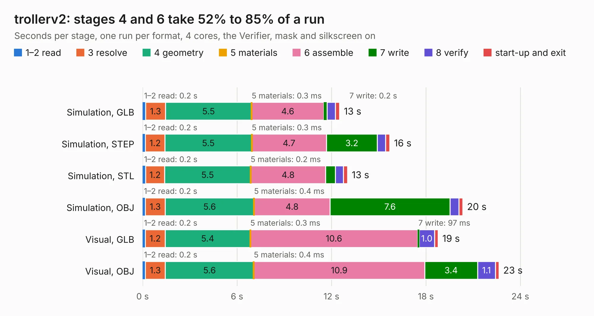

# 2357. trollerv2

Board 2,357 of the 3,122 of [Corpus Testing](../Corpus-Testing.md), on [Corpus Page 22](../CorpusTestingPages/Corpus-Testing-22.md#2357-trollerv2).

| Mode and format | 1–2 read | 3 resolve | 4 geometry | 5 materials | 6 assemble | 7 write | 8 verify | start-up and exit | Total |
|---|---:|---:|---:|---:|---:|---:|---:|---:|---:|
| Simulation, GLB | 0.2 | 1.3 | 5.5 | 0.3&nbsp;ms | 4.6 | 0.2 | 0.5 | 0.3 | 12.5 |
| Simulation, STEP | 0.2 | 1.2 | 5.5 | 0.3&nbsp;ms | 4.7 | 3.2 | 0.5 | 0.3 | 15.7 |
| Simulation, STL | 0.2 | 1.2 | 5.5 | 0.2&nbsp;ms | 4.8 | 0.6 | 0.5 | 0.3 | 13.0 |
| Simulation, OBJ | 0.2 | 1.3 | 5.6 | 0.4&nbsp;ms | 4.8 | 7.6 | 0.6 | 0.3 | 20.3 |
| Visual, GLB | 0.2 | 1.2 | 5.4 | 0.3&nbsp;ms | 10.6 | 97&nbsp;ms | 1.0 | 0.2 | 18.8 |
| Visual, OBJ | 0.2 | 1.3 | 5.6 | 0.4&nbsp;ms | 10.9 | 3.4 | 1.1 | 0.2 | 22.6 |

<table align="center"><tr><td valign="top">

| Board | Repo: [rene-dev/stmbl](https://github.com/rene-dev/stmbl) Board: `trollerv2.kicad_pcb` |
|---|---|
| Folder | hw / kicad / trollerV2 |
| Complexity | 233&nbsp;/&nbsp;1000 (size&nbsp;188, features&nbsp;45) |
| KESE&nbsp;features | through vias, rounded, trapezoid or chamfered pads, filled zones |
| Tested | 9th November 2026 |
| Copper&nbsp;layers | 4 |
| File&nbsp;format | KiCad 5 (20170922) |
| Parts,&nbsp;tracks,&nbsp;vias | 33, 162, 342 |
| Triangles,&nbsp;simulation | 1,338,818 in 47 parts |
| Verifier | PASS in all six runs |

</td><td valign="top">

<table>
<tr><th>File type</th><th>File size</th><th>Peak memory used</th></tr>
<tr><th colspan="3" align="left">Simulation</th></tr>
<tr><td>GLB</td><td align="right">45&nbsp;MB</td><td align="right">524&nbsp;MB</td></tr>
<tr><td>STEP</td><td align="right">120&nbsp;MB</td><td align="right">606&nbsp;MB</td></tr>
<tr><td>STL</td><td align="right">67&nbsp;MB</td><td align="right">510&nbsp;MB</td></tr>
<tr><td>OBJ</td><td align="right">135&nbsp;MB</td><td align="right">907&nbsp;MB</td></tr>
<tr><th colspan="3" align="left">Visual</th></tr>
<tr><td>GLB</td><td align="right">20&nbsp;MB</td><td align="right">626&nbsp;MB</td></tr>
<tr><td>OBJ</td><td align="right">61&nbsp;MB</td><td align="right">641&nbsp;MB</td></tr>
</table>

</td></tr></table>

| Previous | Next |
|:---|---:|
| [2356. to220_powerstage](b2356b_stmbl_to220-powerstage.md) | [2358. stmbl_4.0](b2358b_stmbl_stmbl-4-0.md) |
