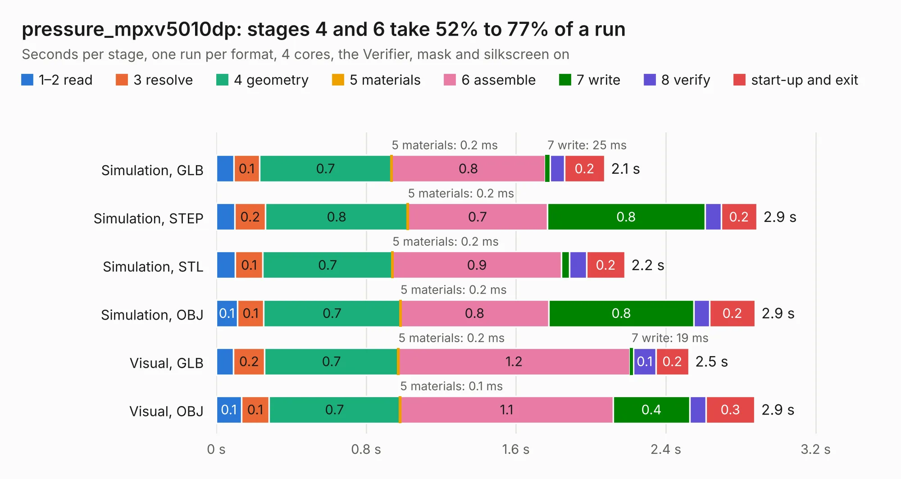

# 2357. pressure_mpxv5010dp

Board 2,357 of the 3,116 of [Corpus Testing](../Corpus-Testing.md), on [Corpus Page 22](../CorpusTestingPages/Corpus-Testing-22.md#2357-pressure_mpxv5010dp).

| Mode and format | 1–2 read | 3 resolve | 4 geometry | 5 materials | 6 assemble | 7 write | 8 verify | start-up and exit | Total |
|---|---:|---:|---:|---:|---:|---:|---:|---:|---:|
| Simulation, GLB | 93&nbsp;ms | 0.1 | 0.7 | 0.2&nbsp;ms | 0.8 | 25&nbsp;ms | 78&nbsp;ms | 0.2 | 2.1 |
| Simulation, STEP | 99&nbsp;ms | 0.2 | 0.8 | 0.2&nbsp;ms | 0.7 | 0.8 | 86&nbsp;ms | 0.2 | 2.9 |
| Simulation, STL | 0.1 | 0.1 | 0.7 | 0.2&nbsp;ms | 0.9 | 42&nbsp;ms | 92&nbsp;ms | 0.2 | 2.2 |
| Simulation, OBJ | 0.1 | 0.1 | 0.7 | 0.2&nbsp;ms | 0.8 | 0.8 | 84&nbsp;ms | 0.2 | 2.9 |
| Visual, GLB | 93&nbsp;ms | 0.2 | 0.7 | 0.2&nbsp;ms | 1.2 | 19&nbsp;ms | 0.1 | 0.2 | 2.5 |
| Visual, OBJ | 0.1 | 0.1 | 0.7 | 0.1&nbsp;ms | 1.1 | 0.4 | 86&nbsp;ms | 0.3 | 2.9 |

<table align="center"><tr><td valign="top">

| Board | Repo: [respiraworks/ventilator](https://github.com/respiraworks/ventilator) Board: `pressure_mpxv5010dp.kicad_pcb` |
|---|---|
| Folder | pcb / sensor-daughterboards / pressure_mpxv5010dp |
| Complexity | 154&nbsp;/&nbsp;1000 (size&nbsp;109, features&nbsp;45) |
| KESE&nbsp;features | through vias, rounded, trapezoid or chamfered pads, filled zones |
| Tested | 9th November 2026 |
| Copper&nbsp;layers | 2 |
| File&nbsp;format | KiCad 5 (20171130) |
| Parts,&nbsp;tracks,&nbsp;vias | 12, 30, 7 |
| Triangles,&nbsp;simulation | 158,644 in 22 parts |
| Verifier | PASS in all six runs |

</td><td valign="top">

<table>
<tr><th>File type</th><th>File size</th><th>Peak memory used</th></tr>
<tr><th colspan="3" align="left">Simulation</th></tr>
<tr><td>GLB</td><td align="right">5.2&nbsp;MB</td><td align="right">189&nbsp;MB</td></tr>
<tr><td>STEP</td><td align="right">18&nbsp;MB</td><td align="right">206&nbsp;MB</td></tr>
<tr><td>STL</td><td align="right">7.9&nbsp;MB</td><td align="right">193&nbsp;MB</td></tr>
<tr><td>OBJ</td><td align="right">15&nbsp;MB</td><td align="right">193&nbsp;MB</td></tr>
<tr><th colspan="3" align="left">Visual</th></tr>
<tr><td>GLB</td><td align="right">2.9&nbsp;MB</td><td align="right">160&nbsp;MB</td></tr>
<tr><td>OBJ</td><td align="right">8.2&nbsp;MB</td><td align="right">159&nbsp;MB</td></tr>
</table>

</td></tr></table>

| Previous | Next |
|:---|---:|
| [2356. pressure_mpxv5004dp](b2356b_ventilator_pressure-mpxv5004dp.md) | [2358. pressure_ms4525do](b2358b_ventilator_pressure-ms4525do.md) |
