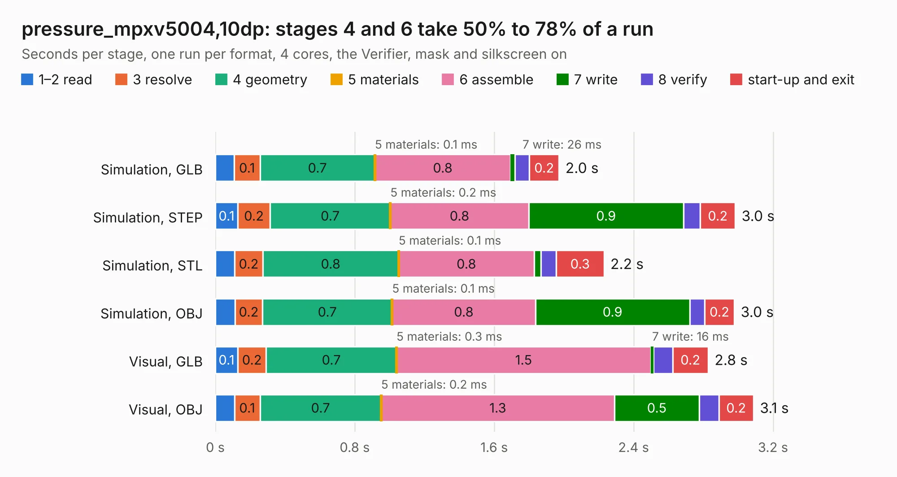

# 2360. pressure_mpxv5004,10dp

Board 2,360 of the 3,121 of [Corpus Testing](../Corpus-Testing.md), on [Corpus Page 22](../CorpusTestingPages/Corpus-Testing-22.md#2360-pressure_mpxv500410dp).

| Mode and format | 1–2 read | 3 resolve | 4 geometry | 5 materials | 6 assemble | 7 write | 8 verify | start-up and exit | Total |
|---|---:|---:|---:|---:|---:|---:|---:|---:|---:|
| Simulation, GLB | 0.1 | 0.1 | 0.7 | 0.1&nbsp;ms | 0.8 | 26&nbsp;ms | 81&nbsp;ms | 0.2 | 2.0 |
| Simulation, STEP | 0.1 | 0.2 | 0.7 | 0.2&nbsp;ms | 0.8 | 0.9 | 97&nbsp;ms | 0.2 | 3.0 |
| Simulation, STL | 0.1 | 0.2 | 0.8 | 0.1&nbsp;ms | 0.8 | 40&nbsp;ms | 87&nbsp;ms | 0.3 | 2.2 |
| Simulation, OBJ | 0.1 | 0.2 | 0.7 | 0.1&nbsp;ms | 0.8 | 0.9 | 85&nbsp;ms | 0.2 | 3.0 |
| Visual, GLB | 0.1 | 0.2 | 0.7 | 0.3&nbsp;ms | 1.5 | 16&nbsp;ms | 0.1 | 0.2 | 2.8 |
| Visual, OBJ | 0.1 | 0.1 | 0.7 | 0.2&nbsp;ms | 1.3 | 0.5 | 0.1 | 0.2 | 3.1 |

<table align="center"><tr><td valign="top">

| Board | Repo: [respiraworks/ventilator](https://github.com/respiraworks/ventilator) Board: `pressure_mpxv5004,10dp.kicad_pcb` |
|---|---|
| Folder | pcb / sensor-daughterboards / pressure_mpxv5004,10dp_common |
| Complexity | 154&nbsp;/&nbsp;1000 (size&nbsp;109, features&nbsp;45) |
| KESE&nbsp;features | through vias, rounded, trapezoid or chamfered pads, filled zones |
| Tested | 9th November 2026 |
| Copper&nbsp;layers | 2 |
| File&nbsp;format | KiCad 5 (20171130) |
| Parts,&nbsp;tracks,&nbsp;vias | 12, 30, 7 |
| Triangles,&nbsp;simulation | 174,100 in 23 parts |
| Verifier | PASS in all six runs |

</td><td valign="top">

<table>
<tr><th>File type</th><th>File size</th><th>Peak memory used</th></tr>
<tr><th colspan="3" align="left">Simulation</th></tr>
<tr><td>GLB</td><td align="right">5.7&nbsp;MB</td><td align="right">195&nbsp;MB</td></tr>
<tr><td>STEP</td><td align="right">22&nbsp;MB</td><td align="right">208&nbsp;MB</td></tr>
<tr><td>STL</td><td align="right">8.7&nbsp;MB</td><td align="right">195&nbsp;MB</td></tr>
<tr><td>OBJ</td><td align="right">17&nbsp;MB</td><td align="right">195&nbsp;MB</td></tr>
<tr><th colspan="3" align="left">Visual</th></tr>
<tr><td>GLB</td><td align="right">3.6&nbsp;MB</td><td align="right">167&nbsp;MB</td></tr>
<tr><td>OBJ</td><td align="right">10&nbsp;MB</td><td align="right">163&nbsp;MB</td></tr>
</table>

</td></tr></table>

| Previous | Next |
|:---|---:|
| [2359. pressure_mpx5700ap,gp](b2359b_ventilator_pressure-mpx5700ap-gp.md) | [2361. pressure_mpxv5004dp](b2361b_ventilator_pressure-mpxv5004dp.md) |
