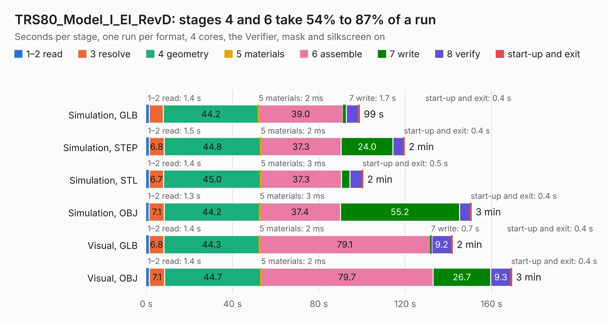

# 2361. TRS80_Model_I_EI_RevD

Board 2,361 of the 3,112 of [Corpus Testing](../Corpus-Testing.md), on [Corpus Page 22](../CorpusTestingPages/Corpus-Testing-22.md#2361-trs80_model_i_ei_revd).

| Mode and format | 1–2 read | 3 resolve | 4 geometry | 5 materials | 6 assemble | 7 write | 8 verify | start-up and exit | Total |
|---|---:|---:|---:|---:|---:|---:|---:|---:|---:|
| Simulation, GLB | 1.4 | 6.5 | 44.2 | 2&nbsp;ms | 39.0 | 1.7 | 5.6 | 0.4 | 98.8 |
| Simulation, STEP | 1.5 | 6.8 | 44.8 | 2&nbsp;ms | 37.3 | 24.0 | 4.9 | 0.4 | 119.6 |
| Simulation, STL | 1.4 | 6.7 | 45.0 | 3&nbsp;ms | 37.3 | 4.0 | 5.5 | 0.5 | 100.4 |
| Simulation, OBJ | 1.3 | 7.1 | 44.2 | 3&nbsp;ms | 37.4 | 55.2 | 5.0 | 0.4 | 150.6 |
| Visual, GLB | 1.4 | 6.8 | 44.3 | 2&nbsp;ms | 79.1 | 0.7 | 9.2 | 0.4 | 141.9 |
| Visual, OBJ | 1.4 | 7.1 | 44.7 | 2&nbsp;ms | 79.7 | 26.7 | 9.3 | 0.4 | 169.3 |

<table align="center"><tr><td valign="top">

| Board | Repo: [RetroStack/TRS-80-Model-I-Expansion-Interface-Rev-D](https://github.com/RetroStack/TRS-80-Model-I-Expansion-Interface-Rev-D) Board: `TRS80_Model_I_EI_RevD.kicad_pcb` |
|---|---|
| Folder | KiCAD |
| Complexity | 388&nbsp;/&nbsp;1000 (size&nbsp;223, features&nbsp;165) |
| KESE&nbsp;features | through vias, padstacks, rounded, trapezoid or chamfered pads, filled zones, copper drawings, copper text, curved board outline, TrueType text, stack-up, dielectric εr and tanδ, copper finish |
| Tested | 9th November 2026 |
| Copper&nbsp;layers | 2 |
| File&nbsp;format | KiCad 9 (20241229) |
| Parts,&nbsp;tracks,&nbsp;vias | 185, 7,843, 464 |
| Triangles,&nbsp;simulation | 8,487,818 in 348 parts |
| Verifier | PASS in all six runs |

</td><td valign="top">

<table>
<tr><th>File type</th><th>File size</th><th>Peak memory used</th></tr>
<tr><th colspan="3" align="left">Simulation</th></tr>
<tr><td>GLB</td><td align="right">284&nbsp;MB</td><td align="right">2.3&nbsp;GB</td></tr>
<tr><td>STEP</td><td align="right">1.3&nbsp;GB</td><td align="right">3.1&nbsp;GB</td></tr>
<tr><td>STL</td><td align="right">424&nbsp;MB</td><td align="right">2.4&nbsp;GB</td></tr>
<tr><td>OBJ</td><td align="right">895&nbsp;MB</td><td align="right">5.2&nbsp;GB</td></tr>
<tr><th colspan="3" align="left">Visual</th></tr>
<tr><td>GLB</td><td align="right">154&nbsp;MB</td><td align="right">2.5&nbsp;GB</td></tr>
<tr><td>OBJ</td><td align="right">490&nbsp;MB</td><td align="right">3.1&nbsp;GB</td></tr>
</table>

</td></tr></table>

| Previous | Next |
|:---|---:|
| [2360. TRS80_Model_I_E_E1](b2360b_TRS-80-Model-I-E-E1_TRS80-Model-I-E-E1.md) | [2362. TRS80_Model_I_G_E1](b2362b_TRS-80-Model-I-G-E1_TRS80-Model-I-G-E1.md) |
