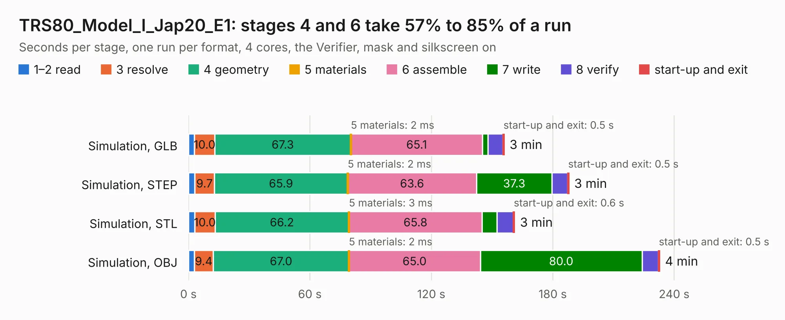

# 2361. TRS80_Model_I_Jap20_E1

Board 2,361 of the 3,110 of [Corpus Testing](../Corpus-Testing.md), on [Corpus Page 22](../CorpusTestingPages/Corpus-Testing-22.md#2361-trs80_model_i_jap20_e1).

| Mode and format | 1–2 read | 3 resolve | 4 geometry | 5 materials | 6 assemble | 7 write | 8 verify | start-up and exit | Total |
|---|---:|---:|---:|---:|---:|---:|---:|---:|---:|
| Simulation, GLB | 3.0 | 10.0 | 67.3 | 2&nbsp;ms | 65.1 | 2.7 | 7.4 | 0.5 | 155.9 |
| Simulation, STEP | 3.1 | 9.7 | 65.9 | 2&nbsp;ms | 63.6 | 37.3 | 7.7 | 0.5 | 187.9 |
| Simulation, STL | 3.1 | 10.0 | 66.2 | 3&nbsp;ms | 65.8 | 7.3 | 8.1 | 0.6 | 161.1 |
| Simulation, OBJ | 2.9 | 9.4 | 67.0 | 2&nbsp;ms | 65.0 | 80.0 | 8.0 | 0.5 | 232.7 |
| Visual, GLB | 3.0 | 9.8 | 67.8 | 2&nbsp;ms | 167.2 | 1.7 | 16.7 | 0.4 | 266.5 |
| Visual, OBJ | 3.1 | 10.0 | 68.3 | 4&nbsp;ms | 156.7 | 45.2 | 18.0 | 0.3 | 301.7 |

<table align="center"><tr><td valign="top">

| Board | Repo: [RetroStack/TRS-80-Model-I-Jap20-E1](https://github.com/RetroStack/TRS-80-Model-I-Jap20-E1) Board: `TRS80_Model_I_Jap20_E1.kicad_pcb` |
|---|---|
| Folder | KiCAD |
| Complexity | 388&nbsp;/&nbsp;1000 (size&nbsp;238, features&nbsp;150) |
| KESE&nbsp;features | through vias, rounded, trapezoid or chamfered pads, drill offsets, arc tracks, filled zones, copper text, curved board outline, TrueType text, stack-up, dielectric εr and tanδ, copper finish |
| Tested | 9th November 2026 |
| Copper&nbsp;layers | 2 |
| File&nbsp;format | KiCad 9 (20241229) |
| Parts,&nbsp;tracks,&nbsp;vias | 253, 16,967, 737 |
| Triangles,&nbsp;simulation | 14,074,810 in 421 parts |
| Verifier | PASS in all six runs |

</td><td valign="top">

<table>
<tr><th>File type</th><th>File size</th><th>Peak memory used</th></tr>
<tr><th colspan="3" align="left">Simulation</th></tr>
<tr><td>GLB</td><td align="right">469&nbsp;MB</td><td align="right">4.5&nbsp;GB</td></tr>
<tr><td>STEP</td><td align="right">2.0&nbsp;GB</td><td align="right">5.2&nbsp;GB</td></tr>
<tr><td>STL</td><td align="right">704&nbsp;MB</td><td align="right">4.6&nbsp;GB</td></tr>
<tr><td>OBJ</td><td align="right">1.5&nbsp;GB</td><td align="right">8.6&nbsp;GB</td></tr>
<tr><th colspan="3" align="left">Visual</th></tr>
<tr><td>GLB</td><td align="right">297&nbsp;MB</td><td align="right">4.2&nbsp;GB</td></tr>
<tr><td>OBJ</td><td align="right">952&nbsp;MB</td><td align="right">5.8&nbsp;GB</td></tr>
</table>

</td></tr></table>

| Previous | Next |
|:---|---:|
| [2360. TRS80_Model_I_G_E1](b2360b_TRS-80-Model-I-G-E1_TRS80-Model-I-G-E1.md) | [2362. TRS80_Model_I_Jap50_E1](b2362b_TRS-80-Model-I-Jap50-E1_TRS80-Model-I-Jap50-E1.md) |
