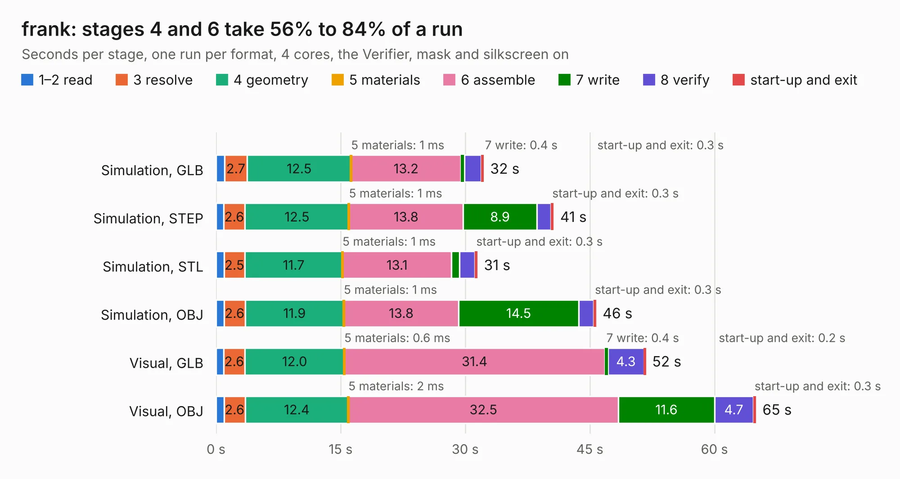

# 2361. frank

Board 2,361 of the 3,105 of [Corpus Testing](../Corpus-Testing.md), on [Corpus Page 22](../CorpusTestingPages/Corpus-Testing-22.md#2361-frank).

| Mode and format | 1–2 read | 3 resolve | 4 geometry | 5 materials | 6 assemble | 7 write | 8 verify | start-up and exit | Total |
|---|---:|---:|---:|---:|---:|---:|---:|---:|---:|
| Simulation, GLB | 1.0 | 2.7 | 12.5 | 1&nbsp;ms | 13.2 | 0.4 | 2.0 | 0.3 | 32.2 |
| Simulation, STEP | 0.9 | 2.6 | 12.5 | 1&nbsp;ms | 13.8 | 8.9 | 1.7 | 0.3 | 40.7 |
| Simulation, STL | 1.0 | 2.5 | 11.7 | 1&nbsp;ms | 13.1 | 1.0 | 1.8 | 0.3 | 31.5 |
| Simulation, OBJ | 1.0 | 2.6 | 11.9 | 1&nbsp;ms | 13.8 | 14.5 | 1.8 | 0.3 | 45.8 |
| Visual, GLB | 0.9 | 2.6 | 12.0 | 0.6&nbsp;ms | 31.4 | 0.4 | 4.3 | 0.2 | 51.7 |
| Visual, OBJ | 1.0 | 2.6 | 12.4 | 2&nbsp;ms | 32.5 | 11.6 | 4.7 | 0.3 | 65.0 |

<table align="center"><tr><td valign="top">

| Board | Repo: [rh1tech/frank](https://github.com/rh1tech/frank) Board: `frank.kicad_pcb` |
|---|---|
| Folder | hardware / frank |
| Complexity | 346&nbsp;/&nbsp;1000 (size&nbsp;201, features&nbsp;145) |
| KESE&nbsp;features | through vias, slotted holes, custom pads, rounded, trapezoid or chamfered pads, drill offsets, filled zones, copper drawings, curved board outline, TrueType text, stack-up, dielectric εr and tanδ |
| Tested | 9th November 2026 |
| Copper&nbsp;layers | 2 |
| File&nbsp;format | KiCad 10 (20260206) |
| Parts,&nbsp;tracks,&nbsp;vias | 162, 1,782, 262 |
| Triangles,&nbsp;simulation | 2,743,410 in 204 parts |
| Verifier | PASS in all six runs |

</td><td valign="top">

<table>
<tr><th>File type</th><th>File size</th><th>Peak memory used</th></tr>
<tr><th colspan="3" align="left">Simulation</th></tr>
<tr><td>GLB</td><td align="right">94&nbsp;MB</td><td align="right">1.0&nbsp;GB</td></tr>
<tr><td>STEP</td><td align="right">499&nbsp;MB</td><td align="right">1.2&nbsp;GB</td></tr>
<tr><td>STL</td><td align="right">137&nbsp;MB</td><td align="right">978&nbsp;MB</td></tr>
<tr><td>OBJ</td><td align="right">288&nbsp;MB</td><td align="right">1.8&nbsp;GB</td></tr>
<tr><th colspan="3" align="left">Visual</th></tr>
<tr><td>GLB</td><td align="right">75&nbsp;MB</td><td align="right">1.2&nbsp;GB</td></tr>
<tr><td>OBJ</td><td align="right">236&nbsp;MB</td><td align="right">1.6&nbsp;GB</td></tr>
</table>

</td></tr></table>

| Previous | Next |
|:---|---:|
| [2360. sun_sensor_test](b2360b_1kcubesat-hardware_sun-sensor-test.md) | [2362. frank_core2_proto](b2362b_frank_frank-core2-proto.md) |
