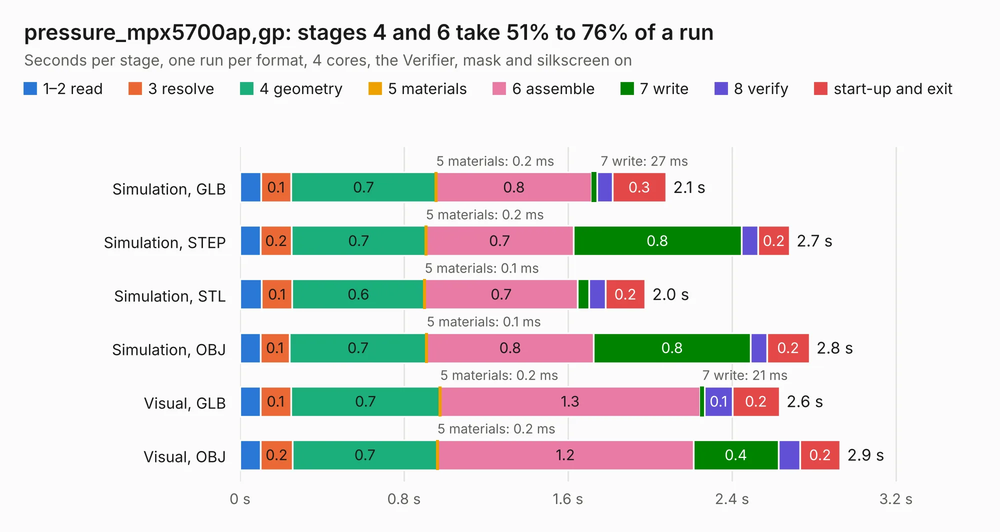

# 2362. pressure_mpx5700ap,gp

Board 2,362 of the 3,124 of [Corpus Testing](../Corpus-Testing.md), on [Corpus Page 22](../CorpusTestingPages/Corpus-Testing-22.md#2362-pressure_mpx5700apgp).

| Mode and format | 1–2 read | 3 resolve | 4 geometry | 5 materials | 6 assemble | 7 write | 8 verify | start-up and exit | Total |
|---|---:|---:|---:|---:|---:|---:|---:|---:|---:|
| Simulation, GLB | 0.1 | 0.1 | 0.7 | 0.2&nbsp;ms | 0.8 | 27&nbsp;ms | 75&nbsp;ms | 0.3 | 2.1 |
| Simulation, STEP | 0.1 | 0.2 | 0.7 | 0.2&nbsp;ms | 0.7 | 0.8 | 82&nbsp;ms | 0.2 | 2.7 |
| Simulation, STL | 0.1 | 0.1 | 0.6 | 0.1&nbsp;ms | 0.7 | 55&nbsp;ms | 81&nbsp;ms | 0.2 | 2.0 |
| Simulation, OBJ | 99&nbsp;ms | 0.1 | 0.7 | 0.1&nbsp;ms | 0.8 | 0.8 | 80&nbsp;ms | 0.2 | 2.8 |
| Visual, GLB | 99&nbsp;ms | 0.1 | 0.7 | 0.2&nbsp;ms | 1.3 | 21&nbsp;ms | 0.1 | 0.2 | 2.6 |
| Visual, OBJ | 0.1 | 0.2 | 0.7 | 0.2&nbsp;ms | 1.2 | 0.4 | 0.1 | 0.2 | 2.9 |

<table align="center"><tr><td valign="top">

| Board | Repo: [respiraworks/ventilator](https://github.com/respiraworks/ventilator) Board: `pressure_mpx5700ap,gp.kicad_pcb` |
|---|---|
| Folder | pcb / sensor-daughterboards / pressure_mpx5700ap,gp |
| Complexity | 153&nbsp;/&nbsp;1000 (size&nbsp;108, features&nbsp;45) |
| KESE&nbsp;features | through vias, rounded, trapezoid or chamfered pads, filled zones |
| Tested | 9th November 2026 |
| Copper&nbsp;layers | 2 |
| File&nbsp;format | KiCad 5 (20171130) |
| Parts,&nbsp;tracks,&nbsp;vias | 12, 29, 6 |
| Triangles,&nbsp;simulation | 193,508 in 23 parts |
| Verifier | PASS in all six runs |

</td><td valign="top">

<table>
<tr><th>File type</th><th>File size</th><th>Peak memory used</th></tr>
<tr><th colspan="3" align="left">Simulation</th></tr>
<tr><td>GLB</td><td align="right">6.3&nbsp;MB</td><td align="right">199&nbsp;MB</td></tr>
<tr><td>STEP</td><td align="right">23&nbsp;MB</td><td align="right">218&nbsp;MB</td></tr>
<tr><td>STL</td><td align="right">9.7&nbsp;MB</td><td align="right">194&nbsp;MB</td></tr>
<tr><td>OBJ</td><td align="right">19&nbsp;MB</td><td align="right">199&nbsp;MB</td></tr>
<tr><th colspan="3" align="left">Visual</th></tr>
<tr><td>GLB</td><td align="right">3.7&nbsp;MB</td><td align="right">171&nbsp;MB</td></tr>
<tr><td>OBJ</td><td align="right">11&nbsp;MB</td><td align="right">168&nbsp;MB</td></tr>
</table>

</td></tr></table>

| Previous | Next |
|:---|---:|
| [2361. indicator-board](b2361b_ventilator_indicator-board.md) | [2363. pressure_mpxv5004,10dp](b2363b_ventilator_pressure-mpxv5004-10dp.md) |
