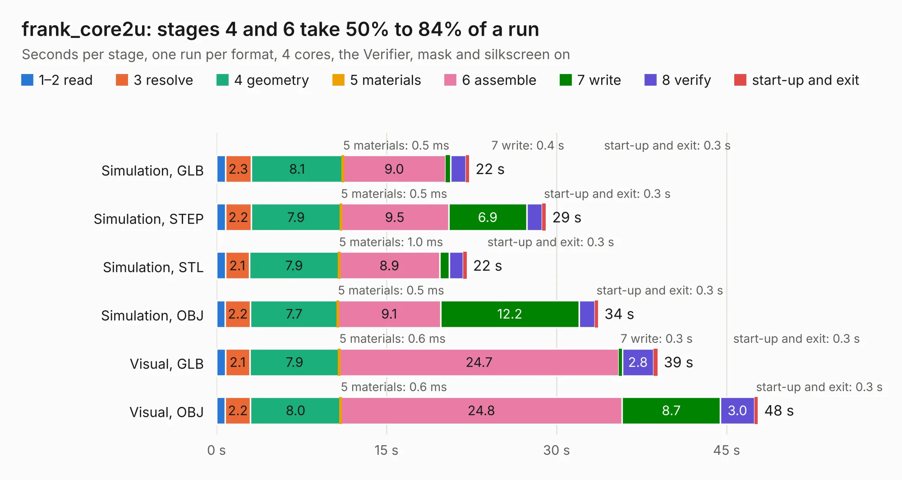

# 2364. frank_core2u

Board 2,364 of the 3,106 of [Corpus Testing](../Corpus-Testing.md), on [Corpus Page 22](../CorpusTestingPages/Corpus-Testing-22.md#2364-frank_core2u).

| Mode and format | 1–2 read | 3 resolve | 4 geometry | 5 materials | 6 assemble | 7 write | 8 verify | start-up and exit | Total |
|---|---:|---:|---:|---:|---:|---:|---:|---:|---:|
| Simulation, GLB | 0.8 | 2.3 | 8.1 | 0.5&nbsp;ms | 9.0 | 0.4 | 1.4 | 0.3 | 22.3 |
| Simulation, STEP | 0.8 | 2.2 | 7.9 | 0.5&nbsp;ms | 9.5 | 6.9 | 1.3 | 0.3 | 29.0 |
| Simulation, STL | 0.8 | 2.1 | 7.9 | 1.0&nbsp;ms | 8.9 | 0.8 | 1.3 | 0.3 | 22.1 |
| Simulation, OBJ | 0.8 | 2.2 | 7.7 | 0.5&nbsp;ms | 9.1 | 12.2 | 1.4 | 0.3 | 33.7 |
| Visual, GLB | 0.8 | 2.1 | 7.9 | 0.6&nbsp;ms | 24.7 | 0.3 | 2.8 | 0.3 | 38.9 |
| Visual, OBJ | 0.8 | 2.2 | 8.0 | 0.6&nbsp;ms | 24.8 | 8.7 | 3.0 | 0.3 | 47.7 |

<table align="center"><tr><td valign="top">

| Board | Repo: [rh1tech/frank](https://github.com/rh1tech/frank) Board: `frank_core2u.kicad_pcb` |
|---|---|
| Folder | hardware / frank_core2u |
| Complexity | 397&nbsp;/&nbsp;1000 (size&nbsp;262, features&nbsp;135) |
| KESE&nbsp;features | through vias, slotted holes, custom pads, rounded, trapezoid or chamfered pads, filled zones, copper drawings, curved board outline, TrueType text, stack-up, dielectric εr and tanδ |
| Tested | 9th November 2026 |
| Copper&nbsp;layers | 4 |
| File&nbsp;format | KiCad 10 (20260206) |
| Parts,&nbsp;tracks,&nbsp;vias | 150, 1,606, 256 |
| Triangles,&nbsp;simulation | 2,544,640 in 194 parts |
| Verifier | PASS in all six runs |

</td><td valign="top">

<table>
<tr><th>File type</th><th>File size</th><th>Peak memory used</th></tr>
<tr><th colspan="3" align="left">Simulation</th></tr>
<tr><td>GLB</td><td align="right">87&nbsp;MB</td><td align="right">1.0&nbsp;GB</td></tr>
<tr><td>STEP</td><td align="right">396&nbsp;MB</td><td align="right">1.1&nbsp;GB</td></tr>
<tr><td>STL</td><td align="right">127&nbsp;MB</td><td align="right">1.0&nbsp;GB</td></tr>
<tr><td>OBJ</td><td align="right">267&nbsp;MB</td><td align="right">1.7&nbsp;GB</td></tr>
<tr><th colspan="3" align="left">Visual</th></tr>
<tr><td>GLB</td><td align="right">60&nbsp;MB</td><td align="right">1.1&nbsp;GB</td></tr>
<tr><td>OBJ</td><td align="right">188&nbsp;MB</td><td align="right">1.4&nbsp;GB</td></tr>
</table>

</td></tr></table>

| Previous | Next |
|:---|---:|
| [2363. frank_core2_proto](b2363b_frank_frank-core2-proto.md) | [2365. frank_next](b2365b_frank_frank-next.md) |
